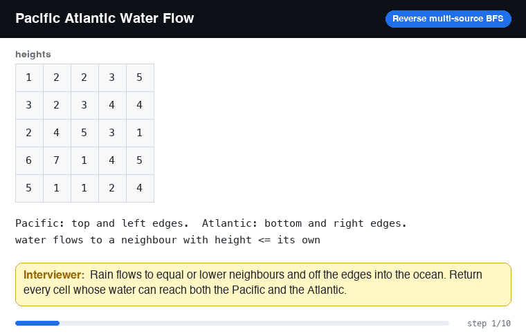

# Walkthrough: Pacific Atlantic Water Flow

**Module:** [12 · Graphs](../README.md) · **Difficulty:** Medium · **Solution:** [`p07_pacific_atlantic.go`](../p07_pacific_atlantic.go)



## The problem in plain words

A grid gives the height of each cell of an island. The Pacific touches the top and left edges, the Atlantic touches the bottom and right edges. Rain flows from a cell to a neighbour (up, down, left, right) of equal or lower height, and from edge cells into the ocean next to them. Return every cell whose water can reach both oceans, in row-major order.

```
heights            result (cells marked *)
1 2 2 3 5          . . . . *
3 2 3 4 4          . . . * *
2 4 5 3 1          . . * . .
6 7 1 4 5          * * . . .
5 1 1 2 4          * . . . .
```

## Mock interview

**Interviewer:** Return all cells from which water can flow to both the Pacific and the Atlantic.

**Candidate:** Water flows to neighbours that are lower **or equal**, right? And a corner cell like the top-right touches both oceans?

**Interviewer:** Yes to both.

**Candidate:** Looking at the example, (0,4) touches the Pacific on top and the Atlantic on the right, so it counts. (2,2), height 5, can flow down to the left toward the Pacific and down to the right toward the Atlantic. The bottom-left corner (4,0) touches both oceans directly. There are 7 such cells.

**Candidate:** The brute force runs a downhill search from every cell and records whether it touches each ocean's edge. One search is O(m·n), so in total it's O((m·n)²). That's `PacificAtlanticBrute`.

**Interviewer:** That repeats a lot of work. How would you share it?

**Candidate:** I reverse the question. Instead of "where can this cell's water go?", I ask "which cells can the Pacific be reached from?". Water flows downhill, so I start at all Pacific edge cells and climb **uphill**, to neighbours at least as high. Every cell I reach can drain into the Pacific by following my path backwards. I do the same from the Atlantic edges. The answer is the cells reached by both.

That's two multi-source searches instead of m·n single-source ones.

**Interviewer:** Why is climbing uphill from the ocean the same as flowing downhill to it?

**Candidate:** A flow path goes from a cell to a neighbour of equal or lower height, step by step, to the edge. Read backwards, each step goes to a neighbour of equal or higher height. So a downhill path from cell X to the ocean exists exactly when an uphill path from the ocean edge to X exists. The BFS finds all such X.

**Candidate:** In Go, `PacificAtlantic` has a closure `climb(starts)` that marks the starts as seen, then runs a BFS. A neighbour is added when it's in bounds, not seen, and `heights[r][c] >= heights[cell]`. I build the Pacific starts from column 0 and row 0, and the Atlantic starts from column n−1 and row m−1. Corners appear twice in the start lists, which is harmless because `seen` is set before the BFS. Then I scan row by row and collect cells where both grids are true.

**Candidate:** Testing: the Pacific climb starts from the top row and left column. Ring 1 reaches (1,1), (1,2), (1,3), (2,1), (3,1). Ring 2 reaches (1,4) and (2,2). The Atlantic climb starts from the bottom row and right column. Ring 1 reaches (1,3), (2,3), (3,0), (3,1), (3,2), (3,3). Ring 2 reaches (2,2). The cells in both are (0,4), (1,3), (1,4), (2,2), (3,0), (3,1), (4,0).

**Interviewer:** Complexity?

**Candidate:** Each BFS visits every cell at most once and checks four neighbours, so **O(m·n) time**, and **O(m·n) space** for the two `seen` grids and the queue.

## What the animation shows

Blue cells can reach the Pacific, yellow cells can reach the Atlantic, orange cells were just reached in the current BFS ring, green cells reach both.

| Step | Search | What happens |
|---|---|---|
| 1 | — | The interviewer shows the heights |
| 2 | — | Brute force: a downhill search from every cell |
| 3 | Pacific | All top and left edge cells start in the queue |
| 4 | Pacific | Ring 1: (1,1), (1,2), (1,3), (2,1), (3,1) |
| 5 | Pacific | Ring 2: (1,4), (2,2) |
| 6 | Atlantic | All bottom and right edge cells start in the queue |
| 7 | Atlantic | Ring 1: (1,3), (2,3), (3,0), (3,1), (3,2), (3,3) |
| 8 | Atlantic | Ring 2: (2,2) |
| 9 | — | Intersection: 7 cells reach both oceans |
| 10 | — | The answer in row-major order and the complexity |

## Detailed explanation

For each ocean, the climb computes exactly the set of cells that can drain into it:

- **Everything it marks can drain.** A cell is marked only from a neighbour that is already marked and not higher. By induction, following those links backwards gives a non-increasing path to an edge cell, and from there into the ocean.
- **Everything that can drain is marked.** Take any downhill path from a cell to the ocean. Its last cell is a start. Walking the path backwards, each next cell is at least as high as the previous one, so the BFS can step to it. By induction the BFS marks every cell on the path, including the first.

The answer is the intersection of the two sets. Reading it out with a row-by-row scan gives row-major order without sorting.

Edge cases:

- One row or one column: every cell touches both oceans, so every cell is in the answer.
- All heights equal: water can flow anywhere, so every cell is in the answer.
- Empty grid: return `nil`.

## Complexity

| Approach | Time | Space |
|---|---|---|
| Brute force (`PacificAtlanticBrute`) | O((m·n)²) | O(m·n) |
| Two uphill BFS runs (`PacificAtlantic`) | O(m·n) | O(m·n) |

## Common mistakes

- Climbing to strictly higher neighbours only. Equal heights must be allowed, because water flows across flat ground.
- Using the downhill condition in the reverse search, which marks the wrong cells.
- Sharing one `seen` grid between the two oceans.
- Forgetting that the top-right and bottom-left corners touch both oceans.

## Try it yourself

```sh
go test ./course/12-graphs/ -run TestPacificAtlantic -v
```
