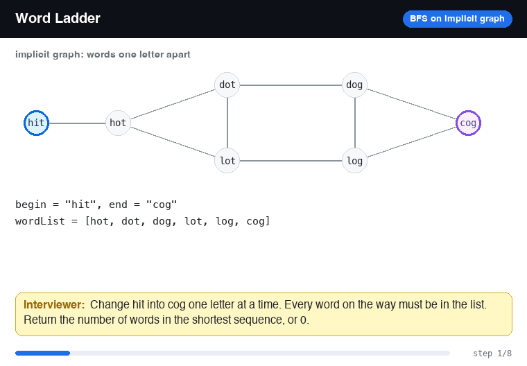

# Walkthrough: Word Ladder

**Module:** [12 · Graphs](../README.md) · **Difficulty:** Hard · **Solution:** [`p08_word_ladder.go`](../p08_word_ladder.go)



## The problem in plain words

Turn `beginWord` into `endWord` by changing one letter at a time. Every word after the first, including `endWord`, must be in `wordList`. Return how many words the shortest such sequence has, counting both ends, or 0 if there is none.

```
"hit" -> "cog", list [hot dot dog lot log cog]  ->  5   (hit hot dot dog cog)
"hit" -> "cog", list [hot dot dog lot log]      ->  0   (cog is not in the list)
```

## Mock interview

**Interviewer:** Return the length of the shortest transformation sequence from `beginWord` to `endWord`.

**Candidate:** Are all words the same length and lowercase? Does `beginWord` have to be in the list? And what if `endWord` isn't in the list?

**Interviewer:** Same length, lowercase. `beginWord` doesn't need to be in the list. If `endWord` isn't in the list, return 0.

**Candidate:** For the example, hit → hot → dot → dog → cog is 5 words. You could also go through lot and log, which is also 5. A shorter ladder would need hit → ? → ? → cog, changing one of the three different letters each time, and the list has no words that do that.

**Candidate:** Think of each word as a node, with an edge between words that differ in one letter. Then I want the shortest path. Building that graph by comparing every pair of words costs O(N²·L), and a DFS over all paths is exponential.

**Interviewer:** So what do you do?

**Candidate:** The graph is unweighted and I want the fewest steps, so BFS. And I don't build the edges up front. For each word I take out of the queue, I generate its neighbours on the fly: for each position, try the 25 other letters, and keep the candidates that are in the word set. That costs L·25 per word instead of comparing against all N words.

To mark words visited, I delete them from the set as soon as I queue them. That prevents queuing a word twice, and it's cheaper than a separate visited map.

**Interviewer:** Why delete when you enqueue and not when you dequeue?

**Candidate:** Two words in the same level can share a neighbour. If I waited until dequeue, it would be queued twice. Deleting on enqueue keeps each word in the queue at most once. The first time BFS reaches a word is already the shortest distance, so nothing is lost.

**Candidate:** In Go, `LadderLength` builds `words` as a `map[string]bool`, returns 0 if `endWord` isn't in it, and deletes `beginWord`. The BFS processes level by level with `steps` starting at 1. When a dequeued word equals `endWord` it returns `steps`. Otherwise it changes each byte of a `[]byte` copy to every other letter, checks `words[cand]`, deletes it and appends it to `next`, then restores the byte. `LadderLengthBidirectional` grows one frontier from each end, always expanding the smaller one, and stops when they touch.

**Candidate:** Testing: level 1 is [hit]. Its 75 candidates contain only hot. Level 2 is [hot], which finds dot and lot. Level 3 is [dot, lot], which finds dog and log. Level 4 is [dog, log], which finds cog. Level 5 is [cog], and cog is the end word, so I return 5.

**Interviewer:** Complexity?

**Candidate:** Each word is queued at most once and generates L·25 candidates, each built in O(L). So roughly **O(N · L · 26)** candidate checks (times L to build each string), and **O(N · L) space** for the set and the queue. Bidirectional BFS has the same worst case but usually explores far fewer words, about 2·b^(d/2) instead of b^d.

## What the animation shows

Blue words are being expanded, green words were just discovered, grey words were visited earlier.

| Step | Level | Queue being expanded | Discovered |
|---|---|---|---|
| 1 | — | The interviewer shows the words | — |
| 2 | — | Brute force: build all edges or DFS all paths | — |
| 3 | 1 | Start: queue [hit] | — |
| 4 | 1 | hit (75 candidates tried) | hot |
| 5 | 2 | hot | dot, lot |
| 6 | 3 | dot, lot | dog, log |
| 7 | 4 | dog, log | cog |
| 8 | 5 | cog is dequeued: answer 5 | — |

## Detailed explanation

BFS processes nodes in order of distance from the start. All words in level k are exactly k − 1 changes away from `beginWord`. So the first time `endWord` is dequeued, its level is the length of the shortest sequence, counting both ends.

Generating neighbours by changing letters is the trick that makes this practical. Comparing a word with all N others costs O(N·L). Trying 25 letters at L positions costs O(25·L) lookups, and when the list is long that is much smaller.

Deleting from the set has two jobs. It marks visited, and it shrinks the set, so later levels find fewer candidates.

Edge cases:

- `endWord` not in the list: return 0 before any search.
- `beginWord == endWord` with the word in the list: the first dequeue matches, return 1.
- No path: the queue empties, return 0.

## Complexity

| Approach | Time | Space |
|---|---|---|
| Brute force (build all edges, then BFS) | O(N² · L) | O(N²) |
| BFS with generated neighbours (`LadderLength`) | O(N · L · 26) lookups | O(N · L) |
| Bidirectional BFS (`LadderLengthBidirectional`) | same worst case, far fewer nodes in practice | O(N · L) |

## Common mistakes

- Using DFS, which finds a path but not the shortest one.
- Marking words visited when they're dequeued, so the same word is queued many times.
- Returning the number of steps (4) instead of the number of words (5).
- Forgetting to restore the changed letter before trying the next position.

## Try it yourself

```sh
go test ./course/12-graphs/ -run TestLadderLength -v
```
