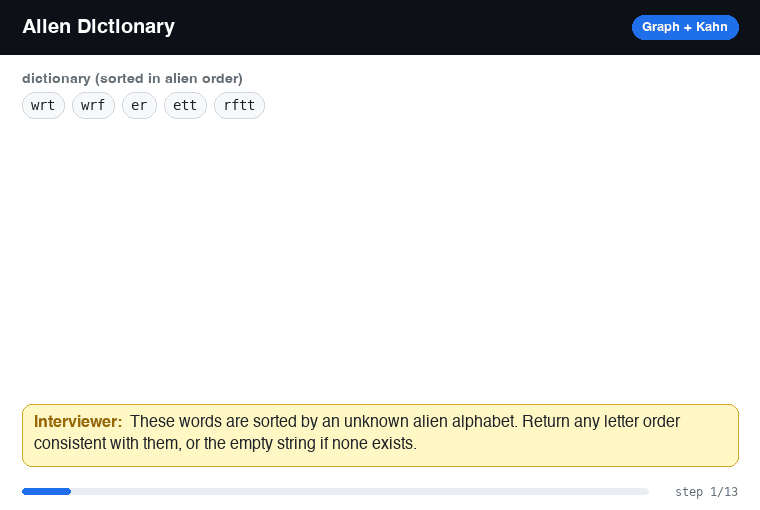

# Walkthrough: Alien Dictionary

**Module:** [12 · Graphs](../README.md) · **Difficulty:** Hard · **Solution:** [`p09_alien_dictionary.go`](../p09_alien_dictionary.go)



## The problem in plain words

An alien language uses lowercase English letters in an unknown order. You get its dictionary: a list of words already sorted in that alien order. Work out an order of all the letters that appear, consistent with the list. Return any valid order, or `""` if no order can make the list sorted.

```
["wrt","wrf","er","ett","rftt"]  ->  "wertf"
["z","x","z"]                    ->  ""    (z < x and x < z)
["abc","ab"]                     ->  ""    (a longer word can't come before its own prefix)
```

## Mock interview

**Interviewer:** Given a sorted alien dictionary, return a valid letter order, or an empty string if none exists.

**Candidate:** Must the answer include every letter that appears, even ones we learn nothing about? And if several orders are valid, can I return any?

**Interviewer:** Every letter that appears, and any valid order.

**Candidate:** Let me read the example. "wrt" before "wrf" means t comes before f. "wrf" before "er" means w before e. "er" before "ett" means r before t. "ett" before "rftt" means e before r. Chaining them: w, e, r, t, f. So "wertf".

**Candidate:** The brute force tries every ordering of the letters and checks whether the list is sorted under it. With k letters that's k! orderings, which is hopeless for 26 letters.

**Interviewer:** What does the list actually tell you?

**Candidate:** Each pair of **adjacent** words gives at most one fact. At the first position where they differ, the earlier word's letter comes first. Letters after that position tell me nothing, because the words are already decided by that first difference. Comparing non-adjacent words adds nothing new, since sorting is transitive.

So I build a directed graph: a node for every letter that appears and an edge u → v for each fact "u before v". A valid alphabet is a topological order of that graph. If the graph has a cycle, no alphabet exists.

There's one more case: if two adjacent words share a full prefix and the first is longer, like "abc" before "ab", the list can't be sorted under any order. I return `""` right away.

**Interviewer:** Why not compare every pair of words to get more edges?

**Candidate:** It would only add edges implied by the adjacent ones, at O(n²) cost. Adjacent pairs are enough to pin down every constraint.

**Candidate:** In Go, `AlienOrder` first marks `present` letters. It uses a `[26][26]bool` adjacency matrix so a repeated fact isn't counted twice in `indeg`. For each adjacent pair it advances `j` past the common prefix. If both words still have a letter at `j`, that gives an edge. If the first word is longer, it returns `""`. Then it runs Kahn's algorithm over the present letters: queue all with in-degree 0, pop, append to the order, and lower the in-degree of each letter it points to. If the order is shorter than the number of letters, there's a cycle, so it returns `""`.

**Candidate:** Testing: the facts are t<f, w<e, r<t, e<r. In-degrees: w 0, e 1, r 1, t 1, f 1. The queue starts with w. Emit w, which frees e. Emit e, which frees r. Emit r, which frees t. Emit t, which frees f. Emit f. All 5 letters are out, so the answer is "wertf".

**Interviewer:** What about `["z","x","z"]`?

**Candidate:** The facts are z<x and x<z, which is a cycle. Neither letter ever reaches in-degree 0, so the order is empty and shorter than 2 letters. Return `""`.

**Interviewer:** Complexity?

**Candidate:** Comparing adjacent words reads each character at most a couple of times: **O(C)** for C total characters. The graph has at most 26 nodes and 26² edges, so Kahn's step is constant-bounded. Space is **O(1)** beyond the input, the fixed 26×26 matrix.

## What the animation shows

| Step | What happens | Fact or order |
|---|---|---|
| 1 | The interviewer shows the dictionary | — |
| 2 | Brute force: try every ordering of the letters | — |
| 3 | "wrt" / "wrf": first difference at index 2 | t < f |
| 4 | "wrf" / "er": first difference at index 0 | w < e |
| 5 | "er" / "ett": first difference at index 1 | r < t |
| 6 | "ett" / "rftt": first difference at index 0 | e < r |
| 7 | In-degrees counted; only w has 0 | queue [w] |
| 8 | Emit w, e is freed | "w" |
| 9 | Emit e, r is freed | "we" |
| 10 | Emit r, t is freed | "wer" |
| 11 | Emit t, f is freed | "wert" |
| 12 | Emit f, queue empty | "wertf" |
| 13 | All letters emitted, no cycle: answer and complexity | "wertf" |

## Detailed explanation

Two claims make the approach correct.

1. **Every fact is necessary.** If adjacent words a and b first differ at position j, then a < b in the alien order is decided by `a[j]` vs `b[j]`, since everything before j is equal. So `a[j]` must come before `b[j]` in any valid alphabet.
2. **The facts are sufficient.** If an alphabet respects every adjacent-pair fact, then each adjacent pair is in order, so by transitivity the whole list is sorted.

So valid alphabets are exactly the topological orders of the fact graph, and Kahn's algorithm finds one or detects a cycle. Letters with no facts still appear in the answer because they start with in-degree 0.

The prefix case is separate because it produces no edge. If "abc" comes before "ab", the shorter word should have come first under any alphabet, so no order works.

Edge cases:

- A single word: no facts, return its distinct letters in any order. The code returns them alphabetically because the queue is filled from a to z.
- Repeated facts: the matrix check `if !edge[u][v]` keeps `indeg` correct.
- Identical adjacent words: no difference and equal length, so no fact and no error.

## Complexity

| Approach | Time | Space |
|---|---|---|
| Brute force (every ordering of k letters) | O(k! · C) | O(k) |
| Facts + Kahn (`AlienOrder`) | O(C) | O(1) (26-letter graph) |

## Common mistakes

- Comparing all letters of two words instead of stopping at the first difference.
- Missing the "longer word before its own prefix" case, which has no edge but is still invalid.
- Counting a repeated fact twice in `indeg`, so a letter never reaches 0.
- Leaving out letters that appear but have no edges.

## Try it yourself

```sh
go test ./course/12-graphs/ -run TestAlienOrder -v
```
