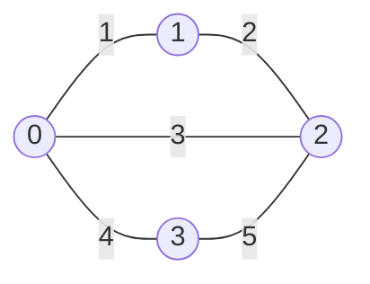

# 13 · Shortest paths & minimum spanning trees

## What you'll learn

- **Dijkstra** with `container/heap` and lazy deletion — the default for non-negative weights.
- **Bellman-Ford** for negative weights, negative-cycle detection, and "at most k edges" limits.
- **0-1 BFS**: a deque instead of a heap when weights are only 0 or 1.
- **Floyd-Warshall** for all-pairs distances on small graphs.
- **Kruskal** and **Prim** for minimum spanning trees, and when each one wins.
- Adapting Dijkstra to **bottleneck** costs (`max` instead of `+`).

## Recognize the pattern

| The prompt says… | Reach for |
|---|---|
| weighted edges, non-negative, "minimum time/cost from a source" | Dijkstra |
| negative weights, "detect arbitrage / negative cycle" | Bellman-Ford |
| "at most k stops / edges" | Bellman-Ford with k+1 snapshot rounds |
| costs are 0 or 1 ("free move vs paid move", "remove an obstacle") | 0-1 BFS |
| "distance between every pair", n ≤ ~400 | Floyd-Warshall |
| "minimum effort", "earliest time", "maximise the minimum capacity" | Dijkstra with `max`, or binary search + BFS, or union-find |
| "connect all nodes with minimum total cost" | MST: Kruskal (sparse) / Prim (dense) |

## The idea

**Dijkstra** settles nodes in order of distance. A min-heap always hands you the closest unsettled node; once popped, its distance is final because every other route would have to pass through a node that is at least as far (this is where non-negative weights matter).

```
         1        2              pop 0 (0)   push 1(1), 2(4)
   (0) -----> (1) -----> (3)     pop 1 (1)   push 3(3), 2(2)   <- 2 improved 4→2
    |          |                 pop 2 (2)
    4          1                 pop 3 (3)
    v          v                 pop 2 (4)   stale (4 > 2): skip
   (2) <-------+
```

**Bellman-Ford** relaxes *every* edge `n-1` times. A shortest path has at most `n-1` edges, so after pass `i` every path with `≤ i` edges is correct. A further improvement on pass `n` proves a negative cycle.

**Floyd-Warshall** is DP over "which intermediate nodes are allowed": `dist[i][j] = min(dist[i][j], dist[i][k] + dist[k][j])`, with `k` as the outermost loop.

**MST.** Kruskal sorts edges and keeps those that join two different components (union-find). Prim grows one tree, repeatedly adding the cheapest edge leaving it. Both are correct by the *cut property*: the cheapest edge across any cut belongs to some MST.



Kruskal: take 1, take 2, skip 3 (0 and 2 already joined), take 4 → total 7.

## Go template

```go
type item struct{ node, dist int }
type minHeap []item

func (h minHeap) Len() int           { return len(h) }
func (h minHeap) Less(i, j int) bool { return h[i].dist < h[j].dist }
func (h minHeap) Swap(i, j int)      { h[i], h[j] = h[j], h[i] }
func (h *minHeap) Push(x any)        { *h = append(*h, x.(item)) }
func (h *minHeap) Pop() any          { old := *h; x := old[len(old)-1]; *h = old[:len(old)-1]; return x }

func Dijkstra(adj [][]Arc, src int) []int {
	dist := make([]int, len(adj))
	for i := range dist {
		dist[i] = Inf
	}
	dist[src] = 0
	h := &minHeap{{src, 0}}
	for h.Len() > 0 {
		cur := heap.Pop(h).(item)
		if cur.dist > dist[cur.node] {
			continue // stale entry
		}
		for _, a := range adj[cur.node] {
			if nd := cur.dist + a.Weight; nd < dist[a.To] {
				dist[a.To] = nd
				heap.Push(h, item{a.To, nd})
			}
		}
	}
	return dist
}
```

All six algorithms live in [shortestpaths.go](shortestpaths.go), with a test that cross-checks them on random graphs.

## Complexity

| Algorithm | Time | Space | Notes |
|---|---|---|---|
| Dijkstra (binary heap) | `O((V + E) log V)` | `O(V + E)` | non-negative weights only |
| Bellman-Ford | `O(V · E)` | `O(V)` | negative edges, cycle detection |
| 0-1 BFS | `O(V + E)` | `O(V)` | weights ∈ {0, 1} |
| Floyd-Warshall | `O(V³)` | `O(V²)` | all pairs |
| Kruskal | `O(E log E)` | `O(V + E)` | sparse graphs |
| Prim (heap) / Prim (array) | `O(E log V)` / `O(V²)` | `O(V + E)` / `O(V)` | array version for complete graphs |

## Common pitfalls

- **`container/heap` usage.** Call `heap.Push(h, x)` / `heap.Pop(h)` — *not* `h.Push(x)`, which just appends without restoring the heap order. `Push`/`Pop` need pointer receivers.
- **Overflow.** `math.MaxInt + w` wraps negative and "wins" every comparison. Use `Inf = math.MaxInt / 2` and/or check `dist[u] != Inf` before relaxing.
- **Forgetting the stale-entry check** (`cur.dist > dist[node]`) makes Dijkstra re-expand nodes — still correct, but can blow up to `O(E²)`-ish work.
- **Dijkstra with negative edges** gives wrong answers silently. Use Bellman-Ford.
- **Hop-limited Bellman-Ford without a snapshot.** Relaxing in place lets one round chain several edges, breaking "at most k stops". Copy `dist` each round.
- **Floyd-Warshall loop order.** `k` must be outermost. Swapping it inward is a classic silent bug.
- **1-based labels.** Many problems number nodes `1..n`; allocate `n+1` and ignore index 0, or subtract 1 consistently.
- **Kruskal sorts the caller's slice** if you're not careful — copy first (`append([]Edge(nil), edges...)`).
- **Disconnected graphs.** An MST only exists if every node is reached; check the edge count (`n-1`) or the number of nodes Prim added.

## Problems

| # | Problem | Difficulty | Key idea |
|---|---|---|---|
| 01 | [Network Delay Time](p01_network_delay_time.go) | Medium | Dijkstra; answer = max distance |
| 02 | [Find the City (threshold distance)](p02_find_the_city.go) | Medium | Floyd-Warshall all-pairs, then count |
| 03 | [Min Cost to Connect All Points](p03_min_cost_connect_points.go) | Medium | MST on a complete graph: `O(n²)` Prim |
| 04 | [Path With Minimum Effort](p04_path_with_minimum_effort.go) | Medium | Dijkstra with `max`; or binary search + BFS |
| 05 | [Cheapest Flights Within K Stops](p05_cheapest_flights_k_stops.go) | Medium | k+1 rounds of snapshot Bellman-Ford |
| 06 | [Minimum Obstacle Removal](p06_minimum_obstacle_removal.go) | Hard | 0-1 BFS with a deque |
| 07 | [Swim in Rising Water](p07_swim_in_rising_water.go) | Hard | Bottleneck path: minimax Dijkstra or union-find by elevation |

## Practice tip

Write the `minHeap` boilerplate from memory until it takes under two minutes — you will need it in every Dijkstra question. Then hide a solution and re-solve:

```bash
go test ./course/13-shortest-paths-mst/ -run TestFindCheapestPrice -v
```

## Next

[14 · Backtracking](../14-backtracking/README.md) — exhaustive search with choose / explore / unchoose.
