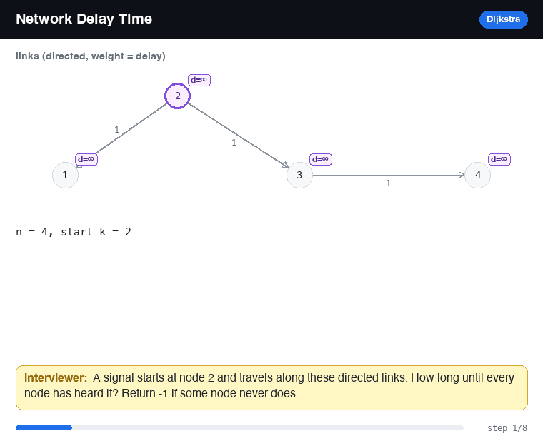

# Walkthrough: Network Delay Time

**Module:** [13 · Shortest paths & minimum spanning trees](../README.md) · **Difficulty:** Medium · **Solution:** [`p01_network_delay_time.go`](../p01_network_delay_time.go)



## The problem in plain words

A network has `n` nodes labelled `1..n` and one-way links. Each link takes some time to carry a signal. A signal starts at node `k`. How long until every node has received it? If some node never receives it, return `-1`.

```
links [[2,1,1],[2,3,1],[3,4,1]], n = 4, k = 2  →  2
```

## Mock interview

**Interviewer:** You have `n` nodes and directed links `{u, v, w}`: a signal sent from `u` reaches `v` after `w` time units. A signal starts at node `k`. Return the time until every node has it, or `-1` if some node never gets it.

**Candidate:** A few questions first. Are the labels 1-based? Can a weight be negative or zero? Can there be parallel links?

**Interviewer:** Labels are `1..n`. Weights are non-negative. Parallel links are allowed.

**Candidate:** Let me check the example. From node 2 the signal reaches nodes 1 and 3 at time 1, then node 4 at time 2. The last node hears it at time 2, so the answer is 2. If I started at node 2 in the second example, node 1 has no link into it, so the answer is `-1`.

**Candidate:** So each node hears the signal at its shortest-path time from `k`, and the answer is the largest of those times. A brute force would DFS every path from `k` and keep the best time per node. The number of paths can grow exponentially.

**Interviewer:** What would you use instead?

**Candidate:** The weights are non-negative, so Dijkstra works. I keep `dist[v]`, starting at infinity except `dist[k] = 0`, and a min-heap of `(node, dist)`. I pop the closest node, and if the entry is current I relax its outgoing links. At the end I take the maximum of `dist`, or return `-1` if any entry is still infinite.

**Interviewer:** Why is a popped distance final?

**Candidate:** When I pop node `u` with distance `d`, every other entry in the heap is at least `d`. Any other route to `u` would have to leave the settled set through one of those nodes, and with non-negative weights it can only get longer from there. So nothing can beat `d` later. With a negative weight that argument fails, which is why Dijkstra needs non-negative weights.

**Candidate:** In code: build an adjacency list of size `n+1` so the 1-based labels index directly, call the shared `Dijkstra(adj, k)`, drop index 0, and let a `slowest` helper return the max or `-1`. Inside `Dijkstra`, I skip a popped entry when `cur.dist > dist[cur.node]`. That's lazy deletion instead of decrease-key.

**Candidate:** Testing on the example: pop 2 at 0, push 1 and 3 at time 1. Pop 1 at 1; it has no links. Pop 3 at 1 and push 4 at 2. Pop 4 at 2. Distances for nodes 1..4 are `[1, 0, 1, 2]`, so the answer is 2.

**Interviewer:** What if a weight could be negative?

**Candidate:** Then I'd use Bellman-Ford, which the file also has as `NetworkDelayTimeBellmanFord`. It relaxes every edge up to `n-1` times, so it's O(V·E).

**Interviewer:** Complexity?

**Candidate:** Each edge pushes at most one heap entry, so Dijkstra is **O(E log V) time and O(V + E) space**.

## What the animation shows

| Step | What happens | Heap after |
|---|---|---|
| 1 | Interviewer states the problem | — |
| 2 | Brute force: every path, exponential | — |
| 3 | `dist[2] = 0`, push node 2 | `2:0` |
| 4 | Pop 2; relax 2→1 and 2→3 to 1 | `1:1, 3:1` |
| 5 | Pop 1 (final at 1); no outgoing links | `3:1` |
| 6 | Pop 3 (final at 1); relax 3→4 to 2 | `4:2` |
| 7 | Pop 4 (final at 2); no outgoing links | empty |
| 8 | `dist = [1, 0, 1, 2]`, answer = max = 2 | — |

## Detailed explanation

The answer is a maximum over shortest paths. The signal goes out along every link at once, so node `v` first hears it at the length of its shortest path from `k`. The whole network has heard it once the slowest node has, so the answer is `max(dist)`.

Dijkstra settles nodes in increasing order of distance. The invariant is: *every popped, non-stale node has its true shortest distance.* When the heap hands us `u` with distance `d`, all other unsettled nodes are at least `d` away. Non-negative weights mean no detour through them can come back cheaper than `d`.

The Go solution uses **lazy deletion**. When a node's distance improves, it pushes a new entry instead of updating the old one. A popped entry with `cur.dist > dist[cur.node]` is stale and is skipped. This keeps the heap code short and still gives O(E log V).

Edge cases:

- **Unreachable node:** its distance stays `Inf`, and `slowest` returns `-1`.
- **1-based labels:** the adjacency list has `n+1` slots and index 0 is dropped before taking the max.
- **Overflow:** `Inf` is `math.MaxInt / 2`, so `Inf + w` can't wrap around.

## Complexity

| Approach | Time | Space |
|---|---|---|
| Dijkstra (`NetworkDelayTime`) | O(E log V) | O(V + E) |
| Bellman-Ford (`NetworkDelayTimeBellmanFord`) | O(V · E) | O(V) |

## Common mistakes

- Returning the distance to one target instead of the **maximum** over all nodes.
- Forgetting the `-1` case when some node is never reached.
- Indexing a 1-based label into a slice of size `n`.
- Calling `h.Push(x)` instead of `heap.Push(h, x)`, which skips restoring heap order.
- Leaving out the stale-entry check. The result is still correct, but nodes get expanded many times.

## Try it yourself

```sh
go test ./course/13-shortest-paths-mst/ -run TestNetworkDelayTime -v
```
