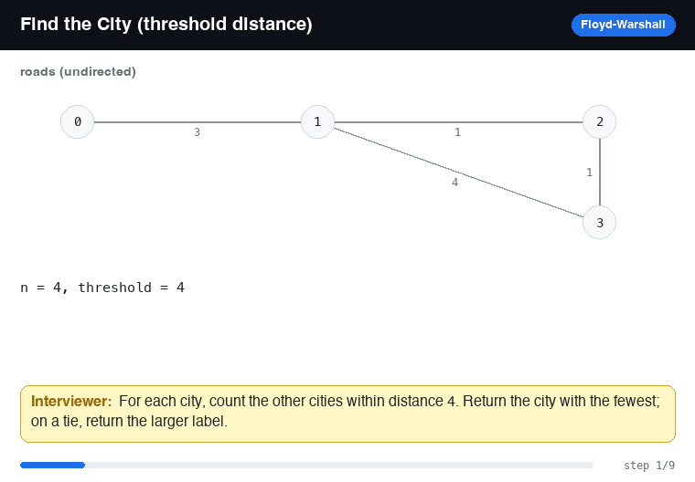

# Walkthrough: Find the City (threshold distance)

**Module:** [13 · Shortest paths & minimum spanning trees](../README.md) · **Difficulty:** Medium · **Solution:** [`p02_find_the_city.go`](../p02_find_the_city.go)



## The problem in plain words

Cities `0..n-1` are joined by two-way roads with lengths. For each city, count how many other cities you can reach with a total distance of at most `threshold`. Return the city with the smallest count. If several cities tie, return the one with the largest label.

```
n = 4, roads [[0,1,3],[1,2,1],[1,3,4],[2,3,1]], threshold = 4  →  3
```

## Mock interview

**Interviewer:** Given `n` cities, undirected weighted roads and a threshold, return the city with the fewest other cities within the threshold distance. Break ties by the larger label.

**Candidate:** Are the weights positive? How big can `n` get?

**Interviewer:** Weights are positive, and `n` is at most 100.

**Candidate:** Let me work through the example. City 0 reaches 1 at 3 and 2 at 4, but 3 is 5 away, so it reaches two cities. City 3 reaches 2 at 1 and 1 at 2, but 0 is 5 away, so also two. Cities 1 and 2 reach three each. Cities 0 and 3 tie, and the larger label wins, so the answer is 3.

**Candidate:** Notice that 0 to 3 is 5 along 0–1–2–3, not 7 along the direct 0–1–3 roads. So I need real shortest distances. A plain BFS counts hops, not lengths, and enumerating every path from every city is exponential.

**Interviewer:** So what do you use?

**Candidate:** I need the distance between every pair of cities. With `n` at most 100, Floyd-Warshall is the simplest tool: O(n³) is about a million steps. I fill a matrix with road weights, zeros on the diagonal and infinity elsewhere. Then for each city `k`, for every pair `(i, j)`, I set `dist[i][j] = min(dist[i][j], dist[i][k] + dist[k][j])`.

**Interviewer:** Why does `k` have to be the outer loop?

**Candidate:** After round `k`, `dist[i][j]` is the shortest path that only stops at cities `0..k` along the way. A shortest path visits `k` at most once. So it either avoids `k`, which is the old value, or it goes `i` to `k` and then `k` to `j`, and both halves only use cities below `k`. Those halves must already be final when round `k` runs. If `k` were an inner loop, they wouldn't be.

**Candidate:** For the code, I turn each road into two directed edges and call the shared `FloydWarshall`. Then `pickCity` counts, per row, the cells with `i != j` and `d <= threshold`. I update the best city on `count <= bestCount`. Because I scan in increasing order, `<=` makes the later, larger label win a tie.

**Candidate:** Testing it: round 0 changes nothing, since city 0 is a dead end. Round 1 gives 0–2 = 4 and 0–3 = 7. Round 2 improves 0–3 to 5 and 1–3 to 2. Round 3 changes nothing. The counts are 2, 3, 3, 2, so the answer is 3.

**Interviewer:** What if `n` were 10,000 with few roads?

**Candidate:** Then O(n³) is too slow. I'd run Dijkstra from every city instead, which is `FindTheCityDijkstra`: O(n · E log n). It feeds the same `pickCity` helper.

**Interviewer:** Complexity?

**Candidate:** Floyd-Warshall is **O(n³) time and O(n²) space** for the matrix. Counting adds O(n²).

## What the animation shows

| Step | What happens | Changes in the matrix |
|---|---|---|
| 1 | Interviewer states the problem | — |
| 2 | Brute force and why BFS is wrong; need all pairs | — |
| 3 | Matrix starts with road weights, 0 diagonal, ∞ elsewhere | — |
| 4 | Round k = 0 | none |
| 5 | Round k = 1 | 0–2: ∞ → 4, 0–3: ∞ → 7 |
| 6 | Round k = 2 | 0–3: 7 → 5, 1–3: 4 → 2 |
| 7 | Round k = 3 | none |
| 8 | Count cells ≤ 4 per row | 2, 3, 3, 2 |
| 9 | Tie between 0 and 3, larger label wins | answer = 3 |

## Detailed explanation

Floyd-Warshall is a dynamic program over "which cities may be used as stops". Define `D_k[i][j]` as the shortest path from `i` to `j` whose intermediate cities are all in `{0..k}`. The shortest such path either avoids `k`, giving `D_{k-1}[i][j]`, or uses `k` once in the middle, giving `D_{k-1}[i][k] + D_{k-1}[k][j]`. The Go code updates one matrix in place. That is safe because row `k` and column `k` don't change during round `k`, since `dist[k][k] = 0`.

The solution also skips row `i` when `dist[i][k]` is infinite, and checks `dist[k][j] != Inf` before adding. That avoids overflow, and the guard is cheap.

The tie-break lives in `pickCity`. It scans cities from 0 upwards and replaces the best on `count <= bestCount`, so the last city with the minimum count wins. That is the largest label.

Edge cases:

- **Disconnected cities:** their distance stays `Inf` and they never count as reachable.
- **Parallel roads:** `FloydWarshall` keeps the cheaper one with `min`.
- **A city's distance to itself** is skipped with `i != j`.

## Complexity

| Approach | Time | Space |
|---|---|---|
| Floyd-Warshall (`FindTheCity`) | O(n³) | O(n²) |
| Dijkstra from every city (`FindTheCityDijkstra`) | O(n · E log n) | O(n² + E) |

## Common mistakes

- Putting `k` in an inner loop. It compiles and gives wrong answers.
- Adding only one direction of each undirected road.
- Using `<` in the tie-break, which returns the smallest label instead of the largest.
- Counting the city itself, since its distance is 0.
- Adding two `Inf` values and overflowing.

## Try it yourself

```sh
go test ./course/13-shortest-paths-mst/ -run TestFindTheCity -v
```
