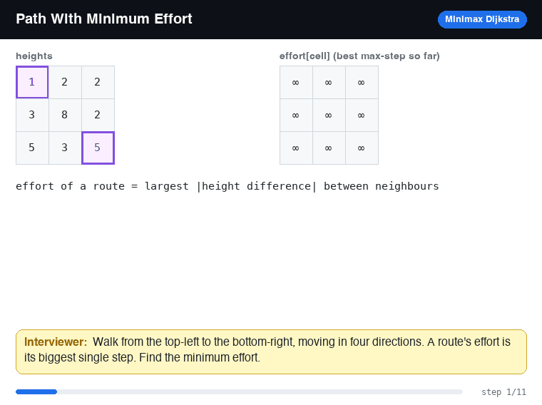

# Walkthrough: Path With Minimum Effort

**Module:** [13 · Shortest paths & minimum spanning trees](../README.md) · **Difficulty:** Medium · **Solution:** [`p04_path_with_minimum_effort.go`](../p04_path_with_minimum_effort.go)



## The problem in plain words

A hiker walks across a grid of heights from the top-left cell to the bottom-right cell, moving up, down, left or right. A route's effort is its single biggest step: the largest height difference between two neighbouring cells on it. Find the route with the smallest effort.

```
1 2 2
3 8 2   →  2   (1 → 3 → 5 → 3 → 5 never steps more than 2)
5 3 5
```

## Mock interview

**Interviewer:** Given a grid of heights, return the minimum effort to get from the top-left to the bottom-right. The effort of a route is the maximum absolute height difference between consecutive cells.

**Candidate:** Can I revisit cells? And what's the answer for a 1×1 grid?

**Interviewer:** You can move freely. A 1×1 grid has effort 0.

**Candidate:** In the example, going right along the top costs steps of 1 and 0, but then going down the right side has a step of 3 (2 to 5). Going down the left side and along the bottom has steps 2, 2, 2, 2, so its effort is 2. That's the best.

**Candidate:** A brute force would DFS every simple path and take the smallest maximum. The number of paths grows exponentially with the grid size.

**Interviewer:** Can you use a shortest-path algorithm when the cost is a max?

**Candidate:** Yes. Dijkstra doesn't really need addition. It needs a path's cost to never go down when you extend the path. `max(cost, step)` is never smaller than `cost`, so that holds. I run Dijkstra on cells with `effort[cell]` instead of `dist`, and relax with `next = max(effort[u], |h[u] - h[v]|)`.

**Interviewer:** Why can you return the moment you pop the target?

**Candidate:** Same argument as normal Dijkstra. When I pop a cell, every other heap entry has effort at least as large. Extending any of those routes can't make their effort smaller. So the first time the target comes off the heap, its effort is final.

**Candidate:** In code: cell `(r, c)` gets id `r*n + c`. I fill `effort` with `Inf`, set `effort[0] = 0`, and push `{0, 0}`. In the loop I pop, skip stale entries, return if it's the target, and otherwise try the four directions.

**Candidate:** Testing it: pop (0,0) and push (1,0) at 2 and (0,1) at 1. The cheap top row comes off first: (0,1), (0,2) and (1,2) all at 1. From (1,2) the step down to (2,2) is 3, so the target gets 3 for now. Then (1,0) at 2 lowers (1,1) from 6 to 5 and pushes (2,0) at 2. (2,0) pushes (2,1) at 2. (2,1) lowers the target from 3 to 2. The target pops at 2, so I return 2.

**Interviewer:** Any other approach?

**Candidate:** Binary search on the answer, which is `MinimumEffortPathBinarySearch`. For a limit `k`, a BFS that only takes steps of at most `k` tells me if the target is reachable. That's monotone in `k`, so `sort.Search` finds the smallest limit. That's O(mn log maxHeight).

**Interviewer:** Complexity?

**Candidate:** Dijkstra is **O(mn log(mn)) time and O(mn) space**.

## What the animation shows

| Step | Pop (cell, effort) | Pushes |
|---|---|---|
| 1 | Interviewer states the problem | |
| 2 | Brute force: every path, exponential | |
| 3 | Start: effort(0,0) = 0 | |
| 4 | (0,0), 0 | (1,0):2, (0,1):1 |
| 5 | (0,1), 1 | (1,1):6, (0,2):1 |
| 6 | (0,2), 1 | (1,2):1 |
| 7 | (1,2), 1 | (2,2):3 |
| 8 | (1,0), 2 | (2,0):2, (1,1):5 (was 6) |
| 9 | (2,0), 2 | (2,1):2 |
| 10 | (2,1), 2 | (2,2):2 (was 3) |
| 11 | (2,2), 2: the target, return 2 | |

## Detailed explanation

Dijkstra is correct for any path cost that is **monotone**: extending a path never makes its cost smaller. With sums, that needs non-negative weights. With `max`, it's always true, because `max(a, b) >= a`. So the usual proof carries over. When a cell is popped, any other route to it must go through a cell still in the heap. That cell's effort is already at least as large, and the route's effort can only grow from there.

The early return matters for speed, not correctness. Without it, the loop still finishes and `effort[m*n-1]` is right.

The heap may hold stale entries. In the example, (1,1) is pushed at 6 and later at 5, and (2,2) at 3 and later at 2. The `cur.dist > effort[cur.node]` check skips the old ones.

Edge cases:

- **1×1 grid:** the start is the target, and it pops with effort 0.
- **All heights equal:** every step is 0, so the answer is 0.

## Complexity

| Approach | Time | Space |
|---|---|---|
| Minimax Dijkstra (`MinimumEffortPath`) | O(mn log(mn)) | O(mn) |
| Binary search + BFS (`MinimumEffortPathBinarySearch`) | O(mn log maxHeight) | O(mn) |

## Common mistakes

- Relaxing with `effort[u] + step` instead of `max(effort[u], step)`.
- Taking the step as `h[v] - h[u]` without the absolute value.
- Plain BFS by number of steps. It finds the shortest route, not the gentlest one.
- Marking a cell visited when it is pushed rather than when it is popped. A later, better route then can't update it.

## Try it yourself

```sh
go test ./course/13-shortest-paths-mst/ -run TestMinimumEffortPath -v
```
