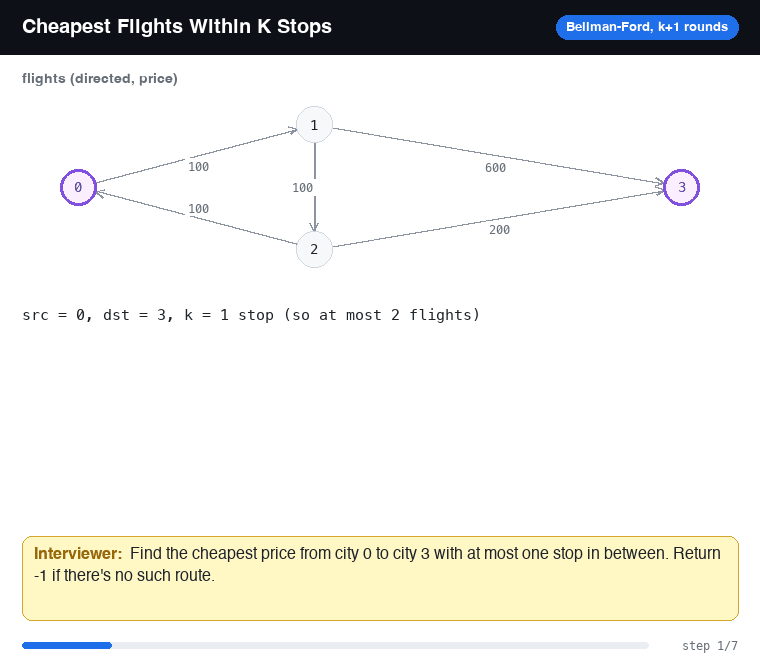

# Walkthrough: Cheapest Flights Within K Stops

**Module:** [13 · Shortest paths & minimum spanning trees](../README.md) · **Difficulty:** Medium · **Solution:** [`p05_cheapest_flights_k_stops.go`](../p05_cheapest_flights_k_stops.go)



## The problem in plain words

There are one-way flights between cities, each with a price. Find the cheapest way from `src` to `dst` that makes at most `k` stops in between, which means at most `k + 1` flights. Return `-1` if there's no such route.

```
n = 4, flights [[0,1,100],[1,2,100],[2,0,100],[1,3,600],[2,3,200]]
src = 0, dst = 3, k = 1  →  700   (0→1→3; the cheaper 0→1→2→3 needs 2 stops)
```

## Mock interview

**Interviewer:** You have `n` cities and one-way flights `{from, to, price}`. Return the cheapest price from `src` to `dst` with at most `k` stops, or `-1`.

**Candidate:** A stop is a city in the middle, so `k` stops means `k + 1` flights. Are prices non-negative? Can there be cycles?

**Interviewer:** Prices are non-negative, and yes, there can be cycles.

**Candidate:** In the example, 0→1→2→3 costs 400 but has two stops. With `k = 1`, the best is 0→1→3 for 700.

**Candidate:** A brute force DFS tries every route of at most `k + 1` flights. That's exponential in `k`. I also can't just run Dijkstra on price. The cheapest way into city 2 is 0→1→2, which already uses one stop. From there, the flight to 3 would be a second stop. Dijkstra would settle city 2 at 200 and throw away the information about how many flights it took.

**Interviewer:** So what do you do?

**Candidate:** Bellman-Ford with a hop limit. After round `i` of Bellman-Ford, `dist[v]` is the cheapest price using at most `i` flights. So I run exactly `k + 1` rounds. The catch is that each round must read from a **snapshot** of the previous round. If I relax in place, one round can chain several flights.

**Interviewer:** Show me that it really breaks.

**Candidate:** In this example, relaxing in place in flight order gives `dist[1] = 100`, then `dist[2] = 200` using the new `dist[1]`, then `dist[3] = 400` using the new `dist[2]`. That's three flights in "one round". With the snapshot, round 1 can only extend paths that existed before the round.

**Candidate:** In code: `dist` filled with `Inf`, `dist[src] = 0`. For each of the `k + 1` rounds I copy `prev := append([]int(nil), dist...)`. For each flight, if `prev[from] != Inf` and `prev[from] + price < dist[to]`, I update `dist[to]`. At the end I return `dist[dst]`, or `-1` if it's still `Inf`.

**Candidate:** Testing it: round 1 only has city 0 in the snapshot, so it sets `dist[1] = 100`. Round 2 reads `prev = [0, 100, ∞, ∞]`. It sets `dist[2] = 200` and `dist[3] = 100 + 600 = 700`. The 2→3 flight is skipped because `prev[2]` is still infinite. After two rounds, `dist[3] = 700`.

**Interviewer:** Complexity?

**Candidate:** `k + 1` rounds, each scanning every flight and copying `n` values: **O(k · (E + n)) time, usually written O(k · E), and O(n) space**.

## What the animation shows

| Step | What happens | `dist` after |
|---|---|---|
| 1 | Interviewer states the problem | |
| 2 | Brute force is exponential; Dijkstra on price is wrong | |
| 3 | The trap: one in-place round already reaches 3 for 400 using 3 flights | `[0, 100, 200, 400]` |
| 4 | Start: `dist[0] = 0`, run 2 rounds | `[0, ∞, ∞, ∞]` |
| 5 | Round 1 from snapshot `[0, ∞, ∞, ∞]`: 0→1 | `[0, 100, ∞, ∞]` |
| 6 | Round 2 from snapshot `[0, 100, ∞, ∞]`: 1→2 and 1→3 | `[0, 100, 200, 700]` |
| 7 | Answer `dist[3] = 700` | |

## Detailed explanation

The invariant is: *after round `i`, `dist[v]` is the cheapest price of a route from `src` to `v` that uses at most `i` flights.* It holds at the start with `i = 0`, since only `src` is reachable with zero flights. In round `i + 1`, every route of `i + 1` flights is a route of at most `i` flights plus one more flight. Its first part is in `prev`, and relaxing the last flight from `prev` finds it. Because the round reads only `prev`, it can't add two flights at once.

`dist` also keeps the values from earlier rounds, so it covers "at most `i + 1` flights", not "exactly". Taking the minimum is fine because fewer flights is always allowed.

Cycles are not a problem here. Prices are non-negative, so going around a cycle never helps. The round limit also bounds the work.

Edge cases:

- **`src == dst`:** `dist[src]` starts at 0 and never gets worse, so the answer is 0.
- **No route within the limit:** `dist[dst]` stays `Inf`, so the answer is `-1`.

## Complexity

| Approach | Time | Space |
|---|---|---|
| Hop-limited Bellman-Ford (`FindCheapestPrice`) | O(k · E) | O(n) |
| DFS over all routes (`FindCheapestPriceBrute`) | exponential in k | O(k) recursion |

## Common mistakes

- Relaxing in place without a snapshot, which silently allows too many flights.
- Running `k` rounds instead of `k + 1`. `k` is stops, not flights.
- Reading `prev[from]` when it's `Inf` and overflowing.
- Using plain Dijkstra on price and settling a city too early.

## Try it yourself

```sh
go test ./course/13-shortest-paths-mst/ -run TestFindCheapestPrice -v
```
