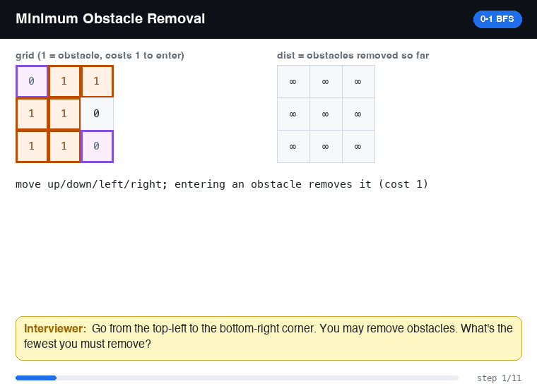

# Walkthrough: Minimum Obstacle Removal

**Module:** [13 · Shortest paths & minimum spanning trees](../README.md) · **Difficulty:** Hard · **Solution:** [`p06_minimum_obstacle_removal.go`](../p06_minimum_obstacle_removal.go)



## The problem in plain words

A grid has empty cells (0) and obstacles (1). You walk from the top-left corner to the bottom-right corner, moving up, down, left or right. You may remove obstacles to walk through them. What is the fewest number you must remove?

```
0 1 1
1 1 0   →  2
1 1 0
```

## Mock interview

**Interviewer:** Given a 0/1 grid, return the minimum number of obstacles to remove so you can walk from the top-left to the bottom-right.

**Candidate:** Are the two corners always empty? How large can the grid be?

**Interviewer:** Both corners are empty. The grid can have up to 10⁵ cells.

**Candidate:** In the example, every route out of the start passes an obstacle right away. One route is (0,0) → (1,0) → (1,1) → (1,2) → (2,2). It enters two obstacles, (1,0) and (1,1), so the answer is 2.

**Candidate:** This is a shortest path where entering a cell costs its value. A brute force over all paths is exponential. A plain BFS counts steps, not removals, so it gives the wrong answer. Dijkstra works, at O(mn log(mn)).

**Interviewer:** Can you do better than Dijkstra?

**Candidate:** Yes. Every weight is 0 or 1, so I can use 0-1 BFS with a deque instead of a heap. I pop from the front. A move into an empty cell keeps the same distance, so it goes to the front. A move into an obstacle adds 1, so it goes to the back. The deque then holds at most two distance values, `d` and `d + 1`, in sorted order. Popping from the front always gives the smallest distance, which is what Dijkstra's heap would give, without the log factor.

**Interviewer:** Why does a 0-cost move go to the front, not the back?

**Candidate:** Its distance equals the one I just popped, which is the smallest in the deque. Putting it at the back would place it behind `d + 1` entries and break the sorted order.

**Candidate:** In code, the Go solution turns the grid into a graph with `gridGraph`. The edge into cell `(r, c)` weighs `grid[r][c]`. Then it calls the shared `ZeroOneBFS` from cell 0 and returns the distance of the last cell. The shared deque keeps pushed-front items in a stack and pushed-back items in a queue.

**Candidate:** Testing it: pop (0,0). Both neighbours are obstacles, so they get distance 1 and go to the back. Pop (1,0), which pushes (2,0) and (1,1) at 2. Pop (0,1), which pushes (0,2) at 2. Pop (2,0), which pushes (2,1) at 3. Pop (1,1). Its neighbour (1,2) is empty, so it gets 2 and goes to the front. Pop (1,2). The corner is empty, so it gets 2 and goes to the front. Pop the corner. Two more pops change nothing. The answer is 2.

**Interviewer:** Complexity?

**Candidate:** Each cell is pushed only when its distance improves, and with weights 0 and 1 that happens a small, constant number of times. So it's **O(mn) time and O(mn) space**.

## What the animation shows

| Step | Pop (cell, dist) | Pushes |
|---|---|---|
| 1 | Interviewer states the problem | |
| 2 | Brute force / Dijkstra, and why a deque is enough | |
| 3 | Start: dist(0,0) = 0 | |
| 4 | (0,0), 0 | (1,0):1 back, (0,1):1 back |
| 5 | (1,0), 1 | (2,0):2 back, (1,1):2 back |
| 6 | (0,1), 1 | (0,2):2 back |
| 7 | (2,0), 2 | (2,1):3 back |
| 8 | (1,1), 2 | (1,2):2 **front** |
| 9 | (1,2), 2 | (2,2):2 **front** |
| 10 | (2,2), 2 | nothing improves |
| 11 | Remaining pops change nothing; answer 2 | |

## Detailed explanation

0-1 BFS is Dijkstra with a cheaper priority queue. Dijkstra needs to pop nodes in non-decreasing order of distance. The deque keeps that order through one invariant: *the deque reads `d, d, …, d, d+1, …, d+1` from front to back*, where `d` is the distance just popped. A 0-edge produces another `d`, which belongs at the front. A 1-edge produces a `d + 1`, which belongs at the back. Neither push breaks the pattern.

The shared `ZeroOneBFS` has no "already settled" check. A node can be pushed again if its distance improves, and when popped it relaxes its neighbours again. That's harmless: a relaxation only pushes when the distance strictly drops. In the example, the last two pops, (0,2) and (2,1), improve nothing.

Edge cases:

- **No obstacles:** every edge weighs 0, so everything goes to the front and the answer is 0.
- **1×1 grid:** the start is the target, with distance 0.

## Complexity

| Approach | Time | Space |
|---|---|---|
| 0-1 BFS (`MinimumObstacles`) | O(mn) | O(mn) |
| Dijkstra (`MinimumObstaclesDijkstra`) | O(mn log(mn)) | O(mn) |

## Common mistakes

- Pushing 0-cost moves to the back. The deque stops being sorted and the answer can be too high.
- Using a plain BFS with a visited set. It counts steps, not removals.
- Charging the cost of the cell you leave instead of the cell you enter.
- Marking cells visited on push. A later 0-cost route then can't improve them.

## Try it yourself

```sh
go test ./course/13-shortest-paths-mst/ -run TestMinimumObstacles -v
```
