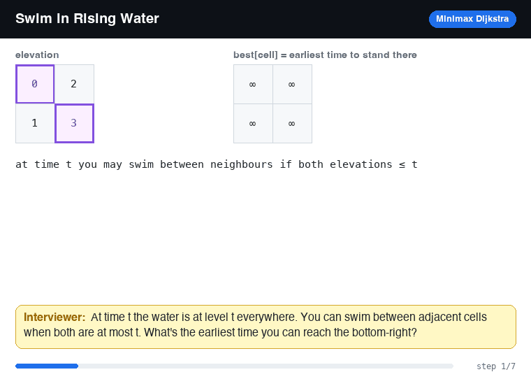

# Walkthrough: Swim in Rising Water

**Module:** [13 · Shortest paths & minimum spanning trees](../README.md) · **Difficulty:** Hard · **Solution:** [`p07_swim_in_rising_water.go`](../p07_swim_in_rising_water.go)



## The problem in plain words

An `n × n` grid holds distinct elevations. At time `t` the water level is `t` everywhere. You can swim between two neighbouring cells only when both are at elevation `t` or below, and swimming takes no time. Starting at the top-left, what is the earliest time you can reach the bottom-right?

```
0 2
1 3   →  3   (you must wait until the water covers the corner at 3)
```

## Mock interview

**Interviewer:** Given an `n × n` grid of distinct elevations from `0` to `n² - 1`, return the earliest time you can swim from the top-left to the bottom-right.

**Candidate:** Swimming is instant, so the only thing that matters is the water level. Is the start cell's elevation also a constraint?

**Interviewer:** Yes. You can't move until the water covers your own cell.

**Candidate:** Then the time for a route is the highest elevation on it, including both ends. In the small example, every route ends at the corner with elevation 3, so the answer is 3. In general I want the route whose highest cell is as low as possible.

**Candidate:** A brute force tries each time `t = 0, 1, 2, …` and runs a BFS through cells with elevation at most `t`. That's up to n² BFS runs of O(n²) each, so O(n⁴).

**Interviewer:** Can you do better?

**Candidate:** This is a bottleneck path, just like Path With Minimum Effort. A route's cost is the max elevation on it, and that never goes down as the route grows. So minimax Dijkstra works. `best[cell]` is the earliest time I can stand there. The start is `grid[0][0]`. Relaxing into a neighbour gives `max(best[u], grid[v])`.

**Interviewer:** Why is the start `grid[0][0]` and not 0?

**Candidate:** Because the water has to cover the starting cell too. If the start were at elevation 5, nothing could happen before time 5.

**Candidate:** In code: ids `r*n + c`, `best` filled with `Inf`, `best[0] = grid[0][0]`, and a min-heap seeded with the start. I pop, skip stale entries, return when the target pops, and relax the four neighbours.

**Candidate:** Testing it: pop (0,0) at 0. Push (1,0) at 1 and (0,1) at 2. Pop (1,0) at 1. Going back to (0,0) doesn't help. (1,1) gets `max(1, 3) = 3`. Pop (0,1) at 2. (1,1) would also be 3, which is no better. Pop (1,1) at 3. It's the target, so I return 3.

**Interviewer:** Is there another way to see it?

**Candidate:** Yes, with union-find, which is `SwimInWaterUnionFind`. Raise the water one level at a time. Switch on the cell at that elevation and union it with neighbours that are already on. The first level at which the two corners are in the same set is the answer.

**Interviewer:** Complexity?

**Candidate:** n² cells through a heap: **O(n² log n) time and O(n²) space**. Union-find costs the same because of the sort.

## What the animation shows

| Step | What happens | Heap after |
|---|---|---|
| 1 | Interviewer states the problem | |
| 2 | Brute force: BFS for every t, O(n⁴) | |
| 3 | Start: best(0,0) = grid[0][0] = 0 | `(0,0):0` |
| 4 | Pop (0,0) at 0; push (1,0):1 and (0,1):2 | `(1,0):1, (0,1):2` |
| 5 | Pop (1,0) at 1; push (1,1):3 | `(0,1):2, (1,1):3` |
| 6 | Pop (0,1) at 2; nothing improves | `(1,1):3` |
| 7 | Pop (1,1) at 3: the target, answer 3 | |

## Detailed explanation

The time for a route is the highest elevation on it, since you can only cross once the water is over every cell. So the problem asks for the path that minimises the maximum: a **bottleneck path**.

Dijkstra still works because the cost is monotone: `max(best[u], grid[v]) >= best[u]`. When a cell is popped, every other heap entry is at least as large, and no route through them can come back lower. The first time the target is popped, its time is final, so the Go code returns right away.

The union-find view gives the same answer from the other direction. Process cells in order of elevation. When the water reaches level `t`, every cell at or below `t` is on, and connected components are the areas you can swim between. The first `t` at which the start and end share a component is the earliest time.

Edge cases:

- **1×1 grid:** the start is the target, and the answer is `grid[0][0]`.
- **High start:** `best[0] = grid[0][0]`, never 0.

## Complexity

| Approach | Time | Space |
|---|---|---|
| Minimax Dijkstra (`SwimInWater`) | O(n² log n) | O(n²) |
| Union-find by elevation (`SwimInWaterUnionFind`) | O(n² log n) | O(n²) |

## Common mistakes

- Starting `best[0]` at 0 instead of `grid[0][0]`.
- Summing elevations instead of taking the max.
- Using the height difference, as in Path With Minimum Effort. Here the cost is the elevation itself.
- In the union-find version, checking connectivity before switching on the current cell.

## Try it yourself

```sh
go test ./course/13-shortest-paths-mst/ -run TestSwimInWater -v
```
