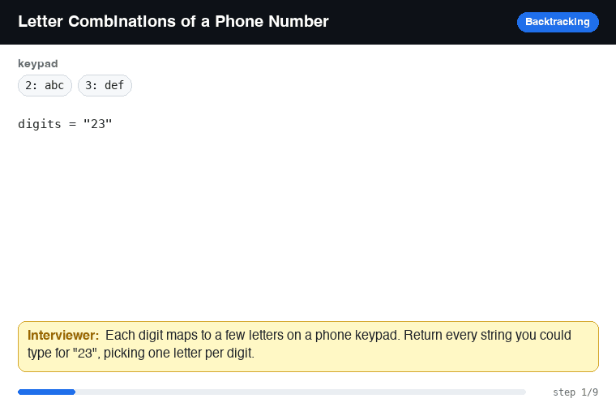

# Walkthrough: Letter Combinations of a Phone Number

**Module:** [14 · Backtracking](../README.md) · **Difficulty:** Medium · **Solution:** [`p01_letter_combinations.go`](../p01_letter_combinations.go)



## The problem in plain words

On an old phone keypad, each digit from 2 to 9 stands for a few letters (2 is `abc`, 3 is `def`, and so on). Given a string of digits, list every word you could type by picking one letter for each digit.

```
"23"  →  [ad ae af bd be bf cd ce cf]
""    →  []
```

## Mock interview

**Interviewer:** Given a string of digits 2–9, return every letter combination the number could represent, using the usual phone keypad.

**Candidate:** Can the input contain 0 or 1? What should an empty string return? Does the order of the output matter?

**Interviewer:** Only 2–9. An empty string returns an empty list. Any order is fine.

**Candidate:** For `"23"`, the first letter is one of `a b c` and the second is one of `d e f`, so there are 3 × 3 = 9 strings: `ad ae af bd be bf cd ce cf`. Note that 7 and 9 have four letters, so the count can be up to 4ⁿ.

**Candidate:** With exactly two digits I'd write two nested loops. But the number of digits varies, so I can't hard-code the loops. And there's no shortcut on the total work: the output itself has up to 4ⁿ strings.

**Interviewer:** So how do you get "one loop per digit"?

**Candidate:** Recursion. Depth `i` picks the letter for digit `i`. I keep a byte buffer. For each letter of the current digit, I append it (choose), recurse to depth `i + 1` (explore), and remove it (unchoose). When `i == len(digits)`, the buffer is a full answer, and I append `string(buf)`, which copies the bytes.

**Interviewer:** Is there any pruning?

**Candidate:** No. Every branch leads to a valid answer, so this is the plain Cartesian product. It's the simplest form of backtracking.

**Candidate:** In code: return `nil` for an empty input, use a `keypad` array indexed by digit, and a recursive closure `backtrack(i)`. The file also has `LetterCombinationsIterative`, which starts from `[""]` and, for each digit, extends every prefix with every letter.

**Candidate:** Testing on `"23"`: choose `a`, then `d` gives `ad`. Unchoose `d`, choose `e` gives `ae`, then `af`. Back at depth 0, swap `a` for `b` and get `bd be bf`, then `c` gives `cd ce cf`. Nine strings in keypad order.

**Interviewer:** Complexity?

**Candidate:** Up to 4ⁿ answers, each n bytes long: **O(n · 4ⁿ) time**. Besides the output, the recursion and the buffer use **O(n) space**.

## What the animation shows

| Step | What happens | Results |
|---|---|---|
| 1 | Interviewer states the problem | |
| 2 | Brute force: nested loops don't work for any length | |
| 3 | Depth 0: choose `a` | |
| 4 | Depth 1: choose `d`; depth 2 reached, record `ad` | ad |
| 5 | Unchoose `d`, choose `e`: record `ae` | ad ae |
| 6 | Unchoose `e`, choose `f`: record `af` | ad ae af |
| 7 | Back to depth 0, swap `a` for `b`: same three choices | + bd be bf |
| 8 | Swap `b` for `c`: same three choices | + cd ce cf |
| 9 | All 9 strings, O(n · 4ⁿ) | |

## Detailed explanation

The recursion tree has one level per digit. Each node at depth `i` has one child per letter of `digits[i]`. Every root-to-leaf path picks exactly one letter per digit, and different paths pick different letters somewhere. So the leaves are exactly the answers, each once.

The buffer is shared by all calls. That is why the unchoose step matters: after the recursive call returns, `buf = buf[:len(buf)-1]` removes the letter, so the next sibling starts from the same prefix. Recording with `string(buf)` makes a copy. Storing the buffer itself would leave every answer pointing at the same bytes.

The iterative version builds the same product level by level. It is easy to read but keeps a whole level of partial strings in memory at once.

Edge cases:

- **Empty input:** return `nil`, not `[""]`. Without the early return, the recursion would record one empty string.
- **Digits 7 and 9:** four letters each, which is where the 4ⁿ bound comes from.

## Complexity

| Approach | Time | Space (besides output) |
|---|---|---|
| Recursive backtracking (`LetterCombinations`) | O(n · 4ⁿ) | O(n) |
| Iterative product (`LetterCombinationsIterative`) | O(n · 4ⁿ) | O(n · 4ⁿ) for the level being built |

## Common mistakes

- Returning `[""]` for an empty input.
- Forgetting to remove the last letter after the recursive call.
- Appending the shared buffer instead of a copy.
- Indexing the keypad with the byte `'2'` instead of `digits[i] - '0'`.

## Try it yourself

```sh
go test ./course/14-backtracking/ -run TestLetterCombinations -v
```
