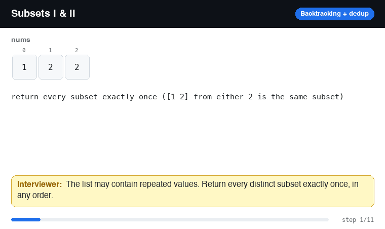

# Walkthrough: Subsets I & II

**Module:** [14 · Backtracking](../README.md) · **Difficulty:** Medium · **Solution:** [`p02_subsets.go`](../p02_subsets.go)



## The problem in plain words

Part I: given distinct numbers, list every subset, including the empty one. Part II: the numbers may repeat. List every subset once, so picking "the first 2" or "the second 2" counts as the same subset. The animation shows Part II, because it includes Part I's logic plus the duplicate rule.

```
I:  [1,2,3]  →  [] [1] [2] [3] [1 2] [1 3] [2 3] [1 2 3]
II: [1,2,2]  →  [] [1] [2] [1 2] [2 2] [1 2 2]
```

## Mock interview

**Interviewer:** Given an integer array that may contain duplicates, return all distinct subsets in any order.

**Candidate:** Does `[1 2]` count as the same as `[2 1]`? And may I reorder the input?

**Interviewer:** Yes, they're the same subset. Don't change the caller's slice.

**Candidate:** For `[1, 2, 2]` the subsets are `[] [1] [2] [1 2] [2 2] [1 2 2]`, six in total. If I treated the two 2s as different, I'd get eight, with `[2]` and `[1 2]` each appearing twice.

**Candidate:** The brute force loops over all 2ⁿ bitmasks, builds each subset, sorts it and dedupes with a hash set. It works, but it builds duplicates only to throw them away, and slices need to be turned into keys first.

**Interviewer:** Can you avoid generating duplicates at all?

**Candidate:** Yes. I copy and sort the input so equal values sit next to each other. Then I backtrack with a start index: each call records the current path as a subset, then tries each `i` from `start` to the end as the next element and recurses with `i + 1`. The start index means I only add elements to the right, so `[2 1]` is never built.

For duplicates, I skip `sorted[i]` when `i > start && sorted[i] == sorted[i-1]`. At a given depth, the first copy of a value already explored every subset that a later copy would start.

**Interviewer:** Why `i > start` and not `i > 0`?

**Candidate:** `i > start` only skips equal *siblings* at the same depth. With `i > 0`, I'd also refuse to take the second 2 right after the first one, and I'd lose `[2 2]` and `[1 2 2]`.

**Candidate:** In code, it's `SubsetsWithDup`. Copy and sort, then a closure `backtrack(start)` that appends `clone(path)` first and then loops. `clone` uses `make` and `copy`, so the empty subset is `[]int{}`, not `nil`.

**Candidate:** Testing on `[1, 2, 2]`: record `[]`. Take 1, record `[1]`. Take 2, record `[1 2]`. Take the second 2, record `[1 2 2]`. Back at `[1]`, the second 2 is a sibling equal to the first, so I skip it. Back at the root, take 2, record `[2]`, then `[2 2]`. The root's second 2 is skipped. Six subsets.

**Interviewer:** Complexity?

**Candidate:** At most 2ⁿ subsets, each copied in O(n): **O(n · 2ⁿ) time** and **O(n) space** for the recursion, besides the output. Sorting adds O(n log n), which is smaller.

## What the animation shows

| Step | Event | Results so far |
|---|---|---|
| 1 | Interviewer states the problem | |
| 2 | Brute force: bitmasks + dedupe | |
| 3 | Root: record `[]` | 1 |
| 4 | Take 1: record `[1]` | 2 |
| 5 | Take 2: record `[1 2]` | 3 |
| 6 | Take 2 again: record `[1 2 2]` | 4 |
| 7 | At `[1]`: skip index 2 (equal sibling) | 4 |
| 8 | At root, take 2: record `[2]` | 5 |
| 9 | Take 2: record `[2 2]` | 6 |
| 10 | At root: skip index 2 (equal sibling) | 6 |
| 11 | Six distinct subsets, O(n · 2ⁿ) | |

## Detailed explanation

Every node of the recursion tree is an answer, not only the leaves. A subset is fully described by which elements it contains, and the start index builds each one in increasing index order. That gives exactly one path per subset, which is why Part I (`Subsets`) needs no dedup at all.

With repeats, two different index sets can give the same values: `{0, 1}` and `{0, 2}` both give `[1 2]`. The sort-and-skip rule picks one canonical index set for each value multiset: *among equal values, always use the leftmost unused copies first.* At a given depth, choosing `sorted[i]` when `sorted[i-1]` has the same value and was available at this depth would start a subtree identical to the one `sorted[i-1]` already explored. So it is skipped.

`SubsetsBitmask` is the iterative alternative for Part I. Bit `i` of a mask says whether to include `nums[i]`. It's short, but it only works for n < 64 and does not handle duplicates.

Edge cases:

- **Empty input:** the result is `[[]]`, one empty subset.
- **All values equal**, like `[2, 2, 2]`: the result is `[] [2] [2 2] [2 2 2]`.

## Complexity

| Approach | Time | Space (besides output) |
|---|---|---|
| Backtracking (`Subsets`) | O(n · 2ⁿ) | O(n) |
| Bitmask (`SubsetsBitmask`) | O(n · 2ⁿ) | O(n) |
| Backtracking with dedup (`SubsetsWithDup`) | O(n · 2ⁿ) | O(n) |

## Common mistakes

- Recording only at leaves, which loses every subset smaller than n.
- Appending `path` instead of a copy, so every result ends up the same.
- Skipping with `i > 0` instead of `i > start`.
- Forgetting to sort before applying the skip rule.
- Sorting the caller's slice in place.

## Try it yourself

```sh
go test ./course/14-backtracking/ -run TestSubsetsWithDup -v
```
