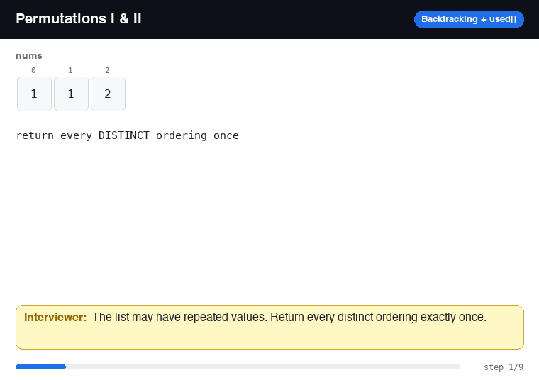

# Walkthrough: Permutations I & II

**Module:** [14 · Backtracking](../README.md) · **Difficulty:** Medium · **Solution:** [`p03_permutations.go`](../p03_permutations.go)



## The problem in plain words

Part I: list every ordering of a list of distinct numbers. Part II: the list may contain repeated values. List every *distinct* ordering once. Swapping two equal values doesn't make a new ordering. The animation shows Part II, which uses the same search as Part I plus one skip rule.

```
I:  [1,2,3]  →  [1 2 3] [1 3 2] [2 1 3] [2 3 1] [3 1 2] [3 2 1]
II: [1,1,2]  →  [1 1 2] [1 2 1] [2 1 1]
```

## Mock interview

**Interviewer:** Given a list that may contain duplicates, return all distinct permutations in any order.

**Candidate:** How long can the list be? And may I sort it?

**Interviewer:** Up to 8 elements. Don't change the caller's slice.

**Candidate:** For `[1, 1, 2]` there are 3! = 6 orderings if the two 1s were different, but only three distinct ones: `[1 1 2]`, `[1 2 1]`, `[2 1 1]`.

**Candidate:** The brute force generates all n! orderings and dedupes them with a set. Here half the work is wasted, and with more repeats the waste grows.

**Interviewer:** How do you avoid the duplicates?

**Candidate:** First the plain search. I fill the result one position at a time. At each position I may use any element that isn't already in the path, so I keep a `used[]` array. When the path has n elements, I record a copy. That's `Permute`.

For duplicates, I sort a copy, then add one rule: skip `sorted[i]` if it equals `sorted[i-1]` and `used[i-1]` is false. That forces equal values to be placed in their original left-to-right order. Each distinct arrangement then has exactly one sequence of choices that builds it.

**Interviewer:** Why `!used[i-1]` and not `used[i-1]`?

**Candidate:** If the previous copy is unused at this point, it was just tried at this same position and then unchosen. Picking the later copy here would start an identical subtree. If the previous copy *is* used, it's earlier in the path, and taking this copy next is the normal left-to-right order. That's allowed.

**Candidate:** In code, `PermuteUnique` sorts a copy, keeps `path` and `used`, and the closure loops over all `i`. It skips used ones, applies the duplicate rule, and does choose/explore/unchoose on both `path` and `used[i]`.

**Candidate:** Testing on `[1, 1, 2]`: take the first 1, then the second 1 is allowed because the first is used, then 2: record `[1 1 2]`. Unchoose and try 2 then 1: `[1 2 1]`. Back at the root, the second 1 is skipped because the first 1 is unused. Take 2, then the first 1, then the second: `[2 1 1]`. Back at `[2]`, the second 1 is skipped again. Three results, no duplicates.

**Interviewer:** Is there another way to generate permutations?

**Candidate:** `PermuteSwap` fixes position `i` by swapping each candidate into it, recursing on `i + 1`, then swapping back. It needs no `used[]` or path, but the duplicate rule is harder to apply there.

**Interviewer:** Complexity?

**Candidate:** At most n! leaves, each copied in O(n): **O(n · n!) time**, and **O(n) space** for the path, `used[]` and recursion, besides the output.

## What the animation shows

| Step | Event | Results |
|---|---|---|
| 1 | Interviewer states the problem | |
| 2 | Brute force: n! orderings + dedupe | |
| 3 | Sort; choose the first 1 (`used[0] = true`) | |
| 4 | Path full: record `[1 1 2]` | 1 |
| 5 | Path full: record `[1 2 1]` | 2 |
| 6 | Root: skip the second 1 (`used[0]` is false) | 2 |
| 7 | Path full: record `[2 1 1]` | 3 |
| 8 | At `[2]`: skip the second 1 again | 3 |
| 9 | Three distinct permutations, O(n · n!) | |

## Detailed explanation

The search tree has n levels. Level `k` decides the value at position `k`, and its children are the elements not yet used. Each root-to-leaf path uses every index exactly once, so the leaves are all n! orderings of the indices.

With duplicates, many index orderings give the same values. The rule "equal values must appear in index order" picks one of them as the representative. Among the copies of a value, the first one placed must be the leftmost copy, the next one the next copy, and so on. The skip condition `sorted[i] == sorted[i-1] && !used[i-1]` blocks exactly the choices that would break that order. Every distinct value sequence still has exactly one valid index sequence, so nothing is lost and nothing is repeated.

Sorting is required. The rule only compares neighbours, so equal values must be adjacent.

Edge cases:

- **All values equal:** there is one permutation, and every other branch is skipped at once.
- **Single element:** one permutation of length 1.

## Complexity

| Approach | Time | Space (besides output) |
|---|---|---|
| `used[]` backtracking (`Permute`) | O(n · n!) | O(n) |
| In-place swaps (`PermuteSwap`) | O(n · n!) | O(n) |
| With dedup (`PermuteUnique`) | O(n · n!) | O(n) |

## Common mistakes

- Using a start index as in subsets. Permutations must be able to pick earlier elements later.
- Forgetting to reset `used[i]` when unchoosing.
- Writing the duplicate rule as `used[i-1]`. It still removes duplicates, but it explores many dead branches and is harder to reason about.
- Applying the rule without sorting first.

## Try it yourself

```sh
go test ./course/14-backtracking/ -run TestPermuteUnique -v
```
