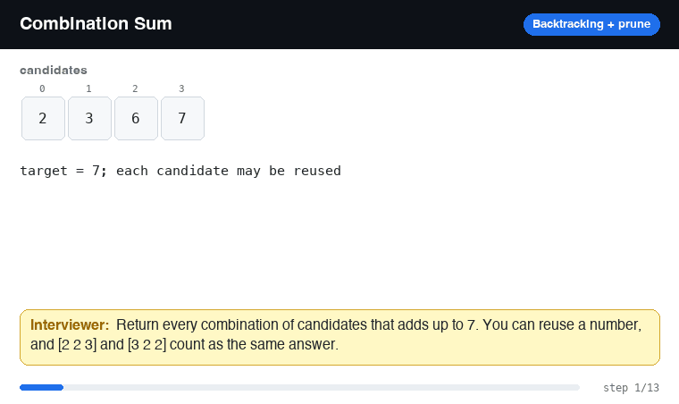

# Walkthrough: Combination Sum

**Module:** [14 · Backtracking](../README.md) · **Difficulty:** Medium · **Solution:** [`p04_combination_sum.go`](../p04_combination_sum.go)



## The problem in plain words

You have some distinct positive numbers and a target. List every way to pick numbers that add up to the target. You can use a number as many times as you like. The order you pick them in doesn't matter, so `[2 2 3]` and `[3 2 2]` are the same answer.

```
candidates [2,3,6,7], target 7  →  [2 2 3] [7]
```

## Mock interview

**Interviewer:** Given distinct positive candidates and a target, return every multiset of candidates that sums to the target. Each candidate may be reused.

**Candidate:** Are all candidates positive? Could the target be 0?

**Interviewer:** All positive. The target is at least 1.

**Candidate:** For `[2, 3, 6, 7]` and 7: 2 + 2 + 3 = 7 and 7 = 7. Nothing else works: 3 + 3 = 6 needs another 1, and 6 needs another 1. So the answer is `[2 2 3]` and `[7]`.

**Candidate:** A brute force tries every sequence of picks until the sum reaches or passes the target. It finds `[2 2 3]`, `[2 3 2]` and `[3 2 2]` separately and then has to dedupe them.

**Interviewer:** How do you make each combination come out once?

**Candidate:** I only pick in non-decreasing order. I sort a copy of the candidates and backtrack with a start index. From a call with `start`, I try `cands[i]` for `i >= start` and recurse with `i`, not `i + 1`, so the same number can be picked again. Because I never go back to a smaller index, each multiset is built in exactly one order.

**Interviewer:** And when do you stop?

**Candidate:** When `remaining == 0`, I record a copy of the path. The sort also gives a strong prune. If `cands[i] > remaining`, every later candidate is bigger too, so I `break` out of the loop instead of `continue`.

**Candidate:** In code, `CombinationSum` copies and sorts, then `backtrack(start, remaining)` records on zero, loops from `start`, breaks on too-big, and does choose / recurse with `i` / unchoose.

**Candidate:** Testing it: pick 2, 2, 2, which leaves 1. Now 2 > 1, so I break. Unchoose the last 2 and pick 3 instead: remaining 0, so record `[2 2 3]`. The rest of the 2-subtree only hits breaks. At the root, 3 leaves 4, but 3 + 3 needs 1, which breaks. 6 leaves 1, which breaks. 7 leaves 0, so record `[7]`.

**Interviewer:** What if the candidates could repeat?

**Candidate:** That's Combination Sum II. I'd sort and skip equal siblings with `i > start && cands[i] == cands[i-1]`, as in Subsets II, and recurse with `i + 1` because each copy can be used once.

**Interviewer:** Complexity?

**Candidate:** The depth is at most T/m, where m is the smallest candidate. Each level branches up to n ways, so the worst case is **O(n^(T/m)) time** and **O(T/m) recursion space**. The sorted break cuts most branches in practice.

## What the animation shows

| Step | Event | Path | Remaining |
|---|---|---|---|
| 1 | Interviewer states the problem | | |
| 2 | Brute force finds each answer in every order | | |
| 3 | Choose 2 | [2] | 5 |
| 4 | Choose 2 | [2 2] | 3 |
| 5 | Choose 2 | [2 2 2] | 1 |
| 6 | 2 > 1: break | [2 2 2] | 1 |
| 7 | Unchoose, choose 3 | [2 2 3] | 0 |
| 8 | Record `[2 2 3]` | | |
| 9 | Root: choose 3 (1 pick and 3 breaks not shown) | [3] | 4 |
| 10 | Root: choose 6 (1 pick and 2 breaks not shown) | [6] | 1 |
| 11 | Root: choose 7 (1 break not shown) | [7] | 0 |
| 12 | Record `[7]` | | |
| 13 | Answer `[2 2 3] [7]` | | |

## Detailed explanation

Two rules give correctness:

1. **Recurse with `i`.** The next pick may be the same candidate again, which allows reuse.
2. **Never go below `start`.** Picks are non-decreasing, so each multiset has exactly one path in the tree.

Together they mean every answer appears exactly once, and every sorted sequence summing to the target is reachable.

The `break` is safe because the candidates are sorted. If `cands[i] > remaining`, then `cands[j] > remaining` for every `j > i`. With `continue`, the result would still be correct, but the loop would keep checking values that can never fit.

The tests check the number of answers against `countCombinations`, an unbounded-knapsack DP (Coin Change II). That DP counts the same multisets without listing them. If you only need the count, the DP is much faster.

Edge cases:

- **No answer**, like `[2]` with target 1: the root breaks at once and the result is empty.
- **The target is a candidate:** it appears as a one-element answer.

## Complexity

| Approach | Time | Space |
|---|---|---|
| Backtracking with sorted break (`CombinationSum`) | O(n^(T/m)) worst case | O(T/m) recursion |
| Count only, unbounded knapsack (`countCombinations`) | O(n · T) | O(T) |

## Common mistakes

- Recursing with `i + 1`, which forbids reuse and loses `[2 2 3]`.
- Recursing from 0 instead of `i`, which produces every ordering of each answer.
- Using `break` without sorting first. On an unsorted list it skips smaller candidates that would still fit.
- Appending `path` without copying it.

## Try it yourself

```sh
go test ./course/14-backtracking/ -run TestCombinationSum -v
```
