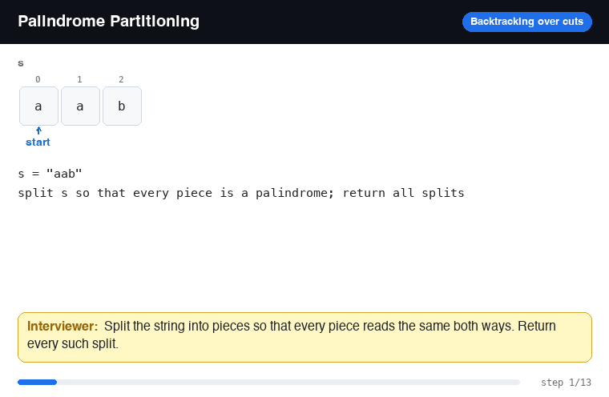

# Walkthrough: Palindrome Partitioning

**Module:** [14 · Backtracking](../README.md) · **Difficulty:** Medium · **Solution:** [`p05_palindrome_partitioning.go`](../p05_palindrome_partitioning.go)



## The problem in plain words

Cut a string into pieces so that every piece reads the same forwards and backwards. List every way to do it.

```
"aab"  →  [a a b] [aa b]
"a"    →  [a]
```

## Mock interview

**Interviewer:** Given a string, return every way to partition it so that each piece is a palindrome.

**Candidate:** Is a single character a palindrome? How long can the string be?

**Interviewer:** Yes, a single character counts. The string has at most 16 characters.

**Candidate:** For `"aab"`: `a | a | b` works, and so does `aa | b`. `a | ab` fails because `ab` isn't a palindrome, and `aab` as one piece fails too. So the answer is `[a a b]` and `[aa b]`. Since every single character is a palindrome, there is always at least one partition.

**Candidate:** A brute force tries all 2ⁿ⁻¹ ways to place cuts between characters and checks every piece. That re-checks the same substrings many times, and it builds whole partitions even when the first piece already fails.

**Interviewer:** How would you do better?

**Candidate:** Backtrack over cut positions. From index `start`, try every `end` from `start` to the last index. If `s[start..end]` is a palindrome, take it as the next piece and recurse from `end + 1`. If it isn't, skip it, and nothing below that branch gets built. When `start` reaches the end of the string, the path is a full partition, so I record a copy.

To make each check O(1), I precompute `isPal[i][j]` with a small DP: `s[i] == s[j]` and either the piece has length at most 2, or `isPal[i+1][j-1]` is true.

**Interviewer:** Why does `i` go downwards in that DP?

**Candidate:** `isPal[i][j]` reads `isPal[i+1][j-1]`, which is in the next row. Filling `i` from `n-1` down to 0 means that row is already done.

**Candidate:** In code, `Partition` builds `isPal`, then a closure `backtrack(start)` records `append([]string(nil), path...)` at the end, and otherwise loops `end` from `start`, skips non-palindromes, and does choose / explore / unchoose with `s[start:end+1]`.

**Candidate:** Testing on `"aab"`: from 0 take `a`, from 1 take `a`, from 2 take `b`, and I'm at the end, so record `[a a b]`. Back at 1, `ab` is not a palindrome, skip. Back at 0, `aa` is a palindrome, so take it, then `b`, and record `[aa b]`. Back at 0, `aab` is not a palindrome, skip. Done.

**Interviewer:** Complexity?

**Candidate:** There can be up to 2ⁿ⁻¹ partitions, as with `"aaaa"`, and copying each costs O(n). So it's **O(n · 2ⁿ) time**. The table takes **O(n²) space**, and the recursion O(n).

## What the animation shows

| Step | Event | Results |
|---|---|---|
| 1 | Interviewer states the problem | |
| 2 | Brute force: 2ⁿ⁻¹ cut sets | |
| 3 | Build the `isPal` table | |
| 4 | start 0: take `a` | |
| 5 | start 1: take `a` | |
| 6 | start 2: take `b` | |
| 7 | start 3 = end: record `[a a b]` | 1 |
| 8 | start 1: `ab` rejected | 1 |
| 9 | start 0: take `aa` | 1 |
| 10 | start 2: take `b` | 1 |
| 11 | start 3 = end: record `[aa b]` | 2 |
| 12 | start 0: `aab` rejected | 2 |
| 13 | Answer `[a a b] [aa b]` | |

## Detailed explanation

Each partition is a sequence of pieces that covers the string from left to right with no gaps. The search builds exactly those sequences. At each `start` it chooses where the next piece ends, and the pieces never overlap because the next call starts at `end + 1`. Every partition whose pieces are all palindromes has exactly one path in the tree, so each is found once.

Skipping a non-palindrome is a prune, not just a filter. Any partition that uses `s[start..end]` as its next piece is invalid, so the whole subtree is skipped.

The `isPal` table moves the palindrome check out of the search. Without it, each check is O(n) and the same substrings are checked again and again in different branches. With it, each check is a table lookup.

`PartitionBrute` enumerates every cut mask and keeps the valid ones. The tests use it to cross-check the backtracking result.

Edge cases:

- **Empty string:** `start == n` immediately, so the result is one empty partition.
- **All characters equal**, like `"aaaa"`: every cut set is valid, which gives the 2ⁿ⁻¹ worst case.

## Complexity

| Approach | Time | Space |
|---|---|---|
| Backtracking with `isPal` (`Partition`) | O(n · 2ⁿ) | O(n²) |
| All cut masks (`PartitionBrute`) | O(n · 2ⁿ) | O(n) besides output |

## Common mistakes

- Filling `isPal` with `i` going up, so `isPal[i+1][j-1]` isn't ready yet.
- Forgetting the `j - i < 2` case, so pieces of length 1 or 2 read outside the table.
- Using `break` instead of `continue` on a non-palindrome. A longer piece can still be a palindrome.
- Appending `path` without copying it.

## Try it yourself

```sh
go test ./course/14-backtracking/ -run TestPartition -v
```
