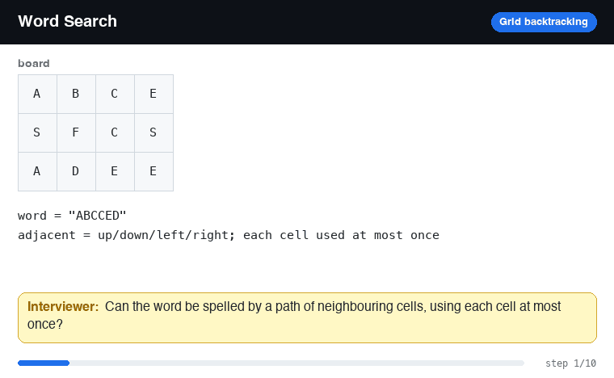

# Walkthrough: Word Search

**Module:** [14 · Backtracking](../README.md) · **Difficulty:** Medium · **Solution:** [`p06_word_search.go`](../p06_word_search.go)



## The problem in plain words

You have a grid of letters and a word. Can you spell the word by moving between cells that touch up, down, left or right, without using any cell twice?

```
A B C E
S F C S     "ABCCED" → true    "SEE" → true    "ABCB" → false
A D E E
```

## Mock interview

**Interviewer:** Given a board of letters and a word, return whether the word exists as a path of horizontally or vertically adjacent cells, each used at most once.

**Candidate:** Is the board case-sensitive? What about an empty word? And may I modify the board while searching?

**Interviewer:** Case-sensitive. An empty word returns true. You may modify the board, but it must be back to normal when you return.

**Candidate:** For `"ABCCED"`: A at (0,0), B at (0,1), C at (0,2), C at (1,2), E at (2,2), D at (2,1). That works, so it's true. `"ABCB"` is false because the only B next to that C is the one already used.

**Candidate:** A brute force would list every path of length L from every cell: m·n starts and up to 4ᴸ paths each. But most paths fail on the second or third letter, so I should stop as soon as a letter doesn't match.

**Interviewer:** So what's your search?

**Candidate:** A DFS from each cell. `dfs(r, c, i)` fails if the cell is off the board or doesn't hold `word[i]`. If `i` is the last index, it succeeds. Otherwise I mark the cell used by overwriting it with 0, try the four neighbours with `i + 1`, and then restore the letter. Restoring is the unchoose step. Without it, later starts would see a corrupted board.

**Interviewer:** Any pruning before the DFS?

**Candidate:** Two cheap checks. If the word needs more of some letter than the board has, or is longer than the board, the answer is false right away. And if the word's last letter is rarer on the board than its first letter, I search for the reversed word. A path spelled backwards is still a path, and starting from the rarer letter gives fewer starting cells and earlier failures.

**Candidate:** In code, `Exist` counts letters with two `[256]int` arrays, maybe reverses the word, and then loops over every cell calling `dfs`. The four calls are joined with `||`, so the search stops at the first success.

**Candidate:** Testing on `"ABCCED"`: the board has one D and two As, so D is rarer and I search `"DECCBA"`. The scan reaches the only D at (2,1). From there, F at (1,1) fails and E at (2,2) matches. Then C at (1,2), then C at (0,2). E at (0,3) fails, B at (0,1) matches. F at (1,1) fails again, and A at (0,0) is the last letter. Return true. Every mark is restored on the way back.

**Interviewer:** Complexity?

**Candidate:** Each start explores 4 directions at the first step and at most 3 after that, because the cell I came from is marked. That's **O(m·n·3ᴸ) time** and **O(L) recursion space**.

## What the animation shows

| Step | Event | Rejected neighbours |
|---|---|---|
| 1 | Interviewer states the problem | |
| 2 | Brute force: every path from every cell | |
| 3 | Letter counts are enough; D is rarer than A, so search `"DECCBA"` | |
| 4 | Start at the only D, (2,1) | |
| 5 | E at (2,2) | F at (1,1) |
| 6 | C at (1,2) | |
| 7 | C at (0,2) | |
| 8 | B at (0,1) | E at (0,3) |
| 9 | A at (0,0): last letter, return true | F at (1,1) |
| 10 | Board restored; answer true | |

On this board the first path tried succeeds, so there is no backtracking past a matched letter. With `"ABCB"`, the search would mark A, B and C, find the only reachable B already used, and unwind.

## Detailed explanation

The DFS keeps this invariant: *the marked cells are exactly the cells on the current path.* Marking before the recursive calls stops the path from reusing a cell. Restoring after them makes the cell available again to other branches and other starting points. Overwriting the cell with 0 works because 0 never matches a letter of the word, so a marked cell fails the first check in `dfs` with no extra `visited` array.

The reverse-word trick is safe because a path that spells the word forwards spells the reversed word when walked backwards. It helps on boards like a grid full of A with one B, when searching `"AAAAB"`. Starting from the rare B kills most branches at the first step.

The letter-count check catches impossible words in O(m·n + L) before any search.

Edge cases:

- **Empty word:** returns true.
- **Empty board:** returns false.
- **Word longer than the board:** returns false at once.

## Complexity

| Approach | Time | Space |
|---|---|---|
| DFS with mark/restore and pruning (`Exist`) | O(m·n·3ᴸ) | O(L) recursion |

## Common mistakes

- Forgetting to restore the cell, so later searches see a damaged board.
- Marking the cell before checking that it matches.
- Using a shared `visited` set that isn't cleared between starting cells.
- Returning early from inside the recursion without restoring. The Go code restores the cell before returning `found`.

## Try it yourself

```sh
go test ./course/14-backtracking/ -run TestExist -v
```
