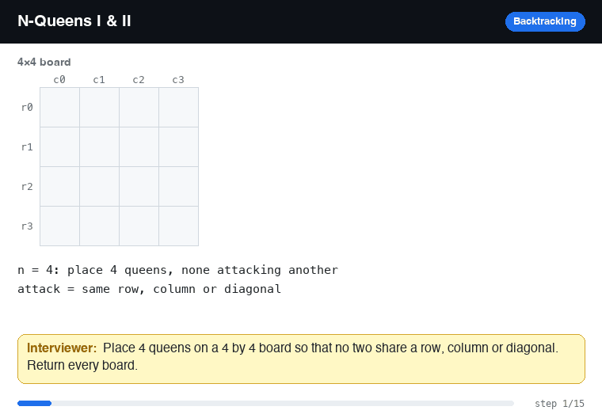

# Walkthrough: N-Queens I & II

**Module:** [14 · Backtracking](../README.md) · **Difficulty:** Hard · **Solution:** [`p07_n_queens.go`](../p07_n_queens.go)



## The problem in plain words

Place `n` chess queens on an `n × n` board so that no two attack each other: no shared row, column or diagonal. Part I returns every such board, drawn with `Q` and `.`. Part II only counts them.

```
n = 4 (two solutions):
. Q . .     . . Q .
. . . Q     Q . . .
Q . . .     . . . Q
. . Q .     . Q . .
```

## Mock interview

**Interviewer:** Return every way to place `n` non-attacking queens on an `n × n` board, each board as a slice of row strings.

**Candidate:** What range of `n`? And for `n = 2` or `3`, should I return an empty list?

**Interviewer:** `n` is between 1 and 9. Yes, no solutions means an empty list.

**Candidate:** For `n = 4` there are two solutions, mirror images of each other. For `n = 1` the single square is a solution.

**Candidate:** A brute force picks any n of the n² squares and checks each set. For `n = 4` that's 1820 sets, and it grows very fast. Most of them fail because two queens share a row.

**Interviewer:** How would you cut that down?

**Candidate:** Two queens can never share a row, so I place exactly one queen per row and only choose its column. To check a square in O(1), I keep three sets: used columns, used `r - c` diagonals and used `r + c` anti-diagonals. Every square on a "\\" diagonal has the same `r - c`, and every square on a "/" diagonal has the same `r + c`. A square is safe if its column, `r - c` and `r + c` are all free.

**Interviewer:** Walk me through the search.

**Candidate:** `place(r)` tries each column `c` in row `r`. If the square is attacked, skip it. Otherwise record `queenCol[r] = c`, mark the three sets, recurse to `place(r + 1)`, then clear the three marks. When `r == n`, every row has a queen, so I render the board and record it.

**Candidate:** In code, `SolveNQueens` uses `[]bool` slices: `cols` of size n, and `diag` and `anti` of size 2n, with `r - c + n` shifted to be non-negative. `render` builds the strings from `queenCol`.

**Candidate:** Testing with `n = 4`: queen at (0,0). Row 1: columns 0 and 1 are attacked, so put it at column 2. Row 2 is fully attacked, a dead end. Back in row 1, try column 3. Row 2: column 0 is attacked, column 1 is free. Row 3 is fully attacked. Every option under (0,0) fails, so row 0 moves to column 1. Then row 1 takes column 3, row 2 column 0, and row 3 column 2. That's the first solution. The search goes on and finds its mirror image.

**Interviewer:** How would you only count the solutions?

**Candidate:** `TotalNQueens` packs the three sets into bitmasks. The free squares in the next row are `full &^ (cols | d1 | d2)`. I take the lowest free bit with `free & -free`. Moving down a row, the diagonal masks shift by one: `d1` left and `d2` right. No board is built, so it's much faster.

**Interviewer:** Complexity?

**Candidate:** Row `r` has at most `n - r` safe columns, so the search is bounded by **O(n!) time**. The sets and recursion use **O(n) space**, besides the output.

## What the animation shows

| Step | Event |
|---|---|
| 1 | Interviewer states the problem |
| 2 | Brute force: 1820 sets of 4 squares |
| 3 | Row 0: queen at column 0 |
| 4 | Row 1: columns 0, 1 attacked; queen at column 2 |
| 5 | Row 2: every column attacked, dead end |
| 6 | Row 1: column 2 failed; queen at column 3 |
| 7 | Row 2: column 0 attacked; queen at column 1 |
| 8 | Row 3: every column attacked, dead end |
| 9 | Back to row 0: queen at column 1 |
| 10 | Row 1: columns 0, 1, 2 attacked; queen at column 3 |
| 11 | Row 2: queen at column 0 |
| 12 | Row 3: columns 0, 1 attacked; queen at column 2 |
| 13 | `r == n`: record `.Q.. / ...Q / Q... / ..Q.` |
| 14 | Same search continues (8 more placements, 2 dead ends): mirror solution |
| 15 | Two boards, O(n!) |

## Detailed explanation

Placing one queen per row removes row conflicts by construction, which shrinks the search from "any n squares" to "one column per row". The three sets then make the remaining checks O(1).

The invariant is: *rows `0..r-1` hold queens that don't attack each other, and the sets contain exactly their columns and diagonals.* Placing a queen only when all three are free keeps the queens non-attacking. Clearing the three entries after the recursive call restores the sets for the next column. When `r == n`, all n queens are placed with no conflicts, so the board is a solution. Every solution has one queen per row, so the search reaches each one exactly once.

The bitmask version uses the same idea with integers. `cols | d1 | d2` marks every attacked square in the current row. As you go down a row, a "\\" attack moves one column right and a "/" attack moves one column left. That's what the shifts do. When `cols == full`, every column has a queen.

Edge cases:

- **n = 1:** one solution, `["Q"]`.
- **n = 2 and n = 3:** no solutions. The search tries everything and returns an empty result.

## Complexity

| Approach | Time | Space (besides output) |
|---|---|---|
| Sets per row (`SolveNQueens`) | O(n!) | O(n) |
| Bitmask counting (`TotalNQueens`) | O(n!) | O(n) recursion |

## Common mistakes

- Using `r - c` directly as a slice index. It can be negative, so shift it by `n`.
- Forgetting to clear the diagonal marks when unchoosing.
- Checking only columns and forgetting one of the two diagonal directions.
- Rendering the board at the end from a shared slice without copying it.

## Try it yourself

```sh
go test ./course/14-backtracking/ -run TestSolveNQueens -v
```
