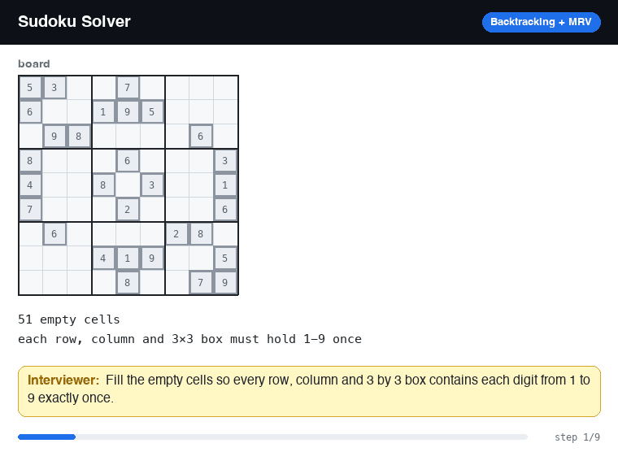

# Walkthrough: Sudoku Solver

**Module:** [14 · Backtracking](../README.md) · **Difficulty:** Hard · **Solution:** [`p08_sudoku_solver.go`](../p08_sudoku_solver.go)



## The problem in plain words

Fill in a 9×9 Sudoku. Empty cells hold `.`. When you're done, every row, every column and every 3×3 box must contain each digit from 1 to 9 exactly once. Return whether you found a solution, and leave the board unchanged if you didn't.

```
5 3 . | . 7 . | . . .        5 3 4 | 6 7 8 | 9 1 2
6 . . | 1 9 5 | . . .   →    6 7 2 | 1 9 5 | 3 4 8
. 9 8 | . . . | . 6 .        1 9 8 | 3 4 2 | 5 6 7
...                          ...
```

## Mock interview

**Interviewer:** Solve a Sudoku in place. Return true if you solved it.

**Candidate:** Can the given clues already conflict? Can there be several solutions?

**Interviewer:** Return false if the clues conflict. If there are several solutions, any one is fine.

**Candidate:** The classic puzzle has 51 empty cells. Its first row becomes `5 3 4 6 7 8 9 1 2`.

**Candidate:** The brute force tries every digit in every empty cell and checks the board at the end. That's up to 9⁵¹ boards. Even checking constraints as I go is slow if I fill cells in reading order, because I may make a bad choice early and only find out much later.

**Interviewer:** How do you make it fast?

**Candidate:** Two ideas. First, keep a 9-bit mask of used digits for every row, column and box. The candidates for a cell are the bits missing from `rows[r] | cols[c] | boxes[b]`. That's O(1), and `bits.OnesCount16` gives the count.

Second, choose *which* cell to fill next: always the empty cell with the fewest candidates. This is called minimum remaining values, or MRV. A cell with one candidate is forced, so there's no branching. A cell with zero candidates proves the current branch is dead, and I return false right away.

**Interviewer:** What does the backtracking look like?

**Candidate:** `solve(remaining)` scans the first `remaining` entries of the empty-cell list for the MRV cell. It swaps that cell to position `remaining - 1`, so the unfilled cells stay at the front. For each candidate bit, lowest first, I set the three masks and the board cell, then recurse with `remaining - 1`. If that fails, I clear the masks and put `.` back.

**Candidate:** In code, `SolveSudoku` first reads the clues into the masks and returns false on a conflict. Then it calls `solve(len(empty))`. It picks bits with `free & -free` and turns a bit into a digit with `bits.TrailingZeros16`.

**Candidate:** Testing on the classic puzzle: the first MRV cell is (4,4), whose only candidate is 5. Placing 5 updates three masks. Then (4,1) is forced to 2, (4,7) to 9, (4,2) to 6, and so on. On this puzzle every step has a cell with exactly one candidate, so the solver makes 51 placements with no guesses and no undos.

**Interviewer:** What if the puzzle is harder?

**Candidate:** Then some step has no forced cell, and MRV picks a cell with two or three candidates. If a guess leads to a cell with zero candidates, that branch fails immediately and I undo. The tests include a hard puzzle with few clues, and MRV still solves it quickly.

**Interviewer:** Complexity?

**Candidate:** In the worst case it's **exponential in the number of empty cells**. In practice, with MRV, real puzzles take milliseconds. Space is **O(81)** for the masks, the empty-cell list and the recursion.

## What the animation shows

| Step | Event |
|---|---|
| 1 | Interviewer states the problem: 51 empty cells |
| 2 | Brute force: up to 9⁵¹ boards |
| 3 | Masks per row, column, box; MRV picks (4,4) with one candidate |
| 4 | Place 5 at (4,4), forced |
| 5 | Place 2 at (4,1), forced |
| 6 | Place 9 at (4,7), forced |
| 7 | Place 6 at (4,2), forced |
| 8 | Same again: halfway, 0 guesses, 0 undos in the whole search |
| 9 | Solved: 51 placements, 0 undos |

The classic puzzle never needs a guess with MRV, so the animation shows forced moves only. The undo step (clear three masks, reset the cell to `.`) runs only on harder puzzles.

## Detailed explanation

The masks hold this invariant: *bit `d` of `rows[r]` is set exactly when digit `d + 1` appears in row `r`*, and the same for columns and boxes. Setting the three bits when placing a digit and clearing them when undoing keeps it true. So the candidate mask of any cell is always correct, and checking it is O(1).

MRV is what keeps the search small. Filling a forced cell can't be a mistake, because it is the only digit that doesn't break a rule. Picking the most constrained cell also finds dead ends as early as possible. If any empty cell has zero candidates, no choice elsewhere can fix that, so the whole branch is dropped. Filling cells in reading order would instead guess at loosely constrained cells and discover conflicts many levels later.

Swapping the chosen cell to the end of the active part of `empty` means no list is rebuilt. `solve(remaining - 1)` simply looks at a shorter prefix. On backtrack the order of the list changes, but that doesn't matter: the prefix still holds exactly the unfilled cells.

If the search fails, every placement has been undone, so the board is back to its starting state, as the problem asks.

Edge cases:

- **Conflicting clues:** detected while reading the board, and the function returns false.
- **Empty grid:** MRV fills it with a valid solution.

## Complexity

| Approach | Time | Space |
|---|---|---|
| Bitmask backtracking with MRV (`SolveSudoku`) | exponential worst case; milliseconds on real puzzles | O(81) |

## Common mistakes

- Computing the box index wrong. It's `(r/3)*3 + c/3`.
- Forgetting to clear all three masks when undoing a digit.
- Not checking the clues for conflicts before searching.
- Filling cells in reading order, which is correct but can be very slow on hard puzzles.
- Leaving partial digits on the board when the search fails.

## Try it yourself

```sh
go test ./course/14-backtracking/ -run TestSolveSudoku -v
```
