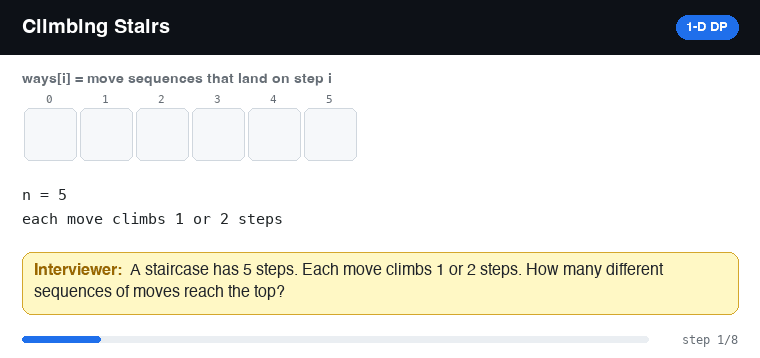

# Walkthrough: Climbing Stairs

**Module:** [15 · Dynamic programming (1-D)](../README.md) · **Difficulty:** Easy · **Solution:** [`p01_climbing_stairs.go`](../p01_climbing_stairs.go)



## The problem in plain words

A staircase has `n` steps. Each move climbs 1 step or 2 steps. Count the different sequences of moves that reach the top.

```
n = 5  →  8
```

## Mock interview

**Interviewer:** A staircase has `n` steps. Each move climbs 1 or 2 steps. In how many distinct sequences of moves can you reach the top?

**Candidate:** Is order important? Is 1+2 different from 2+1? And what should `n = 0` return?

**Interviewer:** Yes, order matters. For `n = 0` or `n = 1`, return 1.

**Candidate:** Small cases first. `n = 2` gives 2 (1+1, 2). `n = 3` gives 3 (1+1+1, 1+2, 2+1). The example `n = 5` should give 8.

**Candidate:** The brute force recurses on the last move: `ways(n) = ways(n-1) + ways(n-2)`. It's correct, but it calls `ways(3)` from both `ways(5)` and `ways(4)`, and so on down. The tree doubles each level, so it's O(2^n).

**Interviewer:** How do you avoid that?

**Candidate:** Save each answer. Here are the four DP pieces:

- **State:** `ways[i]` is the number of move sequences that land exactly on step `i`.
- **Transition:** `ways[i] = ways[i-1] + ways[i-2]`. Every sequence ends with a 1-step from `i-1` or a 2-step from `i-2`. Those two groups don't overlap and cover everything.
- **Base case:** `ways[0] = 1` (the empty sequence) and `ways[1] = 1`.
- **Order:** `i` increasing, because each cell reads the two cells before it.

**Interviewer:** Why is `ways[0]` 1 and not 0?

**Candidate:** Standing at the bottom without moving is one valid sequence: the empty one. With 0, `ways[2]` would come out as 1 instead of 2.

**Candidate:** In code I write a loop from 2 to `n`. Since each cell reads only the last two, I keep two variables, `twoBack` and `oneBack`, and update them with a tuple assignment.

**Candidate:** Testing `n = 5`: ways = 1, 1, 2, 3, 5, 8. The answer is 8.

**Interviewer:** Complexity?

**Candidate:** One pass, constant work per step: **O(n) time and O(1) space**.

**Interviewer:** What if you could also take 3 steps?

**Candidate:** Add a third term: `ways[i-1] + ways[i-2] + ways[i-3]`, and keep three variables.

## What the animation shows

| Step | What happens | `ways` |
|---|---|---|
| 1 | Interviewer states the problem, `n = 5` | empty |
| 2 | Brute-force recursion repeats work: O(2^n) | empty |
| 3 | Base cases `ways[0] = ways[1] = 1` | 1 1 |
| 4 | `ways[2] = 1 + 1 = 2` | 1 1 2 |
| 5 | `ways[3] = 2 + 1 = 3` | 1 1 2 3 |
| 6 | `ways[4] = 3 + 2 = 5` | 1 1 2 3 5 |
| 7 | `ways[5] = 5 + 3 = 8` | 1 1 2 3 5 8 |
| 8 | Answer 8, O(n) time, O(1) space | |

## Detailed explanation

Split the sequences that reach step `i` by their **last move**. If the last move was a 1-step, what came before is any sequence that reaches `i-1`. If it was a 2-step, what came before reaches `i-2`. No sequence is in both groups, because its last move is one or the other. So the count is the sum of the two group sizes.

That's the Fibonacci recurrence, shifted by one. The brute force is slow only because it recomputes the same `ways(k)` many times. Filling the values left to right computes each one once.

`ClimbStairsTab` keeps the whole table. `ClimbStairs` notices that each cell reads just the last two, so it rolls them into `twoBack, oneBack`. Go's tuple assignment reads both old values before writing, so there's no ordering bug.

Edge cases: `n = 0` and `n = 1` return 1 straight away, because the loop doesn't run.

## Complexity

| Approach | Time | Space |
|---|---|---|
| Brute force (`ClimbStairsRecursive`) | O(2^n) | O(n) stack |
| Memoized (`ClimbStairsMemo`) | O(n) | O(n) |
| Table (`ClimbStairsTab`) | O(n) | O(n) |
| Two variables (`ClimbStairs`) | O(n) | O(1) |

## Common mistakes

- Setting `ways[0] = 0`, which makes every later value wrong.
- Allocating `dp` of size `n+1` when `n = 0`, then writing `dp[1]`. `ClimbStairsTab` uses `max(n+1, 2)` for this reason.
- Updating the two variables in two separate lines in the wrong order, which loses the old value.

## Try it yourself

```sh
go test ./course/15-dp-1d/ -run TestClimbStairs -v
```
