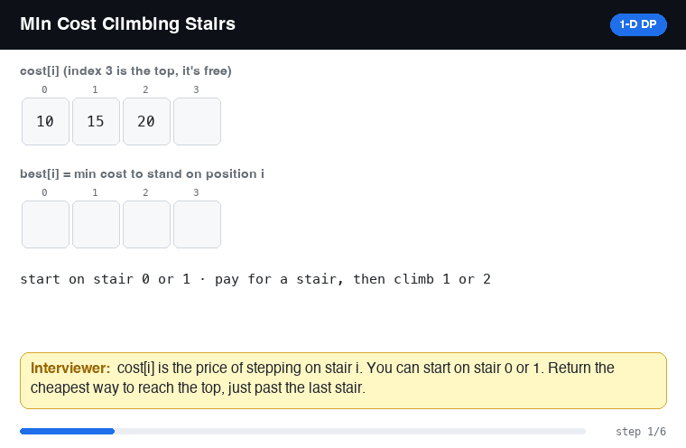

# Walkthrough: Min Cost Climbing Stairs

**Module:** [15 · Dynamic programming (1-D)](../README.md) · **Difficulty:** Easy · **Solution:** [`p02_min_cost_climbing_stairs.go`](../p02_min_cost_climbing_stairs.go)



## The problem in plain words

Each stair has a price. You pay for a stair when you step on it, then climb 1 or 2 stairs. You may start on stair 0 or stair 1 for free. Find the cheapest way to get past the last stair.

```
cost = [10, 15, 20]  →  15   (start on stair 1, pay 15, jump 2 to the top)
```

## Mock interview

**Interviewer:** `cost[i]` is the price of stepping on stair `i`. You may start on stair 0 or 1. After paying, you climb 1 or 2 stairs. The top is just past the last stair. Return the cheapest way to reach it.

**Candidate:** So the top is index `n`, and it costs nothing to stand there? And costs are non-negative?

**Interviewer:** Yes to both.

**Candidate:** With `[10, 15, 20]`: starting on stair 1 and jumping 2 costs 15. Starting on stair 0 costs at least 10 + 20 = 30 or 10 + 15 = 25. So the answer is 15.

**Candidate:** The brute force tries every sequence of moves. That's exponential, and it asks "cheapest way to stand on stair i" many times over.

**Interviewer:** So what do you store?

**Candidate:**

- **State:** `best[i]` is the cheapest cost to stand on position `i`, before paying for it.
- **Transition:** I arrived from `i-1` or from `i-2`, and I paid for the stair I left: `best[i] = min(best[i-1] + cost[i-1], best[i-2] + cost[i-2])`.
- **Base case:** `best[0] = best[1] = 0`, the free starting points.
- **Order:** `i` increasing. The answer is `best[n]`.

**Interviewer:** Why charge for the stair you leave instead of the one you land on?

**Candidate:** Then the top, which has no price, needs no special case. Every move pays for exactly one stair, the one it starts from.

**Candidate:** In code it's a loop from 2 to `n`. Each step reads only the last two values, so I keep `twoBack` and `oneBack`.

**Candidate:** Testing: `best[2] = min(0 + 15, 0 + 10) = 10`. `best[3] = min(10 + 20, 0 + 15) = 15`. Answer 15.

**Interviewer:** Complexity?

**Candidate:** **O(n) time, O(1) space.**

## What the animation shows

| Step | What happens | `best` |
|---|---|---|
| 1 | Interviewer states the problem, `cost = [10, 15, 20]` | empty |
| 2 | Brute force is exponential | empty |
| 3 | Base cases `best[0] = best[1] = 0` | 0 0 |
| 4 | `best[2] = min(0 + 15, 0 + 10) = 10` | 0 0 10 |
| 5 | `best[3] = min(10 + 20, 0 + 15) = 15` | 0 0 10 15 |
| 6 | Answer 15, O(n) time, O(1) space | |

## Detailed explanation

To stand on position `i`, the last move started on `i-1` or `i-2`. Whichever it was, I paid for that stair, and before that I took the cheapest way to stand there. So the cheapest way to `i` is the smaller of the two options. That's all the recurrence says.

The free start is the base case: you can stand on stair 0 or stair 1 without paying anything, so both are 0.

The answer is `best[n]`, not `best[n-1]`. The top is past the last stair. You can reach it from stair `n-1` (paying `cost[n-1]`) or from stair `n-2` (paying `cost[n-2]`).

`MinCostClimbingStairsMemo` uses a separate `done` slice instead of a sentinel, because 0 is a real cached value. `MinCostClimbingStairs` rolls the table into two variables.

## Complexity

| Approach | Time | Space |
|---|---|---|
| Brute force (`MinCostClimbingStairsRecursive`) | O(2^n) | O(n) stack |
| Memoized (`MinCostClimbingStairsMemo`) | O(n) | O(n) |
| Table (`MinCostClimbingStairsTab`) | O(n) | O(n) |
| Two variables (`MinCostClimbingStairs`) | O(n) | O(1) |

## Common mistakes

- Returning `best[n-1]` instead of `best[n]`.
- Paying for the stair you land on and then adding a special case for the top.
- Using 0 as "not computed" in the memo, when 0 is a real answer.

## Try it yourself

```sh
go test ./course/15-dp-1d/ -run TestMinCostClimbingStairs -v
```
