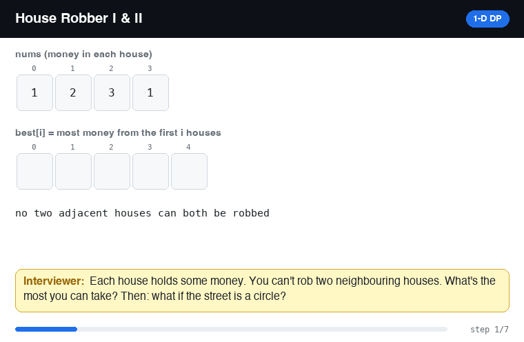

# Walkthrough: House Robber I & II

**Module:** [15 · Dynamic programming (1-D)](../README.md) · **Difficulty:** Medium · **Solution:** [`p03_house_robber.go`](../p03_house_robber.go)



## The problem in plain words

Houses in a row hold some money. You can rob any houses, but never two next to each other. Find the most money you can take. In part II the houses stand in a circle, so the first and last are neighbours too.

```
I:  [1, 2, 3, 1]  →  4   (houses 0 and 2)
II: [1, 2, 3, 1]  →  4
```

## Mock interview

**Interviewer:** Houses along a street hold non-negative amounts of money. You can't rob two adjacent houses. Return the most money you can take. Then solve it for a circular street.

**Candidate:** Can the list be empty? And can amounts be zero?

**Interviewer:** Empty returns 0. Zeros are allowed, negatives aren't.

**Candidate:** For `[1, 2, 3, 1]`, robbing houses 0 and 2 gives 4. Robbing 1 and 3 gives only 3. So the answer is 4.

**Candidate:** The brute force tries every set of houses with no two side by side. That's up to 2^n sets.

**Interviewer:** Can you do better?

**Candidate:** For each house, I either skip it or rob it. That gives a take-or-skip DP:

- **State:** `best[i]` is the most money from the first `i` houses.
- **Transition:** skip house `i-1` and keep `best[i-1]`, or rob it and add `nums[i-1]` to `best[i-2]`. So `best[i] = max(best[i-1], best[i-2] + nums[i-1])`.
- **Base case:** `best[0] = 0`, `best[1] = nums[0]`.
- **Order:** `i` increasing.

**Interviewer:** Why `best[i-2]` when you rob?

**Candidate:** Robbing house `i-1` means house `i-2` must be skipped. `best[i-2]` only uses houses up to `i-3`, so it's always safe to add to.

**Candidate:** In code, I keep two variables, `skip` and `take`, for `best[i-2]` and `best[i-1]`. For each `x`: `skip, take = take, max(take, skip + x)`.

**Candidate:** Testing `[1, 2, 3, 1]`: best = 0, 1, 2, 4, 4. Answer 4.

**Interviewer:** Now the street is a circle.

**Candidate:** Houses 0 and `n-1` can't both be robbed. So at least one of them is skipped. I solve two line problems, houses 0..n-2 and houses 1..n-1, and take the better one. For the example: `max(Rob([1,2,3]), Rob([2,3,1])) = max(4, 3) = 4`. A single house is a special case: just rob it.

**Interviewer:** Complexity?

**Candidate:** **O(n) time and O(1) space** for both parts. Part II runs the line version twice.

## What the animation shows

| Step | What happens | `best` |
|---|---|---|
| 1 | Interviewer states the problem, `nums = [1, 2, 3, 1]` | empty |
| 2 | Brute force: 2^n subsets | empty |
| 3 | Base cases `best[0] = 0`, `best[1] = 1` | 0 1 |
| 4 | House 1: `max(1, 0 + 2) = 2`, rob it | 0 1 2 |
| 5 | House 2: `max(2, 1 + 3) = 4`, rob it | 0 1 2 4 |
| 6 | House 3: `max(4, 2 + 1) = 4`, skip it | 0 1 2 4 4 |
| 7 | Answer 4; circle: `max(4, 3) = 4` | |

## Detailed explanation

Look at the last house. In the best plan, it's either robbed or not. If it isn't, the plan is the best plan for the other `i-1` houses. If it is, the house before it is skipped, and the rest is the best plan for the first `i-2` houses. Taking the max of those two covers every case, so the recurrence is correct.

For the circle, the only new rule is that houses 0 and `n-1` touch. Any valid plan leaves out at least one of them. If it leaves out house `n-1`, it's a valid plan for the line `0..n-2`. If it leaves out house 0, it's valid for `1..n-1`. So the best circle plan is the better of the two line answers. `RobCircular` handles `n = 1` first, because both slices would be empty.

## Complexity

| Approach | Time | Space |
|---|---|---|
| Brute force (`RobRecursive`) | O(2^n) | O(n) stack |
| Memoized (`RobMemo`) | O(n) | O(n) |
| Table (`RobTab`) | O(n) | O(n) |
| Two variables (`Rob`) | O(n) | O(1) |
| Circle (`RobCircular`) | O(n) | O(1) |
| Circle brute force (`RobCircularBrute`) | O(2^n · n) | O(1) |

## Common mistakes

- Thinking "rob every other house" is enough. `[2, 1, 1, 2]` needs houses 0 and 3.
- In part II, running one pass and hoping the ends don't clash.
- Forgetting the single-house circle, where both slices are empty and the answer would come out as 0.

## Try it yourself

```sh
go test ./course/15-dp-1d/ -run TestRob -v
```
