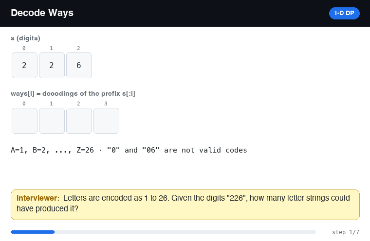

# Walkthrough: Decode Ways

**Module:** [15 · Dynamic programming (1-D)](../README.md) · **Difficulty:** Medium · **Solution:** [`p04_decode_ways.go`](../p04_decode_ways.go)



## The problem in plain words

Letters were turned into numbers: A=1, B=2, ..., Z=26. You get the digits with no spaces. Count how many letter strings could have made them. A piece that starts with 0 is not a letter.

```
"226"  →  3   ("BBF", "BZ", "VF")
```

The animation uses `"226"` rather than the shorter `"12"`, because it is the example the doc comment traces and it shows both checks at work.

## Mock interview

**Interviewer:** A=1 through Z=26. Given a string of digits, count the letter strings that could have produced it. "0" alone and pieces like "06" aren't valid.

**Candidate:** Can the string be empty, and is it digits only?

**Interviewer:** Digits only. Assume it's non-empty.

**Candidate:** `"12"` gives 2: AB or L. `"226"` gives 3: BBF, BZ, VF. `"06"` gives 0, because nothing can start with 0.

**Candidate:** The brute force cuts off one or two digits at a time and recurses. That's exponential, and it counts the same prefixes again and again.

**Interviewer:** How would you speed it up?

**Candidate:** It's Climbing Stairs with checks. The last letter uses either the last digit or the last two digits.

- **State:** `ways[i]` is the number of decodings of the prefix `s[:i]`.
- **Transition:** if `s[i-1]` is 1–9, add `ways[i-1]`. If `s[i-2:i]` is 10–26, add `ways[i-2]`.
- **Base case:** `ways[0] = 1`. The empty prefix decodes one way: nothing.
- **Order:** `i` increasing.

**Interviewer:** Why not check "less than or equal to 26" and leave it there?

**Candidate:** Because "05" is 5 as a number but not a valid code. `twoDigits` rejects a leading 0 first, then checks the value is at most 26.

**Candidate:** In code, two helpers, `oneDigit` and `twoDigits`, and a loop that keeps `twoBack` and `oneBack`.

**Candidate:** Testing `"226"`: `ways[1] = 1`. `ways[2] = 1 + 1 = 2`, since "2" and "22" are both valid. `ways[3] = 2 + 1 = 3`, since "6" and "26" are both valid. Answer 3.

**Interviewer:** Complexity?

**Candidate:** **O(n) time, O(1) space.**

## What the animation shows

| Step | What happens | `ways` |
|---|---|---|
| 1 | Interviewer states the problem, `s = "226"` | empty |
| 2 | Brute force: exponential branching | empty |
| 3 | Base case `ways[0] = 1` | 1 |
| 4 | `"2"`: one digit valid → `ways[1] = 1` | 1 1 |
| 5 | `"22"`: "2" valid, "22" valid → `1 + 1 = 2` | 1 1 2 |
| 6 | `"226"`: "6" valid, "26" valid → `2 + 1 = 3` | 1 1 2 3 |
| 7 | Answer 3, O(n) time, O(1) space | |

## Detailed explanation

Every decoding of `s[:i]` ends with one letter. That letter covers either the last digit alone or the last two digits. The two cases don't overlap, so I add their counts. If a case isn't a valid letter, it adds nothing.

Zeros are where this problem bites. A `0` can never stand alone, so when `s[i-1] == '0'` the one-digit term is skipped. It can only appear as the second digit of 10 or 20. If neither check passes, `ways[i]` is 0, and every later value built on it is 0 too. That's how `"06"` and `"30"` come out as 0.

`ways[0] = 1` makes the two-digit case work at `i = 2`: "22" as a single letter adds exactly one decoding.

## Complexity

| Approach | Time | Space |
|---|---|---|
| Brute force (`NumDecodingsRecursive`) | O(2^n) | O(n) stack |
| Memoized (`NumDecodingsMemo`) | O(n) | O(n) |
| Table (`NumDecodingsTab`) | O(n) | O(n) |
| Two variables (`NumDecodings`) | O(n) | O(1) |

## Common mistakes

- Treating "06" as valid because 6 ≤ 26.
- Forgetting that "0" alone is not a letter.
- Starting `ways[0]` at 0, which makes every count 0.

## Try it yourself

```sh
go test ./course/15-dp-1d/ -run TestNumDecodings -v
```
