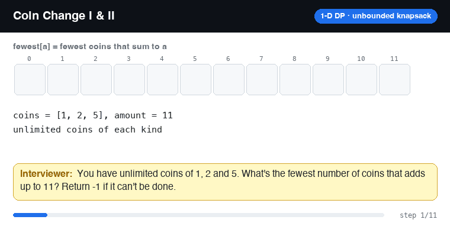

# Walkthrough: Coin Change I & II

**Module:** [15 · Dynamic programming (1-D)](../README.md) · **Difficulty:** Medium · **Solution:** [`p05_coin_change.go`](../p05_coin_change.go)



## The problem in plain words

You have as many coins of each kind as you like. Part I: find the fewest coins that add up to an amount, or -1 if you can't. Part II: count the different combinations that add up to the amount (order doesn't matter).

```
I:  coins [1, 2, 5], amount 11  →  3   (5 + 5 + 1)
II: coins [1, 2, 5], amount 5   →  4
```

The animation shows part I. Part II is covered in the interview below.

## Mock interview

**Interviewer:** You have unlimited coins of each denomination. Return the fewest coins that sum to `amount`, or -1 if it can't be done.

**Candidate:** Are coin values positive? And what does amount 0 return?

**Interviewer:** Positive. Amount 0 needs 0 coins.

**Candidate:** For `[1, 2, 5]` and 11, the answer is 3: 5 + 5 + 1. For `[2]` and 3, it's -1.

**Interviewer:** Why not just take the biggest coin each time?

**Candidate:** Greedy fails for some coin sets. With `[1, 3, 4]` and 6, greedy takes 4 + 1 + 1, but 3 + 3 is better. So I need to try every coin as the last one. The plain recursion does that, but it's exponential: `fewest(6)` is reached from many paths.

**Candidate:** So I tabulate over amounts:

- **State:** `fewest[a]` is the fewest coins summing to `a`.
- **Transition:** `fewest[a] = 1 + min(fewest[a-c])` over coins `c ≤ a`.
- **Base case:** `fewest[0] = 0`. Everything else starts at a huge "unreachable" value.
- **Order:** `a` increasing, since each cell reads smaller amounts.

**Candidate:** In Go, I use `1 << 62` as unreachable, so adding 1 can't overflow. At the end, if `dp[amount]` is still that large, I return -1.

**Candidate:** Testing: fewest = 0, 1, 1, 2, 2, 1, 2, 2, 3, 3, 2, 3. For 11, the candidates are `fewest[10] + 1 = 3`, `fewest[9] + 1 = 4`, `fewest[6] + 1 = 3`. Answer 3.

**Interviewer:** Complexity?

**Candidate:** `amount` cells, one check per coin each: **O(len(coins) · amount) time, O(amount) space**.

**Interviewer:** Part II: count combinations instead.

**Candidate:** `ways[0] = 1`, then for each coin `c` in the **outer** loop, for `a` from `c` upward, `ways[a] += ways[a-c]`. Coins outside means each combination is built in coin order, so 1+2 and 2+1 count once. If I swap the loops, I count ordered sequences instead. That's `CountOrderings`, a different problem.

## What the animation shows

| Step | What happens | `fewest` |
|---|---|---|
| 1 | Interviewer states the problem | empty |
| 2 | Plain recursion repeats subproblems | empty |
| 3 | Base case `fewest[0] = 0` | 0 |
| 4 | `a = 1`: `fewest[0] + 1 = 1` | 0 1 |
| 5 | `a = 2`: `min(1+1, 0+1) = 1` | 0 1 1 |
| 6 | `a = 3`: `min(1+1, 1+1) = 2` | 0 1 1 2 |
| 7 | `a = 4`: `min(2+1, 1+1) = 2` | 0 1 1 2 2 |
| 8 | `a = 5`: the 5-coin fits, `0 + 1 = 1` | 0 1 1 2 2 1 |
| 9 | Same rule for 6–10 | … 2 2 3 3 2 |
| 10 | `a = 11`: `min(2+1, 3+1, 2+1) = 3` | … 3 |
| 11 | Answer 3, O(coins · amount) time | |

## Detailed explanation

Any way of making `a` has a last coin `c`. Remove it, and what's left is a way of making `a - c`. So the best way to make `a` is 1 plus the best way to make `a - c`, for whichever `c` gives the smallest result. Trying every coin covers every possible last coin.

Coins can be reused because `fewest[a-c]` may itself include coin `c`. That's the **unbounded** knapsack. Filling amounts upward makes it work.

If no coin fits, or every `a - c` is unreachable, `fewest[a]` stays at the sentinel. It's important that the sentinel is large but safe: `math.MaxInt + 1` would wrap to a negative number and look like the best answer.

For part II, the loop order decides what you count. With coins outside, every combination is built with coins in a fixed order, so each multiset is counted once.

## Complexity

| Approach | Time | Space |
|---|---|---|
| Brute force (`CoinChangeRecursive`) | exponential | O(amount) stack |
| Memoized (`CoinChangeMemo`) | O(coins · amount) | O(amount) |
| Table (`CoinChange`) | O(coins · amount) | O(amount) |
| Part II brute force (`ChangeRecursive`) | exponential | O(amount) stack |
| Part II memo / 2-D table (`ChangeMemo`, `ChangeTab`) | O(coins · amount) | O(coins · amount) |
| Part II 1-D (`Change`) | O(coins · amount) | O(amount) |

## Common mistakes

- Using greedy (largest coin first).
- Using `math.MaxInt` as infinity and overflowing on `+1`.
- In the memo, using -1 for both "not computed" and "impossible". `CoinChangeMemo` uses -2 for "not computed".
- In part II, putting amounts in the outer loop and counting orderings.

## Try it yourself

```sh
go test ./course/15-dp-1d/ -run TestCoinChange -v
```
