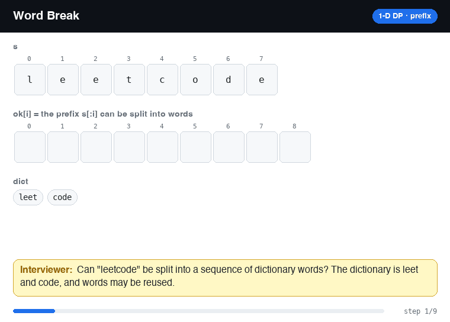

# Walkthrough: Word Break

**Module:** [15 · Dynamic programming (1-D)](../README.md) · **Difficulty:** Medium · **Solution:** [`p06_word_break.go`](../p06_word_break.go)



## The problem in plain words

You get a string and a list of words. Can you cut the string into pieces so that every piece is a word from the list? Words can be used more than once.

```
"leetcode", [leet code]  →  true   ("leet" + "code")
```

## Mock interview

**Interviewer:** Given a string and a dictionary, decide whether the string can be split into a sequence of one or more dictionary words. Words may be reused.

**Candidate:** Is the empty string a valid input? And is the dictionary case-sensitive?

**Interviewer:** Case-sensitive. Assume the string is non-empty.

**Candidate:** `"leetcode"` with `[leet, code]` is true. `"catsandog"` with `[cats, dog, sand, and, cat]` is false: every split leaves "og" or similar.

**Candidate:** The brute force tries each word as the next piece and recurses on the rest. With overlapping words like "a", "aa", "aaa", the same suffix gets checked an exponential number of times.

**Interviewer:** How do you fix that?

**Candidate:** A prefix DP. The last word of a valid split ends the string, and what comes before it must split too.

- **State:** `ok[i]` is true if the prefix `s[:i]` can be split.
- **Transition:** `ok[i]` is true if some `j < i` has `ok[j]` true and `s[j:i]` in the dictionary.
- **Base case:** `ok[0] = true`, the empty prefix.
- **Order:** `i` increasing. The answer is `ok[n]`.

**Interviewer:** Do you have to try every `j`?

**Candidate:** No. A piece can't be longer than the longest word, `L`. So I only look back `L` letters. I also stop as soon as one `j` works.

**Candidate:** In code: put the words in a map, find `maxLen`, then two loops: `i` from 1 to `n`, `j` from `i-1` down while `i-j <= maxLen`.

**Candidate:** Testing `"leetcode"`: `ok[1..3]` are false. At `i = 4`, `ok[0]` is true and "leet" is a word, so `ok[4]` is true. `ok[5..7]` are false. At `i = 8`, `ok[4]` is true and "code" is a word. Answer true.

**Interviewer:** Complexity?

**Candidate:** `n` positions, at most `L` lookbacks each, and each substring check hashes up to `L` letters. So **O(n · L) checks**, O(n · L²) character work in the worst case, and **O(n) extra space** for `ok`, plus the dictionary set.

## What the animation shows

| Step | What happens | `ok` |
|---|---|---|
| 1 | Interviewer states the problem | empty |
| 2 | Brute force re-checks suffixes | empty |
| 3 | Base case `ok[0] = T`, look back at most 4 | T |
| 4 | `i = 1`: "l" is not a word | T F |
| 5 | `i = 2, 3`: no word ends there | T F F F |
| 6 | `i = 4`: `ok[0]` and "leet" → T | T F F F T |
| 7 | `i = 5..7`: no word ends there | … F F F |
| 8 | `i = 8`: `ok[4]` and "code" → T | … T |
| 9 | Answer true, O(n · L) checks | |

## Detailed explanation

Any valid split of `s[:i]` has a last word `s[j:i]`. Remove it, and `s[:j]` must be a valid split too, which is `ok[j]`. So `ok[i]` is true exactly when some `j` has `ok[j]` true and `s[j:i]` in the dictionary. Since every `ok[j]` with `j < i` is already filled, the order works.

`ok[0] = true` lets the first word stand on its own. Without it, nothing would ever become true.

The `maxLen` bound is safe: a piece longer than every word can't be in the dictionary, so checking it is wasted work.

## Complexity

| Approach | Time | Space |
|---|---|---|
| Brute force (`WordBreakRecursive`) | exponential | O(n) stack |
| Memoized (`WordBreakMemo`) | O(n · dict · L) | O(n) |
| Table (`WordBreak`) | O(n · L) checks | O(n + dict) |

## Common mistakes

- Forgetting `ok[0] = true`.
- Using `s[j:i+1]` and mixing up prefix length with index.
- Not breaking out of the inner loop once `ok[i]` is true, which is correct but slower.

## Try it yourself

```sh
go test ./course/15-dp-1d/ -run TestWordBreak -v
```
