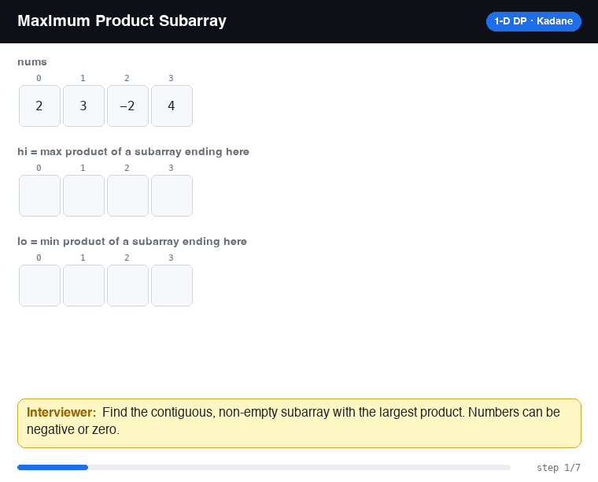

# Walkthrough: Maximum Product Subarray

**Module:** [15 · Dynamic programming (1-D)](../README.md) · **Difficulty:** Medium · **Solution:** [`p07_max_product_subarray.go`](../p07_max_product_subarray.go)



## The problem in plain words

Find the block of neighbouring numbers whose product is the biggest. Numbers can be negative or zero.

```
[2, 3, -2, 4]  →  6   ([2, 3])
```

## Mock interview

**Interviewer:** Given a non-empty list of integers, which may be negative or zero, find the contiguous non-empty subarray with the largest product.

**Candidate:** Can I assume the product fits in an `int`?

**Interviewer:** Yes.

**Candidate:** For `[2, 3, -2, 4]`, the answer is 6 from `[2, 3]`. For `[-2, 3, -4]`, it's 24, because the two negatives cancel. For `[-2, 0, -1]`, it's 0.

**Candidate:** The brute force tries every start and extends the product to every end. That's O(n²).

**Interviewer:** Can you do it in one pass?

**Candidate:** For sums I'd use Kadane: the best subarray ending here is either this number alone or this number added to the best ending one step earlier. Products are trickier. A negative number turns the smallest product into the largest. So I track two values:

- **State:** `hi` is the largest product of a subarray ending at `i`. `lo` is the smallest.
- **Transition:** with `x = nums[i]`, `hi = max(x, hi·x, lo·x)` and `lo = min(x, hi·x, lo·x)`, both from the old values.
- **Base case:** `hi = lo = best = nums[0]`.
- **Answer:** `best`, the max `hi` seen.

**Interviewer:** Why include `x` alone?

**Candidate:** That's starting a new subarray at `i`. It handles zeros: after a 0, both `hi` and `lo` are 0, and the next element restarts from itself.

**Candidate:** In code it's one loop with a tuple assignment, `hi, lo = max(...), min(...)`, so both use the old `hi` and `lo`.

**Candidate:** Testing: start at 2. `x = 3`: hi 6, lo 3, best 6. `x = -2`: candidates -2, -12, -6, so hi -2, lo -12. `x = 4`: candidates 4, -8, -48, so hi 4, lo -48. best stays 6.

**Interviewer:** Complexity?

**Candidate:** **O(n) time, O(1) space.**

## What the animation shows

| Step | `x` | `hi` | `lo` | `best` |
|---|---|---|---|---|
| 1 | Interviewer states the problem | | | |
| 2 | Brute force is O(n²) | | | |
| 3 | 2 (start) | 2 | 2 | 2 |
| 4 | 3 | 6 | 3 | 6 |
| 5 | -2 | -2 | -12 | 6 |
| 6 | 4 | 4 | -48 | 6 |
| 7 | Answer 6, O(n) time, O(1) space | | | |

## Detailed explanation

The best product ending at `i` must use `nums[i]`. Either it's `nums[i]` alone, or `nums[i]` times some product ending at `i-1`. If `nums[i]` is positive, the biggest result comes from the biggest earlier product. If it's negative, the biggest result comes from the **smallest** earlier product, because negative times negative is positive. Keeping both `hi` and `lo` covers both cases. Taking the max and min of all three candidates means I don't need to branch on the sign.

The answer can end anywhere, so `best` tracks the max `hi` over all positions.

The order of updates matters. If I wrote `hi = ...` and then `lo = ...` on separate lines, the second line would use the new `hi`. The tuple assignment avoids that.

## Complexity

| Approach | Time | Space |
|---|---|---|
| Brute force (`MaxProductBrute`) | O(n²) | O(1) |
| Two-state Kadane (`MaxProduct`) | O(n) | O(1) |

## Common mistakes

- Tracking only `hi`, which misses negatives that cancel.
- Updating `hi` before computing `lo` from the old `hi`.
- Starting `best` at 0, which is wrong for `[-3]`.

## Try it yourself

```sh
go test ./course/15-dp-1d/ -run TestMaxProduct -v
```
