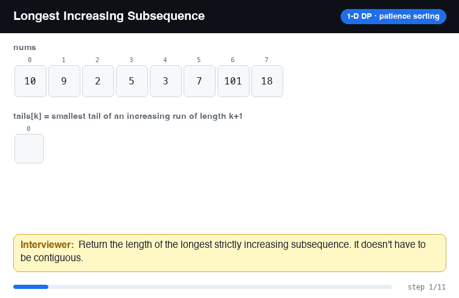

# Walkthrough: Longest Increasing Subsequence

**Module:** [15 · Dynamic programming (1-D)](../README.md) · **Difficulty:** Medium · **Solution:** [`p08_longest_increasing_subsequence.go`](../p08_longest_increasing_subsequence.go)



## The problem in plain words

Pick numbers from the list, keeping their order, so that each one is bigger than the one before. You can skip numbers. How many can you pick at most?

```
[10, 9, 2, 5, 3, 7, 101, 18]  →  4   (2, 3, 7, 18)
```

## Mock interview

**Interviewer:** Return the length of the longest strictly increasing subsequence. It doesn't have to be contiguous.

**Candidate:** Strictly increasing, so equal values don't extend? And the list can be empty?

**Interviewer:** Yes, and empty returns 0.

**Candidate:** For `[10, 9, 2, 5, 3, 7, 101, 18]`, one answer is 2, 3, 7, 18, so 4. For `[7, 7, 7, 7]` it's 1.

**Candidate:** The brute force decides take or skip for each element: O(2^n). The classic DP is better:

- **State:** `lis[i]` is the longest increasing subsequence that ends at `i`.
- **Transition:** `lis[i] = 1 + max(lis[j])` over `j < i` with `nums[j] < nums[i]`.
- **Base case:** `lis[i] = 1`, the element alone.
- **Answer:** the max over all `i`.

That's O(n²) time.

**Interviewer:** Can you do better?

**Candidate:** Yes, O(n log n) with patience sorting. I keep `tails[k]`, the smallest possible last value of an increasing run of length `k+1`. `tails` is always sorted. For each `x`, I binary-search the first tail that's `>= x`:

- If there's none, `x` extends the longest run, so I append it.
- Otherwise I replace that tail with `x`. Same length, smaller tail, which can only help later numbers.

The answer is `len(tails)`.

**Interviewer:** Why `>=` and not `>`?

**Candidate:** For strictly increasing runs, an equal value can't extend. Searching for the first tail `>= x` makes an equal value replace instead of append. Go's `sort.SearchInts` does exactly that.

**Candidate:** Testing: 10 → [10]. 9 → [9]. 2 → [2]. 5 → [2, 5]. 3 → [2, 3]. 7 → [2, 3, 7]. 101 → [2, 3, 7, 101]. 18 → [2, 3, 7, 18]. Length 4.

**Interviewer:** Is `tails` the actual subsequence?

**Candidate:** Not in general. It only records the best tail for each length. Here it happens to be valid, but with `[3, 4, 1]` it ends as [1, 4], which isn't a subsequence.

**Interviewer:** Complexity?

**Candidate:** One binary search per element: **O(n log n) time, O(n) space**.

## What the animation shows

| Step | `x` | Action | `tails` |
|---|---|---|---|
| 1 | Interviewer states the problem | | |
| 2 | The O(n²) DP, and the plan to beat it | | |
| 3 | 10 | append | [10] |
| 4 | 9 | replace 10 | [9] |
| 5 | 2 | replace 9 | [2] |
| 6 | 5 | append | [2, 5] |
| 7 | 3 | replace 5 | [2, 3] |
| 8 | 7 | append | [2, 3, 7] |
| 9 | 101 | append | [2, 3, 7, 101] |
| 10 | 18 | replace 101 | [2, 3, 7, 18] |
| 11 | Answer 4, O(n log n) | | |

## Detailed explanation

The claim is that after each step, `tails[k]` is the smallest tail of any increasing run of length `k+1` seen so far. It holds at the start, when `tails` is empty.

When `x` arrives, look at the first tail `>= x`, at index `k`. Every tail before it is `< x`, so `x` can extend the run of length `k` (ending at `tails[k-1]`) into a run of length `k+1` ending at `x`. Since `x <= tails[k]`, it's at least as good a tail for length `k+1`, so I replace. If no tail is `>= x`, `x` extends the longest run, and `tails` grows by one.

`tails` stays sorted, because each replacement keeps `tails[k-1] < x <= tails[k+1]`. That's why binary search works. Its length is the longest run length.

## Complexity

| Approach | Time | Space |
|---|---|---|
| Brute force (`LengthOfLISRecursive`) | O(2^n) | O(n) stack |
| Memoized (`LengthOfLISMemo`) | O(n²) | O(n²) |
| Ends-at-i table (`LengthOfLISQuadratic`) | O(n²) | O(n) |
| Patience sorting (`LengthOfLIS`) | O(n log n) | O(n) |

## Common mistakes

- Searching for the first tail `> x`, which allows equal values and counts non-strict runs.
- Returning `lis[n-1]` in the O(n²) version, instead of the max over all `i`.
- Reporting `tails` as the subsequence itself.

## Try it yourself

```sh
go test ./course/15-dp-1d/ -run TestLengthOfLIS -v
```
