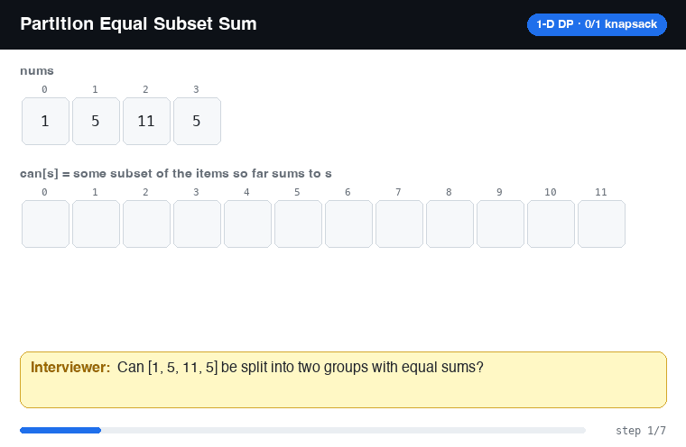

# Walkthrough: Partition Equal Subset Sum

**Module:** [15 · Dynamic programming (1-D)](../README.md) · **Difficulty:** Medium · **Solution:** [`p09_partition_equal_subset_sum.go`](../p09_partition_equal_subset_sum.go)



## The problem in plain words

Can you put the numbers into two groups so that both groups add up to the same total?

```
[1, 5, 11, 5]  →  true   ({11} and {1, 5, 5})
```

## Mock interview

**Interviewer:** Given positive integers, decide whether they can be split into two groups with equal sums.

**Candidate:** Every number must go into one of the two groups? And the numbers are all positive?

**Interviewer:** Yes to both.

**Candidate:** `[1, 5, 11, 5]` sums to 22, and {11} vs {1, 5, 5} works. `[1, 2, 3, 5]` sums to 11, which is odd, so it's false straight away.

**Candidate:** If the total is even, I need one subset that sums to half of it. The other group is everything else. Trying every subset is 2^n.

**Interviewer:** How do you do better?

**Candidate:** It's subset sum, a 0/1 knapsack:

- **State:** `can[s]` is true if some subset of the items seen so far sums to `s`.
- **Transition:** for each item `x`, `can[s] = can[s] || can[s-x]`.
- **Base case:** `can[0] = true`, the empty subset.
- **Order:** items in the outer loop. For each item, `s` goes from `target` **down** to `x`.

**Interviewer:** Why downward?

**Candidate:** Each item can be used once. Going down, `can[s-x]` hasn't been updated for this item yet, so it still means "without `x`". Going up, `can[s-x]` might already include `x`, and I'd use it twice. That's the unbounded knapsack of Coin Change.

**Candidate:** In code: check the total is even, set `target`, then the two loops. I return early once `can[target]` is true.

**Candidate:** Testing: total 22, target 11. After 1: sums {0, 1}. After 5: {0, 1, 5, 6}. After 11: `can[11]` is true, so I stop and return true.

**Interviewer:** Complexity?

**Candidate:** Each item sweeps `target` cells: **O(n · target) time, O(target) space**.

## What the animation shows

| Step | What happens | Reachable sums |
|---|---|---|
| 1 | Interviewer states the problem | |
| 2 | Brute force: 2^n; reduce to subset sum | |
| 3 | Total 22 is even, target 11, `can[0] = T` | {0} |
| 4 | Item 1, sweep down | {0, 1} |
| 5 | Item 5, sweep down | {0, 1, 5, 6} |
| 6 | Item 11: `can[11]` becomes true, early exit | {0, 1, 5, 6, 11} |
| 7 | Answer true, O(n · target) | |

## Detailed explanation

Two groups with equal sums each hold half the total. So the total must be even, and one group must sum to `total/2`. Finding that group is enough, because the rest automatically sums to the other half.

After processing items `x1..xk`, `can[s]` should be true exactly when some subset of those items sums to `s`. A new item `x` adds every old sum plus `x`. That's `can[s-x]` from *before* this item. The downward loop reads `can[s-x]` before it's overwritten for this item, so each item joins a subset at most once.

`CanPartitionTab` shows the same idea as a 2-D table `dp[i][s]`, where row `i` reads only row `i-1`. The 1-D version keeps one row and gets the "previous row" values for free by going downward.

## Complexity

| Approach | Time | Space |
|---|---|---|
| Brute force (`CanPartitionRecursive`) | O(2^n) | O(n) stack |
| Memoized (`CanPartitionMemo`) | O(n · target) | O(n · target) |
| 2-D table (`CanPartitionTab`) | O(n · target) | O(n · target) |
| 1-D table (`CanPartition`) | O(n · target) | O(target) |

## Common mistakes

- Sweeping `s` upward, which reuses items.
- Forgetting the odd-total check, then using `total/2` rounded down.
- Starting `can[0]` as false, so nothing becomes reachable.

## Try it yourself

```sh
go test ./course/15-dp-1d/ -run TestCanPartition -v
```
