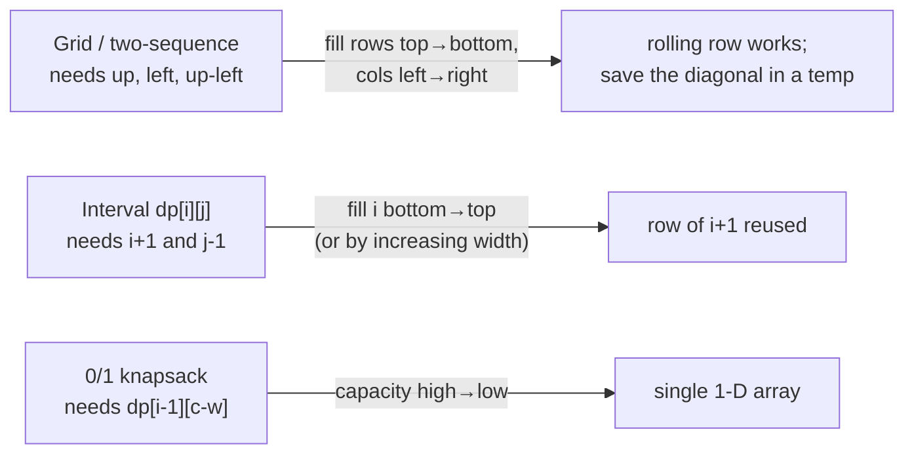

# 16 · Dynamic Programming in 2-D

## What you'll learn

- How to spot problems whose state needs **two indices** — two strings, a grid, or an interval `[i, j]`.
- The three recurring 2-D shapes: **grid DP**, **two-sequence DP** (prefix × prefix), and **interval DP**.
- How to go from brute-force recursion → memoized top-down → bottom-up table → **rolling array** (O(n) space), and the fill-order rules that make each step correct.
- The 0/1 knapsack "iterate capacity backwards" trick and why getting it wrong silently solves a different problem.

## Recognize the pattern

| Signal in the problem | Likely state |
|---|---|
| Grid, move only right/down, count/min/max routes | `dp[i][j]` = answer for cell `(i, j)` |
| Two strings/arrays, "common", "transform", "match", "interleave" | `dp[i][j]` = answer for prefixes `a[:i]`, `b[:j]` |
| One string, "palindromic", "split", "merge", "burst", "order of removal" | `dp[i][j]` = answer for interval `s[i..j]` |
| Items + budget/capacity, each used once | `dp[i][c]` = first `i` items, capacity `c` |

If a 1-D DP feels like it "needs to remember one more thing", that thing becomes the second dimension.

## The idea

Write the recurrence in words first: *"the answer for (i, j) is built from smaller (i', j') by one choice."* Then pick a fill order so every dependency is ready before it's read.

Two-sequence DP — edit distance `"horse" → "ros"`; each cell looks **up** (delete), **left** (insert) and **up-left** (replace / free match):

```
        ""  r  o  s
    ""   0  1  2  3
    h    1  1  2  3
    o    2  2  1  2        dp[i][j] = a[i-1]==b[j-1] ? dp[i-1][j-1]
    r    3  2  2  2                 : 1 + min(up, left, diag)
    s    4  3  3  2
    e    5  4  4  3   <- answer
```

Dependency directions decide the fill order:



**Interval DP's key move** (burst balloons): instead of asking "which balloon goes *first*?" (which leaves the two sides coupled), ask "which goes *last*?" — then its neighbours are the interval boundaries and the two halves are independent subproblems.

## Go template

```go
// Two-sequence DP with an (m+1)×(n+1) table; row/col 0 = empty prefix.
func twoSeq(a, b string) int {
	m, n := len(a), len(b)
	dp := make([][]int, m+1)
	for i := range dp {
		dp[i] = make([]int, n+1)
	}
	// base cases: dp[i][0], dp[0][j]
	for i := 1; i <= m; i++ {
		for j := 1; j <= n; j++ {
			if a[i-1] == b[j-1] {
				dp[i][j] = dp[i-1][j-1] + 1
			} else {
				dp[i][j] = max(dp[i-1][j], dp[i][j-1])
			}
		}
	}
	return dp[m][n]
}

// 0/1 knapsack, 1-D: iterate capacity downwards so each item is used once.
for i, w := range weights {
	for c := capacity; c >= w; c-- {
		dp[c] = max(dp[c], dp[c-w]+values[i])
	}
}
```

`dp2d.go` has a `newTable` helper that allocates one contiguous backing slice for the whole table.

## Complexity

| Shape | Time | Space (table → optimized) |
|---|---|---|
| Grid m×n | O(m·n) | O(m·n) → O(n) |
| Two sequences | O(m·n) | O(m·n) → O(min(m, n)) |
| Interval, O(1) transition (palindromic subsequence) | O(n²) | O(n²) → O(n) |
| Interval, choose split k (burst balloons) | O(n³) | O(n²) |
| 0/1 knapsack | O(n·W) — pseudo-polynomial | O(n·W) → O(W) |

## Common pitfalls

- **Off-by-one between string index and table index.** With an `(m+1)×(n+1)` table, cell `dp[i][j]` talks about `a[i-1]` and `b[j-1]`. Keep one convention per function.
- **Rolling arrays overwrite what you still need.** In edit distance the diagonal `dp[i-1][j-1]` is clobbered when you write `row[j-1]`; save it in a `diag` variable before overwriting.
- **Knapsack direction.** Iterating capacity upward lets an item be reused (that's the *unbounded* knapsack). Downward for 0/1.
- **Interval fill order.** `dp[i][j]` needs `dp[i+1][…]`, so loop `i` from `n-1` down to `0` (or loop by width).
- **Memo sentinel.** `0` is often a legal answer; use `-1` for "not computed", or a tri-state (`0` unknown / `1` true / `2` false) for boolean DPs.
- **Go strings are bytes.** `s[i]` is a `byte`; these solutions assume ASCII. For Unicode input convert once with `[]rune(s)` and index the rune slice.
- **Integer overflow.** Path counts grow like binomial coefficients — `UniquePaths(34, 34)` already overflows `int32`. Go's `int` is 64-bit on 64-bit platforms, but say so in the interview.
- **Closures for memo recursion.** `var f func(int, int) int; f = func(...) {...}` — the variable must be declared before the literal so it can call itself.

## Problems

| # | Problem | Difficulty | Key idea |
|---|---|---|---|
| 01 | [Unique Paths (with obstacles)](p01_unique_paths.go) | Medium | `ways = up + left`, 0 on obstacles; one rolling row |
| 02 | [Minimum Path Sum](p02_min_path_sum.go) | Medium | Grid DP with `min`; first row/col have one parent |
| 03 | [Longest Common Subsequence](p03_longest_common_subsequence.go) | Medium | Match → diag+1, else max(up, left); backtrack to rebuild |
| 04 | [Edit Distance](p04_edit_distance.go) | Medium | Insert/delete/replace = left/up/diag; save diag when rolling |
| 05 | [0/1 Knapsack](p05_knapsack.go) | Medium | Take-or-skip; 1-D array with capacity descending |
| 06 | [Longest Palindromic Subsequence](p06_longest_palindromic_subsequence.go) | Medium | Interval DP: ends match → inner + 2 |
| 07 | [Interleaving String](p07_interleaving_string.go) | Medium | `dp[i][j]`: last char came from s1 or s2 |
| 08 | [Regular Expression Matching](p08_regex_matching.go) | Hard | `x*` → skip it (j+2) or consume one char (i+1) |
| 09 | [Burst Balloons](p09_burst_balloons.go) | Hard | Interval DP choosing the **last** balloon in `(l, r)` |

## Practice tip

Hide the solution file (or open only the doc comment), write the recurrence on paper, then implement top-down first — it's closest to the recurrence — and only then the table and rolling versions. Check yourself with:

```bash
go test ./course/16-dp-2d/ -run TestEditDistance -v
```

Every DP problem here has a test asserting that the memo, table and rolling versions agree on random inputs; keep that habit when you write your own.

## Next

→ [17 · Greedy & Intervals](../17-greedy-intervals/README.md)
