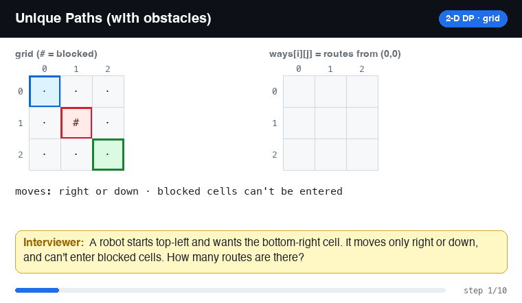

# Walkthrough: Unique Paths (with obstacles)

**Module:** [16 · Dynamic Programming in 2-D](../README.md) · **Difficulty:** Medium · **Solution:** [`p01_unique_paths.go`](../p01_unique_paths.go)



## The problem in plain words

A robot starts in the top-left cell of a grid and wants to reach the bottom-right cell. It can only move right or down, and it can't enter blocked cells. Count the different routes.

```
[[0,0,0],
 [0,1,0],     →  2   (go around the blocked centre on either side)
 [0,0,0]]
```

The animation uses this obstacle grid, the second example in the doc comment, because it shows the obstacle rule. The empty 3×3 grid (answer 6) works the same way without the zero.

## Mock interview

**Interviewer:** A robot moves only right or down from the top-left to the bottom-right of a grid. Cells marked 1 are blocked. Count the distinct routes.

**Candidate:** What if the start or the end is blocked? And can the grid be empty?

**Interviewer:** A blocked start or end gives 0. An empty grid also gives 0.

**Candidate:** On the 3×3 grid with the centre blocked, there are 2 routes: along the top and down the right side, or down the left side and along the bottom.

**Candidate:** The brute force walks every route recursively. That's up to 2^(m+n) routes, and they share cells, so the same "routes from here" is counted many times.

**Interviewer:** How would you avoid that?

**Candidate:** Count routes *into* each cell. The only ways into `(i, j)` are from above and from the left.

- **State:** `ways[i][j]` is the number of routes from `(0, 0)` to `(i, j)`.
- **Transition:** `ways[i][j] = ways[i-1][j] + ways[i][j-1]`, and 0 if the cell is blocked.
- **Base case:** `ways[0][0] = 1`. Missing neighbours outside the grid count as 0.
- **Order:** rows top to bottom, each row left to right.

**Interviewer:** Why is the obstacle rule just "set it to 0"?

**Candidate:** No route passes through a blocked cell. With 0 there, it adds nothing to the cells below and to the right, which is exactly right.

**Candidate:** In code, `UniquePathsRolling` keeps one row. Before I update `row[j]`, it still holds the value from the row above. `row[j-1]` already holds this row's value. So `row[j] += row[j-1]` is "above plus left".

**Candidate:** Testing: row 0 is 1, 1, 1. Row 1 is 1, 0 (blocked), 1. Row 2 is 1, 1, 2. Answer 2.

**Interviewer:** Complexity?

**Candidate:** Every cell once: **O(m·n) time, O(n) space** with the rolling row.

**Interviewer:** And with no obstacles?

**Candidate:** `UniquePaths(m, n)` does the same with no zeros. There's also a closed form, C(m+n-2, m-1), but the DP is what generalises to obstacles.

## What the animation shows

| Step | Cell | Calculation | Value |
|---|---|---|---|
| 1 | | Interviewer states the problem | |
| 2 | | Brute force: O(2^(m+n)) | |
| 3 | row 0 | start = 1, then only "from the left" | 1 1 1 |
| 4 | (1,0) | up 1 | 1 |
| 5 | (1,1) | blocked | 0 |
| 6 | (1,2) | up 1 + left 0 | 1 |
| 7 | (2,0) | up 1 | 1 |
| 8 | (2,1) | up 0 + left 1 | 1 |
| 9 | (2,2) | up 1 + left 1 | 2 |
| 10 | | Answer 2, O(m·n) time, O(n) space | |

## Detailed explanation

Every route into `(i, j)` makes its last move either down from `(i-1, j)` or right from `(i, j-1)`. Those two groups don't overlap and together cover every route. So the count is the sum of the two counts. A blocked cell has no routes into it, and putting 0 there means it contributes nothing to its neighbours.

The table fills in reading order, so both parents are always ready. The first row and first column have only one parent each. In the Go code that's handled by the `i > 0` and `j > 0` checks in `UniquePathsTab`, and by starting `row` as `[1, 0, 0, ...]` in the rolling version.

## Complexity

| Approach | Time | Space |
|---|---|---|
| Brute force (`UniquePathsBrute`) | O(2^(m+n)) | O(m+n) stack |
| Memoized (`UniquePathsMemo`) | O(m·n) | O(m·n) |
| Table (`UniquePathsTab`) | O(m·n) | O(m·n) |
| Rolling row (`UniquePathsRolling`) | O(m·n) | O(n) |
| No obstacles (`UniquePaths`) | O(m·n) | O(n) |

## Common mistakes

- Filling the first row with 1s even after an obstacle. Every cell after a rock in row 0 must be 0.
- Forgetting that a blocked start gives 0.
- In the rolling row, resetting `row[j]` instead of adding to it.

## Try it yourself

```sh
go test ./course/16-dp-2d/ -run TestUniquePaths -v
```
