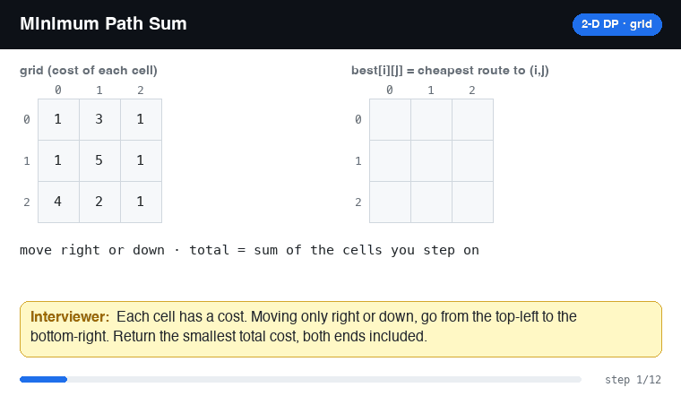

# Walkthrough: Minimum Path Sum

**Module:** [16 · Dynamic Programming in 2-D](../README.md) · **Difficulty:** Medium · **Solution:** [`p02_min_path_sum.go`](../p02_min_path_sum.go)



## The problem in plain words

Each cell of a grid has a cost. Walk from the top-left to the bottom-right, moving only right or down. Add up the costs of the cells you step on. Find the smallest total.

```
[[1,3,1],
 [1,5,1],     →  7   (1 → 3 → 1 → 1 → 1)
 [4,2,1]]
```

## Mock interview

**Interviewer:** Each cell holds a non-negative cost. Moving only right or down, go from the top-left to the bottom-right and return the smallest total, counting both ends.

**Candidate:** Costs are non-negative, and both the start and the end count? Empty grid returns 0?

**Interviewer:** Yes.

**Candidate:** In the example, 1 → 3 → 1 → 1 → 1 gives 7. Going down first, 1 → 1 → 4 → 2 → 1, gives 9.

**Candidate:** Trying every route is exponential, and routes share most of their cells. But the cheapest way to *reach* a cell doesn't depend on where I go afterwards, so I can save it.

**Interviewer:** Set up the DP.

**Candidate:**

- **State:** `best[i][j]` is the cheapest total from `(0, 0)` to `(i, j)`, including both.
- **Transition:** `best[i][j] = grid[i][j] + min(best[i-1][j], best[i][j-1])`.
- **Base case:** `best[0][0] = grid[0][0]`. The first row only has a left parent; the first column only has a parent above.
- **Order:** rows top to bottom, left to right.

**Interviewer:** Why is it safe to keep only the cheapest way into a cell?

**Candidate:** Any route through `(i, j)` continues the same way no matter how it arrived. If a cheaper way to arrive exists, swapping it in can only lower the total.

**Candidate:** `MinPathSumRolling` keeps one row. `row[j]` holds "above" until I overwrite it, and `row[j-1]` is already this row's "left".

**Candidate:** Testing: row 0 is 1, 4, 5. Row 1 is 2, 7, 6. Row 2 is 6, 8, 7. Answer 7.

**Interviewer:** Complexity?

**Candidate:** **O(m·n) time, O(n) space** with one row.

## What the animation shows

| Step | Cell | Calculation | Value |
|---|---|---|---|
| 1 | | Interviewer states the problem | |
| 2 | | Brute force is exponential | |
| 3 | (0,0) | start | 1 |
| 4 | (0,1) | left 1 + 3 | 4 |
| 5 | (0,2) | left 4 + 1 | 5 |
| 6 | (1,0) | up 1 + 1 | 2 |
| 7 | (1,1) | min(4, 2) + 5 | 7 |
| 8 | (1,2) | min(5, 7) + 1 | 6 |
| 9 | (2,0) | up 2 + 4 | 6 |
| 10 | (2,1) | min(7, 6) + 2 | 8 |
| 11 | (2,2) | min(6, 8) + 1 | 7 |
| 12 | | Answer 7 with the path highlighted | |

## Detailed explanation

The last move into `(i, j)` comes from above or from the left. Whatever came before is a route to that parent, and the cheapest such route is already stored. So the cheapest route to `(i, j)` is its own cost plus the cheaper parent.

Costs are non-negative, but the DP doesn't actually need that. Because moves only go right or down, there are no cycles, and the fill order always has both parents ready.

The edges need care. In row 0 there's no "above"; in column 0 there's no "left". `MinPathSumTab` uses a `switch` with these cases. Treating the missing parent as 0 would be wrong, because 0 would always win the `min`.

## Complexity

| Approach | Time | Space |
|---|---|---|
| Memoized (`MinPathSumMemo`) | O(m·n) | O(m·n) |
| Table (`MinPathSumTab`) | O(m·n) | O(m·n) |
| Rolling row (`MinPathSumRolling`) | O(m·n) | O(n) |

## Common mistakes

- Treating a missing parent as 0 instead of skipping it.
- Forgetting to add the start cell's own cost.
- Using greedy "step to the cheaper neighbour", which can walk into an expensive corner.

## Try it yourself

```sh
go test ./course/16-dp-2d/ -run TestMinPathSum -v
```
