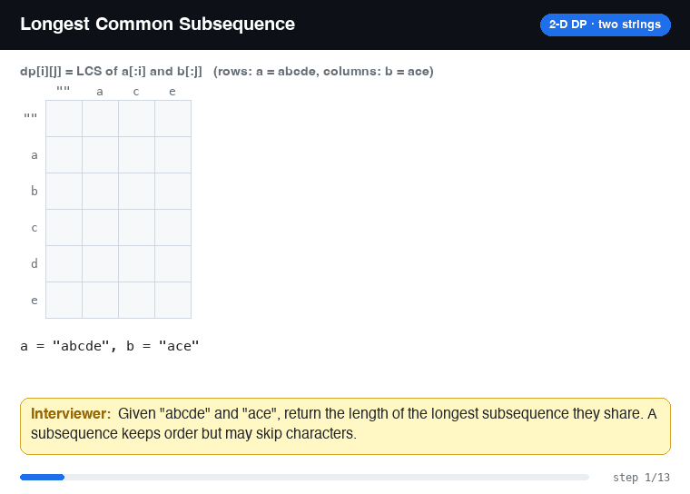

# Walkthrough: Longest Common Subsequence

**Module:** [16 · Dynamic Programming in 2-D](../README.md) · **Difficulty:** Medium · **Solution:** [`p03_longest_common_subsequence.go`](../p03_longest_common_subsequence.go)



## The problem in plain words

A subsequence keeps some letters of a string in their original order, with gaps allowed. Given two strings, find the length of the longest subsequence they both have.

```
"abcde", "ace"  →  3   ("ace")
```

## Mock interview

**Interviewer:** Given two strings, return the length of their longest common subsequence.

**Candidate:** Subsequence, not substring, so gaps are allowed? And if nothing matches, 0?

**Interviewer:** Right.

**Candidate:** "abcde" and "ace" share "ace", so 3. "abc" and "def" share nothing, so 0.

**Candidate:** The brute force compares the first letters. If they match, take both. If not, try dropping one from either string. Two branches per mismatch is O(2^(m+n)), and the same pair of suffixes comes up again and again.

**Interviewer:** So what's your table?

**Candidate:** Prefixes of both strings:

- **State:** `dp[i][j]` is the LCS of `a[:i]` and `b[:j]`.
- **Transition:** if `a[i-1] == b[j-1]`, `dp[i][j] = dp[i-1][j-1] + 1`. Otherwise `dp[i][j] = max(dp[i-1][j], dp[i][j-1])`.
- **Base case:** row 0 and column 0 are 0. An empty prefix shares nothing.
- **Order:** row by row, left to right. The answer is `dp[m][n]`.

**Interviewer:** Why is it safe to take both letters when they match?

**Candidate:** If the best answer didn't use both, I could swap its last letter for this matching pair and get one at least as long. So matching them never hurts.

**Candidate:** `LCSTwoRows` keeps only the previous and current rows, and makes the row length the shorter string.

**Candidate:** Testing: row 'a' is 1, 1, 1 because 'a' matches 'a'. Row 'b' stays 1, 1, 1. Row 'c' becomes 1, 2, 2. Row 'd' copies it. Row 'e' ends with 3. Answer 3.

**Interviewer:** Can you return the subsequence itself?

**Candidate:** Yes, that's `LCSString`. Start at `dp[m][n]` and walk back. On a match, record the letter and step diagonally. Otherwise step toward the larger neighbour. Reverse at the end. Here it gives "ace".

**Interviewer:** Complexity?

**Candidate:** **O(m·n) time, O(min(m, n)) space** with two rows. Rebuilding the string needs the full table, so O(m·n) space.

## What the animation shows

| Step | What happens | Row values |
|---|---|---|
| 1 | Interviewer states the problem | |
| 2 | Brute force: O(2^(m+n)) | |
| 3 | Row 0 and column 0 are 0 | |
| 4 | (a, a): match, diag 0 + 1 | 1 |
| 5 | (a, c): max(up 0, left 1) | 1 |
| 6 | (a, e): max(up 0, left 1) | 1 |
| 7 | (b, a): max(up 1, left 0) | 1 |
| 8 | (b, c): max(up 1, left 1) | 1 |
| 9 | (b, e): max(up 1, left 1) | 1 |
| 10 | Row 'c' at once; (c, c) is diag 1 + 1 | 1 2 2 |
| 11 | Row 'd' at once; no match | 1 2 2 |
| 12 | Row 'e' at once; (e, e) is diag 2 + 1 | 1 2 3 |
| 13 | Answer 3; walk back gives "ace" | |

## Detailed explanation

Look at the last letters, `a[i-1]` and `b[j-1]`.

- If they're equal, some longest common subsequence ends with that letter in both strings. Removing it leaves an LCS of the two shorter prefixes, so the answer is `dp[i-1][j-1] + 1`.
- If they're different, at least one of them isn't the last letter of the common subsequence. Dropping that one doesn't change the answer. I don't know which one, so I take the max of both options.

Every cell reads only cells above, to the left, or up-left. Filling row by row keeps all three ready.

The two-row version swaps `prev` and `cur` after each row, so no new slice is allocated per row.

## Complexity

| Approach | Time | Space |
|---|---|---|
| Brute force (`LCSBrute`) | O(2^(m+n)) | O(m+n) stack |
| Memoized (`LCSMemo`) | O(m·n) | O(m·n) |
| Table (`LCSTab`) | O(m·n) | O(m·n) |
| Two rows (`LCSTwoRows`) | O(m·n) | O(min(m, n)) |
| Rebuild the string (`LCSString`) | O(m·n) | O(m·n) |

## Common mistakes

- Confusing subsequence with substring. For substrings, a mismatch resets to 0.
- Off-by-one between `dp[i][j]` and `a[i-1]`.
- On a match, taking `max(up, left) + 1` instead of `diag + 1`.

## Try it yourself

```sh
go test ./course/16-dp-2d/ -run TestLCS -v
```
