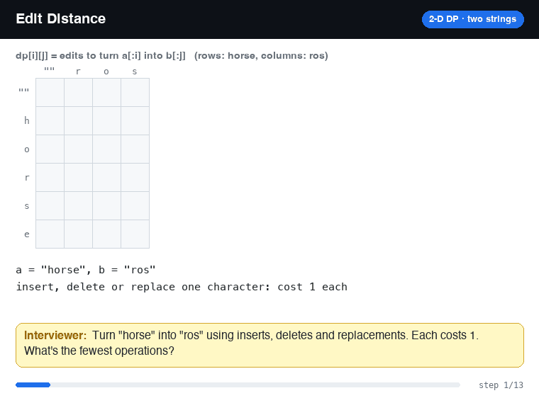

# Walkthrough: Edit Distance

**Module:** [16 · Dynamic Programming in 2-D](../README.md) · **Difficulty:** Medium · **Solution:** [`p04_edit_distance.go`](../p04_edit_distance.go)



## The problem in plain words

You can insert a letter, delete a letter, or replace a letter. Each costs 1. Find the fewest operations that turn one word into another.

```
"horse", "ros"  →  3   (horse → rorse → rose → ros)
```

## Mock interview

**Interviewer:** You may insert, delete or replace a character, each at cost 1. Return the fewest operations to turn word `a` into word `b`.

**Candidate:** All three operations cost the same? And either word can be empty?

**Interviewer:** Yes, and yes.

**Candidate:** "horse" to "ros": replace h with r, delete r, delete e. That's 3. If `a` is empty, the answer is `len(b)` inserts.

**Candidate:** The brute force compares letters. On a match it moves on. On a mismatch it tries all three operations. That's up to 3^(m+n) calls, mostly on the same pairs of prefixes.

**Interviewer:** What's the DP?

**Candidate:**

- **State:** `dp[i][j]` is the cost to turn `a[:i]` into `b[:j]`.
- **Transition:** if `a[i-1] == b[j-1]`, `dp[i][j] = dp[i-1][j-1]`, free. Otherwise `1 + min(dp[i-1][j], dp[i][j-1], dp[i-1][j-1])`: delete, insert, replace.
- **Base case:** `dp[i][0] = i` (delete everything) and `dp[0][j] = j` (insert everything).
- **Order:** row by row, left to right.

**Interviewer:** Map each neighbour to an operation.

**Candidate:** Up, `dp[i-1][j]`: I deleted `a[i-1]` and still need to turn `a[:i-1]` into `b[:j]`. Left, `dp[i][j-1]`: I insert `b[j-1]` at the end. Diagonal, `dp[i-1][j-1]`: I replace `a[i-1]` with `b[j-1]`.

**Candidate:** `EditDistanceRow` keeps one row. The tricky part: the cell I overwrite, `row[j]`, is "above" for this cell but the **diagonal** for the next one. So I save it in `diag` before writing.

**Candidate:** Testing: row 'h' is 1, 2, 3. Row 'o' is 2, 1, 2, where 'o' matches 'o'. Row 'r' is 2, 2, 2. Row 's' is 3, 3, 2. Row 'e' is 4, 4, 3. Answer 3.

**Interviewer:** Complexity?

**Candidate:** **O(m·n) time, O(n) space** with one row and a saved diagonal.

## What the animation shows

| Step | What happens | Row values |
|---|---|---|
| 1 | Interviewer states the problem | |
| 2 | Brute force: three branches per mismatch | |
| 3 | Base row 0..3 and column 0..5 | |
| 4 | (h, r): 1 + min(1, 1, 0) | 1 |
| 5 | (h, o): 1 + min(2, 1, 1) | 2 |
| 6 | (h, s): 1 + min(3, 2, 2) | 3 |
| 7 | (o, r): 1 + min(1, 2, 1) | 2 |
| 8 | (o, o): match, copy diag 1 | 1 |
| 9 | (o, s): 1 + min(3, 1, 2) | 2 |
| 10 | Row 'r' at once; (r, r) copies diag 2 | 2 2 2 |
| 11 | Row 's' at once; (s, s) copies diag 2 | 3 3 2 |
| 12 | Row 'e' at once; corner 1 + min(2, 4, 3) | 4 4 3 |
| 13 | Answer 3 | |

## Detailed explanation

Look at the last letters of the two prefixes. In some cheapest edit sequence, one of four things happens to them:

- They're equal and left alone: cost `dp[i-1][j-1]`.
- `a[i-1]` is deleted: cost 1 + `dp[i-1][j]`.
- `b[j-1]` is inserted at the end: cost 1 + `dp[i][j-1]`.
- `a[i-1]` is replaced by `b[j-1]`: cost 1 + `dp[i-1][j-1]`.

The minimum over the options that apply is the answer. When the letters match, the free option is never worse than the others, so the Go code takes it directly.

The base cases are the only ways to handle an empty side: delete every letter, or insert every letter.

## Complexity

| Approach | Time | Space |
|---|---|---|
| Memoized (`EditDistanceMemo`) | O(m·n) | O(m·n) |
| Table (`EditDistanceTab`) | O(m·n) | O(m·n) |
| One row (`EditDistanceRow`) | O(m·n) | O(n) |

## Common mistakes

- Initialising the base row and column to 0 instead of `i` and `j`.
- Adding 1 on a match.
- In the one-row version, forgetting to save the diagonal before overwriting `row[j]`.

## Try it yourself

```sh
go test ./course/16-dp-2d/ -run TestEditDistance -v
```
