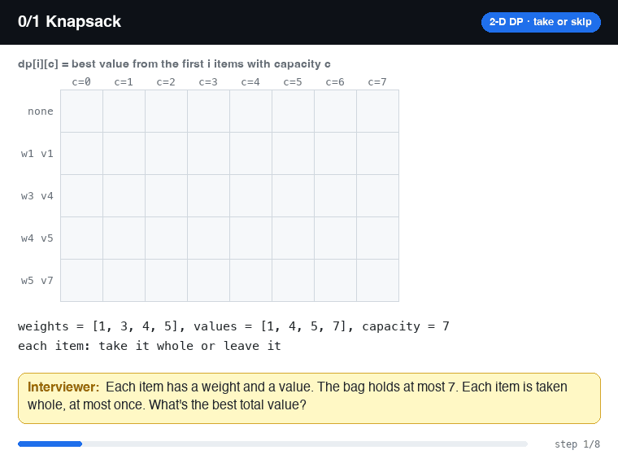

# Walkthrough: 0/1 Knapsack

**Module:** [16 · Dynamic Programming in 2-D](../README.md) · **Difficulty:** Medium · **Solution:** [`p05_knapsack.go`](../p05_knapsack.go)



## The problem in plain words

Each item has a weight and a value. Your bag holds a limited total weight. You take each item whole or leave it, at most once. Find the most value that fits.

```
weights [1,3,4,5], values [1,4,5,7], capacity 7  →  9   (the items weighing 3 and 4)
```

## Mock interview

**Interviewer:** You have `n` items with weights and values, and a bag with a capacity. Each item is taken whole or not at all. Return the best total value.

**Candidate:** Weights and capacity are non-negative integers? Each item at most once?

**Interviewer:** Yes.

**Candidate:** In the example, weights 3 and 4 fill the bag exactly and give 4 + 5 = 9. The heaviest item, weight 5 and value 7, plus weight 1 gives only 8.

**Candidate:** Trying every subset is 2^n. But once I've decided about the first few items, only the remaining capacity matters. That's a small state.

**Interviewer:** Define it.

**Candidate:**

- **State:** `dp[i][c]` is the best value using the first `i` items with capacity `c`.
- **Transition:** skip item `i-1`: `dp[i-1][c]`. Take it, if it fits: `dp[i-1][c-w] + v`. Take the max.
- **Base case:** `dp[0][c] = 0`. No items, no value.
- **Order:** items one by one; any order of `c` in the 2-D table.

**Interviewer:** Can you save space?

**Candidate:** Row `i` only reads row `i-1`, so one array is enough, as long as I loop `c` from high to low. Then `dp[c-w]` still holds the previous row's value. Going low to high, `dp[c-w]` might already include this item, and I'd take it twice. That's the unbounded knapsack.

**Candidate:** Testing: item 1 (w1, v1) fills row 1 with 1s from c = 1. Item 2 (w3, v4): at c = 4, take gives 4 + 1 = 5. Item 3 (w4, v5): at c = 7, take gives 5 + 4 = 9. Item 4 (w5, v7): at c = 7, take gives 7 + 1 = 8, so skip keeps 9. Answer 9.

**Interviewer:** Complexity?

**Candidate:** **O(n·W) time, O(W) space** with the rolling row, where W is the capacity.

## What the animation shows

| Step | What happens | Row values (c = 0..7) |
|---|---|---|
| 1 | Interviewer states the problem | |
| 2 | Brute force: 2^n subsets | |
| 3 | Row 0 is all 0 | 0 0 0 0 0 0 0 0 |
| 4 | Item w1 v1; c=1: max(0, 0 + 1) | 0 1 1 1 1 1 1 1 |
| 5 | Item w3 v4; c=4: max(1, 1 + 4) | 0 1 1 4 5 5 5 5 |
| 6 | Item w4 v5; c=7: max(5, 4 + 5) | 0 1 1 4 5 6 6 9 |
| 7 | Item w5 v7; c=7: max(9, 1 + 7) | 0 1 1 4 5 7 8 9 |
| 8 | Answer 9, O(n·W) time, O(W) space | |

## Detailed explanation

Take the best choice of items from the first `i`. Either it includes item `i-1` or it doesn't. If not, it's the best choice from the first `i-1` items with the same capacity. If it does, the rest is the best choice from the first `i-1` items with capacity `c - w`. Taking the max of the two covers every case.

The direction of the 1-D loop is the whole trick. When `c` goes from high to low, every `dp[c-w]` I read is still from the previous item's row. Each item is considered once per capacity, so it's used at most once.

Edge cases: a negative capacity returns 0, and an item heavier than the bag is never taken.

## Complexity

| Approach | Time | Space |
|---|---|---|
| Brute force (`KnapsackBrute`) | O(2^n) | O(n) stack |
| Memoized (`KnapsackMemo`) | O(n·W) | O(n·W) |
| Table (`KnapsackTab`) | O(n·W) | O(n·W) |
| Rolling row (`KnapsackRolling`) | O(n·W) | O(W) |

## Common mistakes

- Looping capacity upward in the 1-D version, which allows repeats.
- Sorting by value per weight and taking greedily. That only works for the fractional knapsack.
- Reading `dp[i][c-w]` instead of `dp[i-1][c-w]` in the 2-D table.

## Try it yourself

```sh
go test ./course/16-dp-2d/ -run TestKnapsack -v
```
