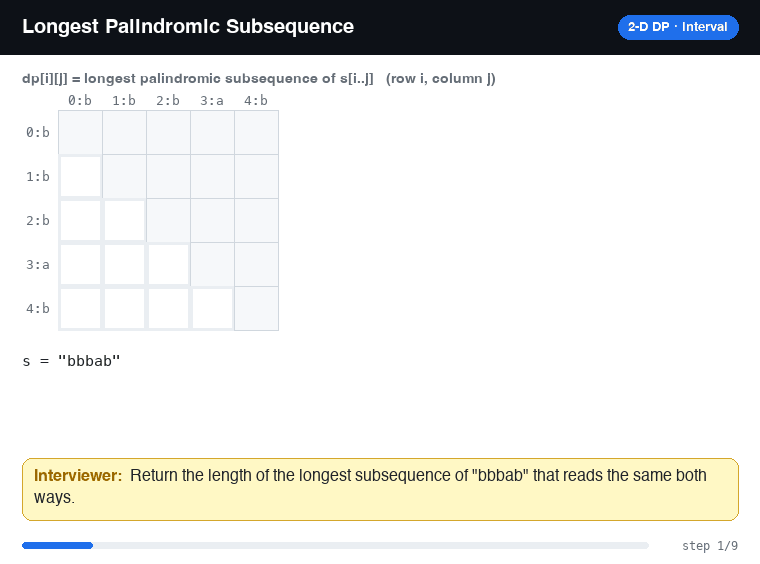

# Walkthrough: Longest Palindromic Subsequence

**Module:** [16 · Dynamic Programming in 2-D](../README.md) · **Difficulty:** Medium · **Solution:** [`p06_longest_palindromic_subsequence.go`](../p06_longest_palindromic_subsequence.go)



## The problem in plain words

Delete any letters you like from a string, keeping the order of the rest. What's the longest result that reads the same forwards and backwards?

```
"bbbab"  →  4   ("bbbb")
```

## Mock interview

**Interviewer:** Return the length of the longest subsequence of `s` that is a palindrome.

**Candidate:** Subsequence, so gaps are allowed? Empty string returns 0?

**Interviewer:** Yes.

**Candidate:** "bbbab" gives "bbbb", so 4. "cbbd" gives "bb", so 2. Any single letter gives at least 1.

**Candidate:** Checking all 2^n subsequences is too slow. A palindrome is decided by its two ends, so I'll solve every interval of the string.

**Interviewer:** Set it up.

**Candidate:** Interval DP:

- **State:** `dp[i][j]` is the answer for `s[i..j]`, both ends included.
- **Transition:** if `s[i] == s[j]`, `dp[i][j] = dp[i+1][j-1] + 2`. Otherwise `dp[i][j] = max(dp[i+1][j], dp[i][j-1])`.
- **Base case:** `dp[i][i] = 1`. An empty interval (`i > j`) is 0.
- **Order:** `dp[i][j]` reads row `i+1`, so `i` goes from the bottom up, and `j` goes left to right.

**Interviewer:** Why can't you fill it top to bottom like the other tables?

**Candidate:** Row `i` needs row `i+1`, the row below. Top to bottom, that row isn't ready yet. Filling `i` from `n-1` down to 0 fixes that. It's the same as filling by interval length.

**Candidate:** `LPSRow` keeps one row. `row[j]` holds `dp[i+1][j]` until I overwrite it, and I save the old value in `diag` for the next column, like in Edit Distance.

**Candidate:** Testing "bbbab": `dp[3][4]` ("ab") is 1. `dp[2][3]` ("ba") is 1. `dp[2][4]` ("bab") is 1 + 2 = 3. Row 1 is 2, 2, 3. Row 0 is 2, 3, 3, 4. Answer 4.

**Interviewer:** Is there another way to see it?

**Candidate:** The LPS of `s` equals the LCS of `s` and its reverse. The tests check that too.

**Interviewer:** Complexity?

**Candidate:** n² intervals, O(1) each: **O(n²) time, O(n) space** with one row.

## What the animation shows

| Step | What happens | Value |
|---|---|---|
| 1 | Interviewer states the problem | |
| 2 | Brute force: 2^n subsequences | |
| 3 | Diagonal `dp[i][i] = 1`; fill rows bottom-up | |
| 4 | `dp[3][4]`, "ab": ends differ, max(1, 1) | 1 |
| 5 | `dp[2][3]`, "ba": ends differ, max(1, 1) | 1 |
| 6 | `dp[2][4]`, "bab": ends match, 1 + 2 | 3 |
| 7 | Row 1 at once | 2 2 3 |
| 8 | Row 0 at once; corner wraps "bba" (2) + 2 | 2 3 3 4 |
| 9 | Answer 4 | |

## Detailed explanation

Take the interval `s[i..j]`.

- If its ends match, both can be the outer pair of a palindrome. The best inside is `dp[i+1][j-1]`, so the answer is that plus 2. Using the matching ends never hurts, because any palindrome inside can be wrapped by them.
- If its ends differ, they can't both be in the palindrome. So one of them is unused, and the answer is the best of the interval without the left end or without the right end.

When `j == i+1` and the two letters match, `dp[i+1][j-1]` is `dp[i+1][i]`, an empty interval. The table holds 0 there, so the result is 2, which is right.

## Complexity

| Approach | Time | Space |
|---|---|---|
| Memoized (`LPSMemo`) | O(n²) | O(n²) |
| Table (`LPSTab`) | O(n²) | O(n²) |
| One row (`LPSRow`) | O(n²) | O(n) |

## Common mistakes

- Filling rows top to bottom, reading cells that aren't ready.
- Confusing it with longest palindromic **substring**, where a mismatch breaks the run.
- Forgetting the base case `dp[i][i] = 1`.

## Try it yourself

```sh
go test ./course/16-dp-2d/ -run TestLPS -v
```
