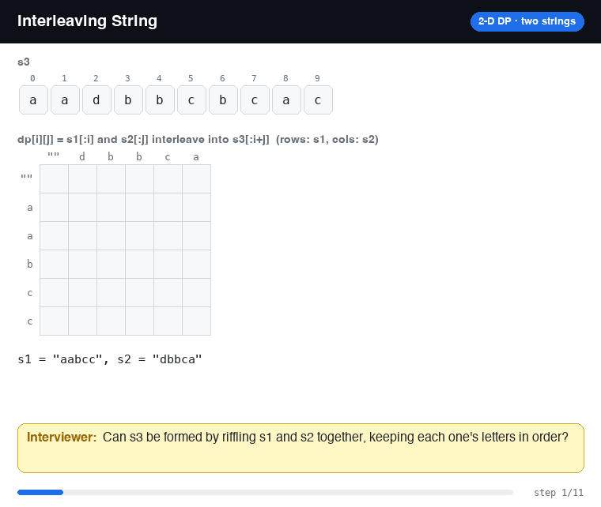

# Walkthrough: Interleaving String

**Module:** [16 · Dynamic Programming in 2-D](../README.md) · **Difficulty:** Medium · **Solution:** [`p07_interleaving_string.go`](../p07_interleaving_string.go)



## The problem in plain words

Can you build `s3` by shuffling `s1` and `s2` together, like riffling two decks of cards? Each string's letters must stay in their own order.

```
s1 = "aabcc", s2 = "dbbca", s3 = "aadbbcbcac"  →  true
```

## Mock interview

**Interviewer:** Decide whether `s3` can be formed by interleaving `s1` and `s2`, keeping the order of each.

**Candidate:** Every letter of `s1` and `s2` must be used exactly once? Then the lengths must add up.

**Interviewer:** Yes. If they don't, return false.

**Candidate:** For the example, the lengths are 5 + 5 = 10, so it's possible. With s3 = "aadbbbaccc" the answer is false.

**Interviewer:** Why not just take the next letter from whichever string matches?

**Candidate:** Both strings can offer the same next letter. Pick the wrong one and you fail later. So I'd have to try both, which is exponential. But the state is small: how many letters of `s1` and `s2` I've used.

**Candidate:**

- **State:** `dp[i][j]` is true if `s1[:i]` and `s2[:j]` can interleave into `s3[:i+j]`.
- **Transition:** the last letter came from `s1` or `s2`. `dp[i][j] = (dp[i-1][j] && s1[i-1] == s3[i+j-1]) || (dp[i][j-1] && s2[j-1] == s3[i+j-1])`.
- **Base case:** `dp[0][0] = true`.
- **Order:** row by row, left to right. The answer is `dp[m][n]`.

**Interviewer:** What does a move down or right mean in the table?

**Candidate:** Down means the next letter of `s3` came from `s1`. Right means it came from `s2`. A path of true cells from the top-left to the bottom-right is one valid interleaving.

**Candidate:** `IsInterleaveRow` keeps one row. `row[j]` is "above" before I write it, and `row[j-1]` is "left".

**Candidate:** Testing: row 0 is T, F, F, F, F, F, because 'd' doesn't match 'a'. `dp[1][0]` is true: 'a' matches. `dp[1][1]` is false: s3[1] is 'a', and coming from the left needs 'd'. Rows 2 to 5 fill the same way, and `dp[5][5]` is true.

**Interviewer:** Complexity?

**Candidate:** **O(m·n) time, O(n) space** with one row.

## What the animation shows

| Step | What happens | Row values |
|---|---|---|
| 1 | Interviewer states the problem | |
| 2 | Greedy fails; branching is exponential | |
| 3 | `dp[0][0] = T`, row 0 uses only s2 | T F F F F F |
| 4 | `dp[1][0]`: from above, 'a' == s3[0] | T |
| 5 | `dp[1][1]`: above F, left needs 'd' != 'a' | F |
| 6 | Rest of row 1 | T F F F F F |
| 7 | Row 2 | T T T T T F |
| 8 | Row 3 | F T T F T F |
| 9 | Row 4 | F F T T T T |
| 10 | Row 5 | F F F T F T |
| 11 | Answer true, with one valid path highlighted | |

## Detailed explanation

After using `i` letters of `s1` and `j` of `s2`, the next letter to produce is `s3[i+j]`. The last letter placed, `s3[i+j-1]`, came from one of the two strings. If it came from `s1`, then it equals `s1[i-1]` and the rest was a valid interleaving of `s1[:i-1]` and `s2[:j]`, which is `dp[i-1][j]`. The `s2` case mirrors this. The cell is true if either case works.

The length check comes first. Without it, the indexes into `s3` could run past its end.

The table is boolean, so `IsInterleaveTab` uses `newBoolTable`, and the memo version stores 0, 1, 2 for unknown, true, false.

## Complexity

| Approach | Time | Space |
|---|---|---|
| Memoized (`IsInterleaveMemo`) | O(m·n) | O(m·n) |
| Table (`IsInterleaveTab`) | O(m·n) | O(m·n) |
| One row (`IsInterleaveRow`) | O(m·n) | O(n) |

## Common mistakes

- Using a greedy two-pointer scan.
- Skipping the `len(s1) + len(s2) == len(s3)` check.
- Indexing `s3[i+j]` instead of `s3[i+j-1]` for the last letter.

## Try it yourself

```sh
go test ./course/16-dp-2d/ -run TestIsInterleave -v
```
