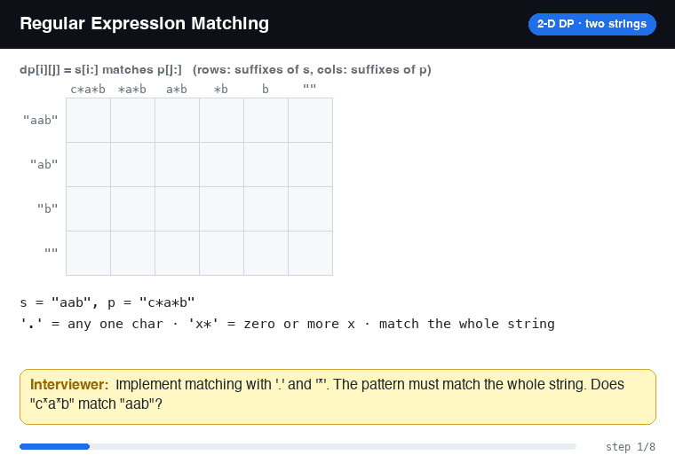

# Walkthrough: Regular Expression Matching

**Module:** [16 · Dynamic Programming in 2-D](../README.md) · **Difficulty:** Hard · **Solution:** [`p08_regex_matching.go`](../p08_regex_matching.go)



## The problem in plain words

Build a tiny pattern matcher. A `.` matches any one letter. A `*` means "zero or more of the thing just before me". The pattern must match the whole string.

```
s = "aab", p = "c*a*b"  →  true   (c* matches nothing, a* matches "aa", b matches "b")
```

The animation uses this example rather than the first one in the doc comment (`"aa"`, `"a"`), because it exercises both star choices.

## Mock interview

**Interviewer:** Implement matching with `.` and `*`. The pattern must match the entire string. Patterns are valid: a `*` always follows a letter or `.`.

**Candidate:** So `a*` can match "", "a", "aa", and so on. And `.*` matches anything?

**Interviewer:** Right.

**Candidate:** `"aa"` vs `"a"` is false: the pattern is too short. `"aa"` vs `"a*"` is true. `"aab"` vs `"c*a*b"` is true: `c*` takes nothing, `a*` takes "aa", `b` takes "b".

**Candidate:** The recursion looks at whether the next pattern element is starred. If not, the first letters must match and I move both on. If it is, I either skip `x*` entirely, or, if the first letter matches, eat one letter and keep `x*`. That branches at every star, and inputs like `a*a*a*a*c` blow up.

**Interviewer:** How do you make it polynomial?

**Candidate:** The recursion only ever asks about suffixes: `s[i:]` and `p[j:]`. There are (m+1)(n+1) of those.

- **State:** `dp[i][j]` is true if `s[i:]` matches `p[j:]`.
- **Transition:** let `first = i < m && (p[j] == s[i] || p[j] == '.')`. If `p[j+1]` is `*`: `dp[i][j] = dp[i][j+2] || (first && dp[i+1][j])`. Otherwise `dp[i][j] = first && dp[i+1][j+1]`.
- **Base case:** `dp[m][n] = true`. An empty pattern matches only an empty string.
- **Order:** `i` from `m` down to 0, `j` from `n-1` down to 0.

**Interviewer:** Why does the row for the empty string still need filling?

**Candidate:** Because `x*` can match nothing. `""` vs `"a*"` is true. So `i = m` is a real row, not just a base case.

**Candidate:** Testing "aab" against "c*a*b", from the bottom row up. Row "" is all false except the base. Row "b": `b` matches and leaves empty vs empty, so true; `a*` and `c*` are skipped and carry that true left. Row "ab": `b` fails on 'a', but `a*` eats the 'a' and lands on "b" vs "a*b", which is true. Row "aab": `a*` eats again, and `c*` is skipped. `dp[0][0]` is true.

**Interviewer:** Complexity?

**Candidate:** O(1) per cell: **O(m·n) time and space**.

## What the animation shows

| Step | What happens |
|---|---|
| 1 | Interviewer states the problem |
| 2 | Plain recursion branches at every star |
| 3 | Last column: empty pattern matches only the empty string |
| 4 | Row `""`: `b` needs a letter; `a*`, `c*` skipped, still false |
| 5 | Row `"b"`: `b` matches → T; `a*` and `c*` skipped → T |
| 6 | Row `"ab"`: `b` fails; `a*` eats one 'a' → T; `c*` skipped → T |
| 7 | Row `"aab"`: `b` fails; `a*` eats one 'a' → T; `c*` skipped → T |
| 8 | Answer `dp[0][0] = T` |

## Detailed explanation

The cases follow what the pattern element at `j` can do.

- **No star.** The element must match exactly one letter. So `s[i]` must exist and match, and the rest, `s[i+1:]` vs `p[j+1:]`, must match.
- **Star.** `x*` matches zero or more `x`. Zero: skip the two pattern characters, `dp[i][j+2]`. One or more: `s[i]` must match `x`, then the rest of the string still faces `x*`, `dp[i+1][j]`. "One or more" is "one, then zero or more", so these two cases cover everything.

The cell `dp[i][j]` reads `dp[i][j+2]`, `dp[i+1][j]` and `dp[i+1][j+1]`. All are to the right or below, so filling from the bottom-right corner works. Columns where `p[j]` is `*` are never true on their own, because `*` isn't a letter; they're never read through the star rule either.

## Complexity

| Approach | Time | Space |
|---|---|---|
| Brute force (`RegexBrute`) | exponential | O(m + n) stack |
| Memoized (`RegexMemo`) | O(m·n) | O(m·n) |
| Table (`RegexTab`) | O(m·n) | O(m·n) |

## Common mistakes

- Treating `*` as its own element instead of part of `x*`.
- Skipping the `i = m` row, which breaks patterns like `"a*"` matching `""`.
- Checking `first` before the star case, so `x*` can't match zero letters when `s` is empty.

## Try it yourself

```sh
go test ./course/16-dp-2d/ -run TestRegex -v
```
