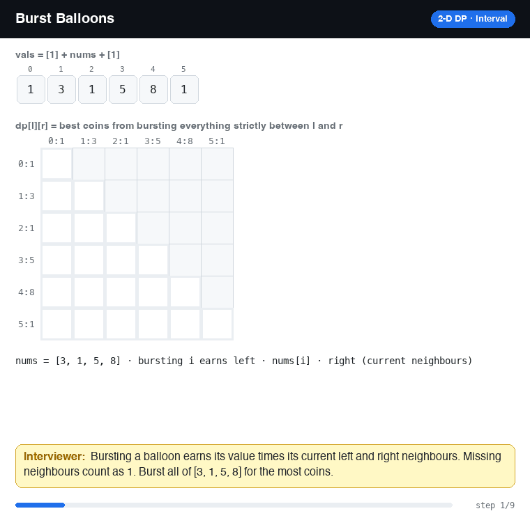

# Walkthrough: Burst Balloons

**Module:** [16 · Dynamic Programming in 2-D](../README.md) · **Difficulty:** Hard · **Solution:** [`p09_burst_balloons.go`](../p09_burst_balloons.go)



## The problem in plain words

Balloons in a row carry numbers. When you burst one, you earn its number times its current left neighbour times its current right neighbour. Missing neighbours count as 1. After a burst, its neighbours become next to each other. Burst them all and earn as much as you can.

```
[3, 1, 5, 8]  →  167   (burst 1, 5, 3, 8: 15 + 120 + 24 + 8)
```

## Mock interview

**Interviewer:** Bursting balloon `i` earns `left · nums[i] · right`, using its current neighbours, with 1 for a missing one. Burst every balloon and return the most coins.

**Candidate:** The neighbours change as balloons disappear? And values are non-negative?

**Interviewer:** Yes to both.

**Candidate:** For `[3, 1, 5, 8]`, bursting 1, 5, 3, 8 earns 3·1·5 + 3·5·8 + 1·3·8 + 1·8·1 = 15 + 120 + 24 + 8 = 167.

**Candidate:** The brute force tries every order: n!.

**Interviewer:** What about choosing which balloon to burst first and recursing on the two sides?

**Candidate:** That doesn't split cleanly. After the first burst, its two neighbours become adjacent, so the left side's coins depend on the right side. The trick is to choose the **last** balloon in a range instead. When it's burst, everything else in the range is gone, so its neighbours are the range's boundaries. The two sides are then independent.

**Candidate:** I pad the array: `vals = [1, 3, 1, 5, 8, 1]`.

- **State:** `dp[l][r]` is the most coins from bursting every balloon strictly between `l` and `r`.
- **Transition:** `dp[l][r] = max over l < k < r of dp[l][k] + vals[l]·vals[k]·vals[r] + dp[k][r]`.
- **Base case:** `dp[l][l+1] = 0`. Nothing is between them.
- **Order:** by width, `r - l`, from 2 up to `n-1`. Every sub-range is narrower, so it's already done.

**Candidate:** In code it's three loops: width, `l`, and `k`.

**Candidate:** Testing: width 2 gives 3, 15, 40, 40. `dp[0][3]` is best with k = 1: 0 + 1·3·5 + 15 = 30. Width 3 also gives 135 and 48. Width 4 gives 159 and 159. For the whole range, bursting 8 last gives 159 + 1·8·1 + 0 = 167.

**Interviewer:** Complexity?

**Candidate:** O(n²) ranges, O(n) choices of `k` each: **O(n³) time, O(n²) space**.

## What the animation shows

| Step | What happens | Values |
|---|---|---|
| 1 | Interviewer states the problem | |
| 2 | Brute force: n! orders; think "last burst" | |
| 3 | Pad with 1s; `dp[l][l+1] = 0` | |
| 4 | Width 2: one balloon, it's the last | 3, 15, 40, 40 |
| 5 | `dp[0][3]`: try k = 1, 2 | max(30, 8) = 30 |
| 6 | Rest of width 3 | `dp[1][4]` = 135, `dp[2][5]` = 48 |
| 7 | Width 4 | `dp[0][4]` = 159, `dp[1][5]` = 159 |
| 8 | `dp[0][5]`: try k = 1..4; balloon 8 last wins | 167 |
| 9 | Answer 167, O(n³) time, O(n²) space | |

## Detailed explanation

Fix a range `(l, r)` and suppose balloon `k` is burst last inside it. Before that, every balloon between `l` and `k` and every balloon between `k` and `r` was burst. While `k` is still there, it separates the two groups, so bursting a balloon on the left never changes a neighbour on the right. Each side is its own smaller problem, `dp[l][k]` and `dp[k][r]`. When `k` finally goes, its neighbours are `l` and `r`, so it earns `vals[l]·vals[k]·vals[r]`.

Every order has some last balloon, so trying every `k` covers every order. That makes the max correct.

The padding removes edge cases: the outer 1s are never burst, and they give the "missing neighbour counts as 1" rule for free.

## Complexity

| Approach | Time | Space |
|---|---|---|
| Brute force (`BurstBalloonsBrute`) | O(n!) | O(n²) |
| Memoized (`BurstBalloonsMemo`) | O(n³) | O(n²) |
| Table by width (`BurstBalloonsTab`) | O(n³) | O(n²) |

## Common mistakes

- Choosing the *first* balloon to burst, which leaves the two sides coupled.
- Using closed ranges `[l, r]` and getting the neighbours wrong. Open ranges with padding are simpler.
- Filling the table row by row instead of by width, so sub-ranges aren't ready.

## Try it yourself

```sh
go test ./course/16-dp-2d/ -run TestBurstBalloons -v
```
