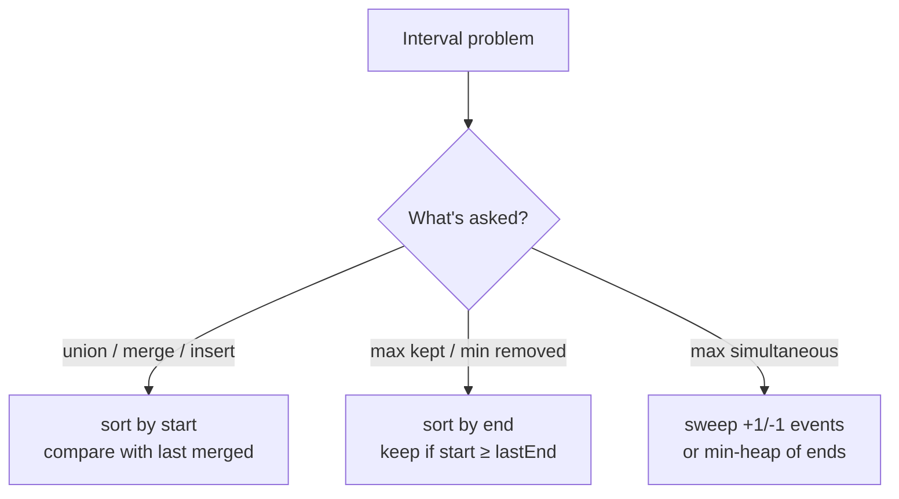

# 17 · Greedy & Intervals

## What you'll learn

- When a **locally best choice** is also globally optimal — and how to *prove* it with an exchange argument instead of hoping.
- The standard greedy scans: running best (Kadane), farthest reach (jump games), restart-on-failure (gas station).
- The interval toolkit: **sort by start to merge**, **sort by end to schedule**, and **sweep line / min-heap to count overlaps**.

## Recognize the pattern

| Signal | Tool |
|---|---|
| "Maximum/minimum … contiguous", one pass feels possible | Kadane-style running value |
| "Can you reach", "minimum jumps" | Farthest-reach / BFS-by-levels |
| Circular route, running balance goes negative | Restart greedy + total check |
| Intervals: "merge", "union", "insert" | Sort by **start**, compare with the last merged |
| Intervals: "max non-overlapping", "min to remove", "min arrows" | Sort by **end**, keep earliest finisher |
| Intervals: "how many at once", "min rooms/platforms" | Sweep line (+1/−1 events) or min-heap of end times |
| "Each letter/item in one group" | Convert to intervals [first, last] and merge |

If you can't find an argument for why greedy is safe, reach for DP (module 15/16) — it's the fallback when choices interact.

## The idea

### Why greedy works: the exchange argument

To prove "always pick X first" is optimal:

1. Take **any** optimal solution `OPT`.
2. If `OPT` doesn't start with the greedy choice `g`, find the element `o` it uses instead.
3. Show that **swapping `o` for `g`** keeps the solution valid and no worse.
4. Repeat for the rest — so the greedy solution is at least as good as `OPT`.

Worked example — keep the most non-overlapping intervals, greedy = "earliest end first":

```
OPT:     [---o---]      [--b--]   [--c--]
greedy:  [-g-]                              g ends no later than o
swap:    [-g-]          [--b--]   [--c--]   still valid: b started after o ended ≥ g ended
```

Same count, so some optimal solution starts with `g`. Recurse on what's left.

### Interval sweeps

```
Merge (sort by start):         Count overlaps (sweep events):
[1,3]                           time  0   5  10  15  20  30
  [2,6]       -> [1,6]          event +1  +1 -1  +1  -1  -1
       [8,10] -> [8,10]         live   1   2  1   2   1   0   peak = rooms = 2
```



## Go template

```go
// Merge: sort by start, extend the last interval or append a new one.
slices.SortFunc(xs, func(a, b Interval) int { return cmp.Compare(a.Start, b.Start) })
out := []Interval{xs[0]}
for _, iv := range xs[1:] {
	last := &out[len(out)-1]
	if iv.Start <= last.End {
		last.End = max(last.End, iv.End)
	} else {
		out = append(out, iv)
	}
}

// Schedule: sort by end, keep anything that starts after the last kept end.
kept, lastEnd := 0, math.MinInt
for _, iv := range byEnd {
	if iv.Start >= lastEnd {
		kept, lastEnd = kept+1, iv.End
	}
}
```

`greedy.go` defines `Interval` plus `sortedByStart` / `sortedByEnd`, which sort a **copy** so callers' data isn't mutated.

## Complexity

| Problem shape | Time | Space |
|---|---|---|
| Single-pass greedy (Kadane, jumps, gas, partition labels) | O(n) | O(1) |
| Sort + sweep (merge, schedule) | O(n log n) | O(n) for the copy/output |
| Insert into already-sorted intervals | O(n) | O(n) |
| Min rooms (heap or two sorted arrays) | O(n log n) | O(n) |

## Common pitfalls

- **Closed vs half-open intervals.** `[1,2]` and `[2,3]` overlap if closed (merge them) but not as meetings `[1,2)`, `[2,3)`. Decide per problem; it changes `<` vs `<=` and the tie-breaking in sweeps (process ends before starts for half-open).
- **Forgetting `max` when merging.** `[1,10]` followed by `[2,3]` must stay `[1,10]`, not shrink to `[1,3]`.
- **Sorting mutates the caller's slice.** `slices.SortFunc` sorts in place; clone first if the input belongs to someone else.
- **Sort comparator overflow.** `func(a, b) int { return a.Start - b.Start }` can overflow with extreme values; use `cmp.Compare`.
- **Kadane with all negatives.** Initialise with `nums[0]`, not `0`, or you'll return 0 for `[-3,-1]`.
- **Pointer into a slice you append to.** `last := &out[len(out)-1]` is safe only until the next `append` may reallocate; take it fresh each iteration (as the template does).
- **Greedy without proof.** "Take the biggest coin first" fails for coins `{1, 3, 4}` and amount 6. Test greedy against a brute force on small random inputs — every problem in this module does.

## Problems

| # | Problem | Difficulty | Key idea |
|---|---|---|---|
| 01 | [Maximum Subarray](p01_maximum_subarray.go) | Medium | Kadane: extend or restart; drop negative prefixes |
| 02 | [Jump Game](p02_jump_game.go) | Medium | Track farthest reach; fail if `i > reach` |
| 03 | [Jump Game II](p03_jump_game_ii.go) | Medium | BFS levels as index windows |
| 04 | [Gas Station](p04_gas_station.go) | Medium | Restart after the failing station; check total |
| 05 | [Merge Intervals](p05_merge_intervals.go) | Medium | Sort by start, merge into last |
| 06 | [Insert Interval](p06_insert_interval.go) | Medium | Three phases: before / overlapping / after |
| 07 | [Non-overlapping Intervals](p07_non_overlapping_intervals.go) | Medium | Sort by end, keep earliest finisher (exchange argument) |
| 08 | [Meeting Rooms II](p08_meeting_rooms_ii.go) | Medium | Peak live count: min-heap of ends or sweep |
| 09 | [Partition Labels](p09_partition_labels.go) | Medium | Last occurrence → implicit interval merge |

## Practice tip

Hide the solution and, before coding, say the greedy rule **and** the one-line reason it's safe. Then code it and let the randomized brute-force test catch you if the reasoning was wrong:

```bash
go test ./course/17-greedy-intervals/ -run TestEraseOverlapIntervals -v
```

## Next

→ [18 · Bit Manipulation](../18-bit-manipulation/README.md)
