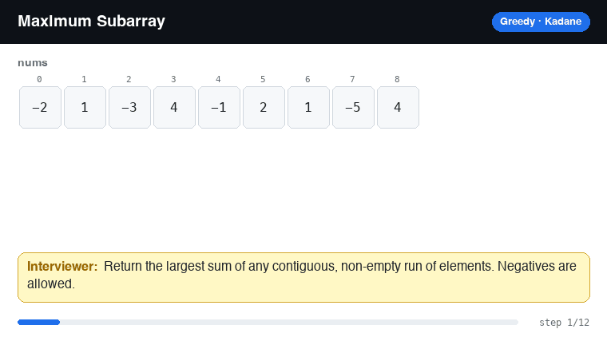

# Walkthrough: Maximum Subarray

**Module:** [17 · Greedy & Intervals](../README.md) · **Difficulty:** Medium · **Solution:** [`p01_maximum_subarray.go`](../p01_maximum_subarray.go)



## The problem in plain words

You get a list of whole numbers, some of them negative. Pick one unbroken stretch of the list (at least one number) so that its sum is as large as possible, and return that sum.

```
nums = [-2, 1, -3, 4, -1, 2, 1, -5, 4]  →  6   because 4 + (-1) + 2 + 1 = 6
```

## Mock interview

**Interviewer:** Given a non-empty slice of integers, negatives allowed, return the largest sum of any contiguous, non-empty run.

**Candidate:** A few questions first. Can the slice be empty? If every number is negative, do I still have to pick one? And can the sum overflow?

**Interviewer:** It's never empty. Yes, you must pick at least one element, so `[-3, -1, -2]` gives -1. Assume the sum fits in an `int`.

**Candidate:** For `[-2, 1, -3, 4, -1, 2, 1, -5, 4]` the best run is `[4, -1, 2, 1]`, which sums to 6. The all-negative case is the edge case to watch: the answer is the largest single element, not 0.

**Candidate:** The brute force tries every start `i`, then extends to every end `j` with a running sum. That's O(n²) time and O(1) space.

**Interviewer:** Can you do it in one pass?

**Candidate:** Yes. Let `cur` be the best sum of a run that ends exactly at index `i`. That run either extends the best run ending at `i-1`, or starts fresh at `i`. So `cur = max(x, cur + x)`. If the run so far is negative, carrying it only makes `x` smaller, so I drop it. I keep `best` as the largest `cur` I've seen.

**Interviewer:** Why is it safe to throw away a negative prefix for good?

**Candidate:** Any run that continues past `i` would include that prefix. Removing a negative prefix always gives a bigger sum, so no optimal run that ends later can start with it.

**Candidate:** In code, `cur` and `best` both start at `nums[0]`. Then I loop over `nums[1:]` doing `cur = max(x, cur+x)` and `best = max(best, cur)`.

**Candidate:** Testing it: `cur` starts at -2. At 1, -2 + 1 = -1 is less than 1, so I restart at 1. At -3, I extend to -2. At 4, -2 + 4 = 2 is less than 4, so I restart at 4. Then I extend: 3, 5, 6. `best` becomes 6. The -5 drops `cur` to 1 and the last 4 lifts it to 5, but `best` stays 6.

**Interviewer:** Complexity?

**Candidate:** One pass with two variables: **O(n) time and O(1) space.**

**Interviewer:** What if I also want the start and end of the run?

**Candidate:** I track where the current run started. When `cur` beats `best`, I save that start and the current index. That's `MaxSubarrayRange` in the repo.

## What the animation shows

| Step | What happens |
|---|---|
| 1 | Interviewer states the problem on `[-2, 1, -3, 4, -1, 2, 1, -5, 4]` |
| 2 | Brute force: every start and end, O(n²) |
| 3 | Start: `cur = best = -2` |
| 4 | x = 1: -2 + 1 = -1 < 1 → restart, `cur = 1`, `best = 1` |
| 5 | x = -3: extend, `cur = -2` |
| 6 | x = 4: -2 + 4 = 2 < 4 → restart, `cur = 4`, `best = 4` |
| 7 | x = -1: extend, `cur = 3` |
| 8 | x = 2: extend, `cur = 5`, new `best = 5` |
| 9 | x = 1: extend, `cur = 6`, new `best = 6` |
| 10 | x = -5: extend, `cur = 1` |
| 11 | x = 4: extend, `cur = 5`, `best` stays 6 |
| 12 | Answer 6 from `[4, -1, 2, 1]`; O(n) time, O(1) space |

## Detailed explanation

Kadane's algorithm is a one-variable DP. `cur` after index `i` is the best sum of any run that **ends at `i`**. A run ending at `i` is either `[x]` alone or a run ending at `i-1` plus `x`. The best of the second kind is `cur + x`, so `cur = max(x, cur + x)`. Every run ends somewhere, so the answer is the largest `cur` seen.

The greedy reading is the same rule: if `cur` is negative, restarting is better than extending. A negative prefix can only lower whatever comes after it. A zero or positive prefix never hurts, so you keep it.

Edge cases:

- **All negative.** Starting `cur` and `best` at `nums[0]` (not 0) makes the answer the largest single element.
- **One element.** The loop body never runs and `best = nums[0]`.
- **Empty slice.** `MaxSubarray` panics, by design: the problem says the input is non-empty.

## Complexity

| Approach | Time | Space |
|---|---|---|
| Brute force (`MaxSubarrayBrute`) | O(n²) | O(1) |
| Kadane (`MaxSubarray`) | O(n) | O(1) |
| Kadane with bounds (`MaxSubarrayRange`) | O(n) | O(1) |

## Common mistakes

- Starting `best` at 0. That returns 0 for an all-negative input instead of the largest element.
- Resetting `cur` to 0 instead of to `x`. That allows an empty run.
- Updating `best` before `cur`, which misses the run that ends at the current index.

## Try it yourself

```sh
go test ./course/17-greedy-intervals/ -run TestMaxSubarray -v
```
