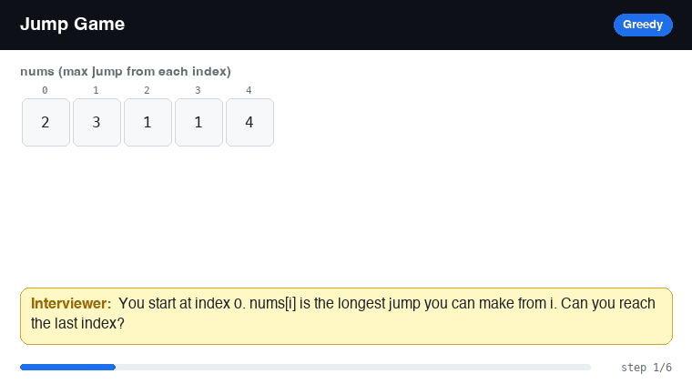

# Walkthrough: Jump Game

**Module:** [17 · Greedy & Intervals](../README.md) · **Difficulty:** Medium · **Solution:** [`p02_jump_game.go`](../p02_jump_game.go)



## The problem in plain words

You stand on the first square of a row. The number on each square says how far you may jump from it: any distance from 0 up to that number. Can you reach the last square?

```
nums = [2, 3, 1, 1, 4]  →  true    (0 → 1 → 4)
nums = [3, 2, 1, 0, 4]  →  false   (every route lands on the 0 at index 3)
```

## Mock interview

**Interviewer:** You start at index 0. `nums[i]` is the maximum jump length from index `i`. Return whether you can reach the last index.

**Candidate:** Can values be 0? Is a one-element slice already at the end?

**Interviewer:** Values are 0 or more. A single element counts as reached, so it's `true`.

**Candidate:** With `[2, 3, 1, 1, 4]` I can go 0 → 1 → 4, so it's `true`. With `[3, 2, 1, 0, 4]`, every path ends on the 0 at index 3, so it's `false`. Zeros are the only thing that can trap me.

**Candidate:** A simple solution marks reachable indices. For each reachable `i`, I mark `i+1` through `i+nums[i]`. That's O(n²) time in the worst case and O(n) space.

**Interviewer:** Can you avoid marking every index?

**Candidate:** Yes. The reachable indices always form a prefix `[0, reach]`, because if I can jump far I can also jump short. So I only need one number, `reach`. I scan left to right. If `i > reach`, I'm stuck, so I return `false`. Otherwise `reach = max(reach, i + nums[i])`. If `reach` gets to the last index, I return `true`.

**Interviewer:** Why is greedy enough? You never decide which jump to take.

**Candidate:** I don't need to. The question is only whether the last index is reachable, not how. Tracking the farthest point covers every route at once.

**Candidate:** In code, it's one `for i, n := range nums` loop with the `i > reach` check first, then the update, then the early return.

**Candidate:** Testing it: `reach` starts at 0. At `i = 0`, reach becomes 0 + 2 = 2. At `i = 1`, reach becomes 1 + 3 = 4, which is the last index, so I return `true`.

**Interviewer:** Complexity?

**Candidate:** One pass and one variable: **O(n) time and O(1) space.**

**Interviewer:** What if I ask for the fewest jumps?

**Candidate:** That's Jump Game II. I'd scan in BFS levels: the indices reachable with k jumps form a window, and the farthest point from that window is the end of the next one.

## What the animation shows

| Step | `i` | `reach` before | `reach` after | Decision |
|---|---|---|---|---|
| 1 | | | | Interviewer states the problem on `[2, 3, 1, 1, 4]` |
| 2 | | | | Marking DP is O(n²) |
| 3 | | 0 | 0 | Start: every index up to `reach` is reachable |
| 4 | 0 | 0 | 2 | 0 ≤ 0, reach = 0 + 2 |
| 5 | 1 | 2 | 4 | 1 ≤ 2, reach = 1 + 3 = 4 ≥ last index → `true` |
| 6 | | | | Answer `true`; O(n) time, O(1) space |

## Detailed explanation

The invariant is: **after processing index `i`, every index in `[0, reach]` is reachable, and none past it is reachable using only indices up to `i`.** It holds at the start (`reach = 0`). If `i ≤ reach`, index `i` is reachable, and from it every index up to `i + nums[i]` is reachable too, so taking the max keeps the invariant.

If the scan hits an `i > reach`, no earlier index can jump to `i`, and nothing after `i` can be reached without passing through a reachable index first. So the answer is `false`.

Edge cases:

- **One element.** At `i = 0`, `reach = nums[0] ≥ 0 = last index`, so the function returns `true`.
- **A zero you can jump over.** `[2, 0, 0]`: reach becomes 2 at `i = 0`, which is the last index. The zeros never matter.
- **A zero that traps you.** `[3, 2, 1, 0, 4]`: reach stays 3, and at `i = 4` the check `i > reach` returns `false`.

## Complexity

| Approach | Time | Space |
|---|---|---|
| Marking DP (`CanJumpDP`) | O(n²) | O(n) |
| Farthest reach (`CanJump`) | O(n) | O(1) |

## Common mistakes

- Checking `i > reach` after updating `reach`. Then an unreachable index can extend the reach.
- Treating `nums[i]` as the exact jump length. It's the maximum; shorter jumps are allowed.
- Forgetting the early return. It isn't needed for correctness, but it saves work on long inputs.

## Try it yourself

```sh
go test ./course/17-greedy-intervals/ -run TestCanJump -v
```
