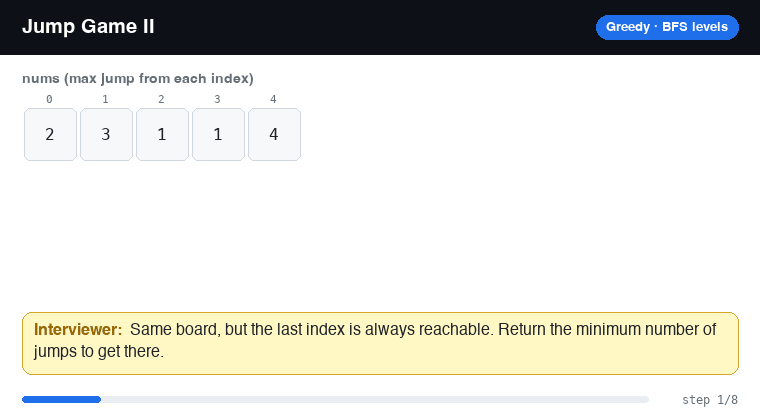

# Walkthrough: Jump Game II

**Module:** [17 · Greedy & Intervals](../README.md) · **Difficulty:** Medium · **Solution:** [`p03_jump_game_ii.go`](../p03_jump_game_ii.go)



## The problem in plain words

Same row of squares as Jump Game: the number on a square is the longest jump you may make from it. This time you know the last square is reachable. What is the smallest number of jumps to get there?

```
nums = [2, 3, 1, 1, 4]  →  2   (0 → 1 → 4)
```

## Mock interview

**Interviewer:** The last index is guaranteed reachable. Return the minimum number of jumps from index 0 to the last index.

**Candidate:** If the slice has one element, I'm already there, so the answer is 0?

**Interviewer:** Yes.

**Candidate:** For `[2, 3, 1, 1, 4]`, jumping 0 → 2 → 3 → 4 takes three jumps, but 0 → 1 → 4 takes two. So the answer is 2. Being greedy about the longest single jump doesn't work: from index 0 the longest jump lands on index 2, which is worse.

**Candidate:** A DP stores the fewest jumps to every index. For each `i`, I relax every `j` from `i+1` to `i+nums[i]`. That's O(n²) time and O(n) space.

**Interviewer:** Can you do better?

**Candidate:** I'll think of it as BFS. The indices I can reach with exactly k jumps form a contiguous window. Window 0 is just index 0. While I scan a window, I track `farthest`, the farthest index one more jump can reach. When I reach the end of the window, I take a jump: `jumps++`, and the next window ends at `farthest`.

**Interviewer:** Why does that give the minimum?

**Candidate:** It's BFS on the indices, level by level. The first level that contains the last index gives the fewest jumps. I don't choose a specific landing square; the window holds all of them at once.

**Candidate:** In code: `jumps, end, farthest := 0, 0, 0`. I loop `i` from 0 to `len(nums)-2`. I stop before the last index, because I never jump from it. In the loop: `farthest = max(farthest, i+nums[i])`, and if `i == end`, then `jumps++` and `end = farthest`.

**Candidate:** Testing it: at `i = 0`, farthest is 2 and `i == end`, so jumps = 1 and end = 2. At `i = 1`, farthest is 4, still inside the window. At `i = 2`, farthest stays 4 and `i == end`, so jumps = 2 and end = 4. At `i = 3` nothing changes. The loop ends and I return 2.

**Interviewer:** Complexity?

**Candidate:** One pass, three variables: **O(n) time and O(1) space.**

**Interviewer:** What if the last index might be unreachable?

**Candidate:** Then I'd check, when `i == end`, whether `farthest` is still `i`. If it is, no jump makes progress and I return -1.

## What the animation shows

| Step | `i` | `farthest` | `end` | `jumps` | Decision |
|---|---|---|---|---|---|
| 1 | | | | | Interviewer states the problem on `[2, 3, 1, 1, 4]` |
| 2 | | | | | DP is O(n²) |
| 3 | | 0 | 0 | 0 | Window 0 is just index 0 |
| 4 | 0 | 2 | 0 → 2 | 1 | `i == end` → jump |
| 5 | 1 | 4 | 2 | 1 | inside window, keep scanning |
| 6 | 2 | 4 | 2 → 4 | 2 | `i == end` → jump |
| 7 | 3 | 4 | 4 | 2 | inside window, keep scanning |
| 8 | | | | 2 | Answer 2 (0 → 1 → 4); O(n) time, O(1) space |

## Detailed explanation

Call `W_k` the set of indices reachable with at most k jumps. `W_0 = {0}`. Because a jump can be any length up to `nums[i]`, each `W_k` is a prefix `[0, end_k]`. The loop scans the new part of each window, and `farthest` becomes `end_{k+1}`.

The variable `end` marks where the current level stops. When `i` reaches it, every index in the level has been scanned, so `farthest` is final for the next level. Incrementing `jumps` then is the same as moving to the next BFS level.

The loop stops at `len(nums)-2`. If it ran to the last index and `i == end` there, it would count an extra jump from the goal.

Edge cases:

- **One element.** The loop body never runs; the answer is 0.
- **A window that already covers the goal.** `[5, 1, 1]`: at `i = 0`, jumps = 1 and end = 5. No more jumps happen.

## Complexity

| Approach | Time | Space |
|---|---|---|
| DP over every jump (`JumpDP`) | O(n²) | O(n) |
| BFS levels (`Jump`) | O(n) | O(1) |

## Common mistakes

- Looping to the last index, which adds one jump too many.
- Always taking the longest jump from the current square. That's a different, wrong greedy.
- Updating `end` before updating `farthest` with the current index.

## Try it yourself

```sh
go test ./course/17-greedy-intervals/ -run TestJump -v
```
