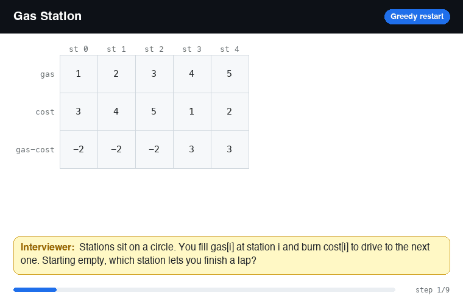

# Walkthrough: Gas Station

**Module:** [17 · Greedy & Intervals](../README.md) · **Difficulty:** Medium · **Solution:** [`p04_gas_station.go`](../p04_gas_station.go)



## The problem in plain words

Gas stations sit in a circle. At station `i` you can fill `gas[i]` units. Driving to the next station uses `cost[i]` units. You start with an empty tank. Which station can you start from and drive all the way around? Return -1 if none works.

```
gas  = [1, 2, 3, 4, 5]
cost = [3, 4, 5, 1, 2]   →  3
```

## Mock interview

**Interviewer:** Return the index of a station from which you can complete one lap clockwise, or -1. If an answer exists, it's unique.

**Candidate:** The tank has no limit, and I can't let it go below zero between stations?

**Interviewer:** Right.

**Candidate:** For the example, starting at 3: I fill 4, use 1, have 3. Fill 5, use 2, have 6. Fill 1, use 3, have 4. Fill 2, use 4, have 2. Fill 3, use 5, have 0. I make it, so the answer is 3. A case with no answer is `gas [2,3,4], cost [3,4,3]`: total gas 9 is less than total cost 10.

**Candidate:** The brute force simulates a lap from every station. That's O(n²) time and O(1) space.

**Interviewer:** Can you do it in one pass?

**Candidate:** Only `gas[i] - cost[i]` matters. I use two facts. First, if the sum of all those differences is negative, no start works. Second, if I start at `s` and the tank first goes negative after station `k`, then no station between `s` and `k` works either. So my next candidate is `k + 1`, with an empty tank.

**Interviewer:** Why can you skip all the stations between `s` and `k`?

**Candidate:** When I arrived at any station `j` between them, starting from `s`, my tank was at least 0. Starting fresh at `j` means a tank of exactly 0, which is no better. If I failed at `k` with the extra fuel, I fail at `k` without it.

**Candidate:** In code: `total, tank, start := 0, 0, 0`. For each `i`, I add the difference to both `total` and `tank`. If `tank < 0`, I set `start = i + 1` and `tank = 0`. At the end I return -1 if `total < 0`, otherwise `start`.

**Candidate:** Testing it: the differences are `[-2, -2, -2, 3, 3]`. Stations 0, 1 and 2 each drive the tank to -2, so the start moves to 1, then 2, then 3. From 3 the tank goes to 3, then 6. The total is 0, which isn't negative, so I return 3.

**Interviewer:** Why don't you check the wrap-around part, from station 4 back to 2?

**Candidate:** Because the total is at least 0. The part from `start` to the end has a non-negative sum, and the part before `start` has a sum of at least `-(tail)`. The tail's surplus covers it.

**Interviewer:** Complexity?

**Candidate:** One pass, three variables: **O(n) time and O(1) space.**

## What the animation shows

| Step | `i` | diff | `tank` | `total` | `start` |
|---|---|---|---|---|---|
| 1 | | | | | Interviewer states the problem |
| 2 | | | | | Brute force: a lap from every start, O(n²) |
| 3 | | | | | Only `gas - cost` matters |
| 4 | 0 | -2 | -2 → reset 0 | -2 | 0 → 1 |
| 5 | 1 | -2 | -2 → reset 0 | -4 | 1 → 2 |
| 6 | 2 | -2 | -2 → reset 0 | -6 | 2 → 3 |
| 7 | 3 | 3 | 3 | -3 | 3 |
| 8 | 4 | 3 | 6 | 0 | 3 |
| 9 | | | | 0 ≥ 0 | answer 3; O(n) time, O(1) space |

## Detailed explanation

Write `d[i] = gas[i] - cost[i]`. A start `s` works when every prefix sum of `d` taken around the circle from `s` stays at 0 or above.

**Skipping is safe.** Suppose the run from `s` first goes negative after station `k`. For any `j` with `s < j ≤ k`, the sum from `s` to `j-1` is at least 0 (otherwise the run would have failed earlier). So the sum from `j` to `k` is the sum from `s` to `k` minus a non-negative number, which is still negative. Every such `j` fails too.

**The last candidate works if the total is not negative.** After the loop, the run from `start` to `n-1` never went negative; call its sum `tail ≥ 0`. The part from 0 to `start-1` sums to `total - tail`. When the car wraps around, it has `tail` fuel, and every prefix of the head part is at least `total - tail ≥ -tail`, so the tank stays at 0 or above.

Edge cases:

- **Total negative.** Return -1, whatever `start` is.
- **One station.** The answer is 0 if `gas[0] ≥ cost[0]`, else -1.

## Complexity

| Approach | Time | Space |
|---|---|---|
| Simulate every start (`CanCompleteCircuitBrute`) | O(n²) | O(1) |
| One-pass greedy (`CanCompleteCircuit`) | O(n) | O(1) |

## Common mistakes

- Setting `start = i` instead of `i + 1` after a failure. Station `i` is one of the stations that failed.
- Forgetting the `total < 0` check, which returns a start that can't finish.
- Resetting `total` along with `tank`. `total` must cover the whole circle.

## Try it yourself

```sh
go test ./course/17-greedy-intervals/ -run TestCanCompleteCircuit -v
```
