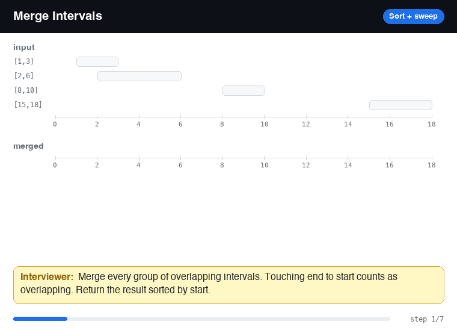

# Walkthrough: Merge Intervals

**Module:** [17 · Greedy & Intervals](../README.md) · **Difficulty:** Medium · **Solution:** [`p05_merge_intervals.go`](../p05_merge_intervals.go)



## The problem in plain words

You get a list of ranges like `[1,3]`, in any order. Whenever two ranges overlap or touch, join them into one. Return the joined ranges sorted by where they start.

```
[1,3] [2,6] [8,10] [15,18]  →  [1,6] [8,10] [15,18]
[1,4] [4,5]                 →  [1,5]
```

## Mock interview

**Interviewer:** Given closed intervals in any order, merge every overlapping group and return the result sorted by start. Touching end to start counts as overlapping.

**Candidate:** So `[1,4]` and `[4,5]` merge into `[1,5]`. Can I modify the input slice? What about an empty input?

**Interviewer:** Don't modify the input. Empty in, `nil` out.

**Candidate:** For `[1,3] [2,6] [8,10] [15,18]`, the first two overlap and become `[1,6]`. The other two are separate. One tricky case is one interval inside another, like `[1,10]` and `[2,3]`. The merge must keep the end at 10.

**Candidate:** A brute force fuses any overlapping pair and repeats until nothing changes. That's O(n³) in the worst case.

**Interviewer:** How would you do it faster?

**Candidate:** Sort a copy by start. After sorting, an interval can only overlap the **last** interval I've merged. Every earlier merged interval ended before the last one started, so it also ends before the current one starts. Then one sweep works: if `iv.Start <= last.End`, extend `last.End = max(last.End, iv.End)`. Otherwise append `iv`.

**Interviewer:** Why `max` and not just `iv.End`?

**Candidate:** Because of containment. `[1,10]` followed by `[2,3]` would shrink the end to 3 without the `max`.

**Candidate:** In code: return `nil` for empty input, then `sorted := sortedByStart(in)`, `out := []Interval{sorted[0]}`, and loop over `sorted[1:]` with a pointer `last := &out[len(out)-1]` so I can extend it in place.

**Candidate:** Testing it: the input is already sorted. I seed with `[1,3]`. `[2,6]` starts at 2 ≤ 3, so the end becomes 6. `[8,10]` starts at 8 > 6, so I append it. `[15,18]` starts at 15 > 10, so I append it. The result is `[1,6] [8,10] [15,18]`.

**Interviewer:** Complexity?

**Candidate:** The sort is **O(n log n)** and the sweep is O(n). The sorted copy and the output take **O(n)** space.

**Interviewer:** What if the intervals were half-open, so touching doesn't count?

**Candidate:** I'd change the test to `iv.Start < last.End`.

## What the animation shows

| Step | Interval | Compared with `last.end` | Action | Merged so far |
|---|---|---|---|---|
| 1 | | | Interviewer states the problem | |
| 2 | | | Brute force is O(n³) | |
| 3 | [1,3] | | seed the output | [1,3] |
| 4 | [2,6] | 2 ≤ 3 | extend end to max(3, 6) = 6 | [1,6] |
| 5 | [8,10] | 8 > 6 | append | [1,6] [8,10] |
| 6 | [15,18] | 15 > 10 | append | [1,6] [8,10] [15,18] |
| 7 | | | answer; O(n log n) time, O(n) space | [1,6] [8,10] [15,18] |

## Detailed explanation

After sorting by start, the loop keeps this invariant: *the intervals in `out` are disjoint and sorted, and they cover exactly the intervals seen so far.*

Take the next interval `iv`. Every interval in `out` except the last ends before the last one starts (they're disjoint and sorted). And `iv` starts at or after the last one's start, because of the sort. So `iv` can't touch anything but the last interval. If it touches that one, extending the end keeps the invariant. If not, there's a gap. No later interval can close it, because later intervals start at or after `iv.Start`. So appending is safe.

`sortedByStart` breaks ties by end, but ties don't matter for correctness here.

Edge cases:

- **Empty input.** Returns `nil`.
- **Containment.** `[1,10] [2,3]` stays `[1,10]` because of the `max`.
- **Touching.** `[1,4] [4,5]` merges, because the test is `<=`.

## Complexity

| Approach | Time | Space |
|---|---|---|
| Fuse pairs until stable (`MergeIntervalsBrute`) | O(n³) | O(n) |
| Sort + sweep (`MergeIntervals`) | O(n log n) | O(n) |

## Common mistakes

- Forgetting to sort first. The sweep only works on sorted input.
- Writing `last.End = iv.End` instead of the `max`, which breaks containment.
- Using a copy of the last interval (`last := out[len(out)-1]`) instead of a pointer. In Go, changing the copy doesn't change `out`.
- Sorting the caller's slice in place when the problem says not to.

## Try it yourself

```sh
go test ./course/17-greedy-intervals/ -run TestMergeIntervals -v
```
