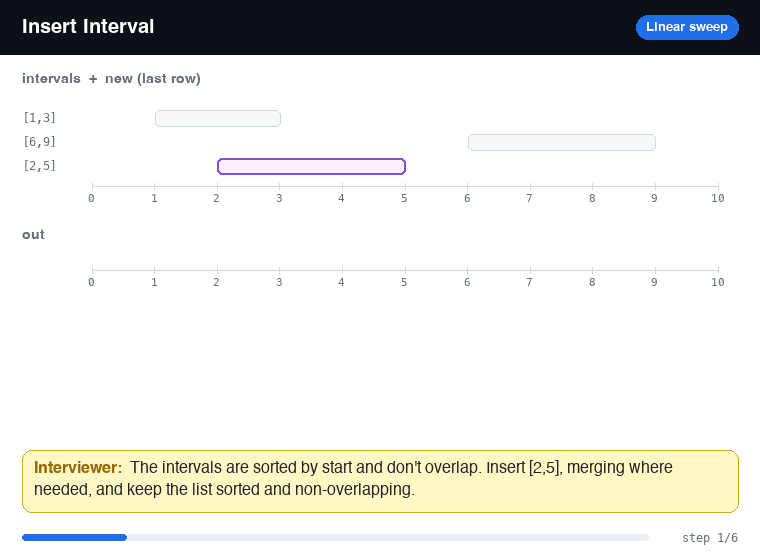

# Walkthrough: Insert Interval

**Module:** [17 · Greedy & Intervals](../README.md) · **Difficulty:** Medium · **Solution:** [`p06_insert_interval.go`](../p06_insert_interval.go)



## The problem in plain words

You have a list of ranges that is already sorted and has no overlaps. Add one new range. If it overlaps or touches any existing ranges, join them. The result must still be sorted with no overlaps.

```
[1,3] [6,9]  +  [2,5]                       →  [1,5] [6,9]
[1,2] [3,5] [6,7] [8,10] [12,16]  +  [4,8]  →  [1,2] [3,10] [12,16]
```

## Mock interview

**Interviewer:** The intervals are closed, sorted by start, and don't overlap. Insert a new interval, merging where needed, and return a sorted, non-overlapping list.

**Candidate:** Touching counts as overlapping, so `[1,3]` and `[3,4]` would merge? And should I leave the input slice alone?

**Interviewer:** Yes to both.

**Candidate:** For `[1,3] [6,9] + [2,5]`, the new interval overlaps `[1,3]`, giving `[1,5]`. It doesn't reach `[6,9]`. So the answer is `[1,5] [6,9]`. Edge cases: an empty list, a new interval before everything, and one after everything.

**Candidate:** The simple way is to append the new interval, sort, and run Merge Intervals. That's O(n log n).

**Interviewer:** The input is already sorted. Can you use that?

**Candidate:** Yes. One left-to-right pass in three phases:

1. Copy every interval that ends **before** the new one starts (`End < add.Start`).
2. Absorb every interval that starts **at or before** the new one ends (`Start <= add.End`), growing the new interval to cover it.
3. Append the grown interval, then copy everything left.

**Interviewer:** How do you know phase 2 stops at the right place?

**Candidate:** Starts are sorted. Once one interval starts after `add.End`, every later one does too. And phase 1 already removed everything that ends too early, so every interval in phase 2 really does overlap.

**Candidate:** In code: `out := make([]Interval, 0, len(intervals)+1)`, an index `i`, two `for` loops for phases 1 and 2, then `append(out, add)` and `append(out, intervals[i:]...)`.

**Candidate:** Testing it: phase 1 checks `[1,3]`. It ends at 3, which isn't before 2, so phase 1 copies nothing. Phase 2: `[1,3]` starts at 1 ≤ 5, so `add` becomes `[min(2,1), max(5,3)] = [1,5]`. `[6,9]` starts at 6 > 5, so phase 2 stops. Phase 3 appends `[1,5]` and copies `[6,9]`.

**Interviewer:** Complexity?

**Candidate:** Each interval is looked at once: **O(n) time**, and **O(n) space** for the output.

**Interviewer:** What if you had to do it in place?

**Candidate:** I'd still find the overlap range `[i, j)` in one pass, then replace that slice with the single merged interval using `slices.Replace`. It's still O(n) because of the shift.

## What the animation shows

| Step | Phase | Check | Result |
|---|---|---|---|
| 1 | | Interviewer states the problem: insert `[2,5]` into `[1,3] [6,9]` | |
| 2 | | Brute force: append, sort, merge | O(n log n) |
| 3 | 1 | `[1,3]`: end 3 < start 2? No | phase 1 copies nothing |
| 4 | 2 | `[1,3]`: start 1 ≤ end 5 | new grows to `[1,5]` |
| 5 | 2 | `[6,9]`: start 6 ≤ end 5? No | phase 2 ends |
| 6 | 3 | append `[1,5]`, copy `[6,9]` | answer `[1,5] [6,9]`; O(n) time, O(n) space |

The doc comment's second example, `+ [4,8]`, shows all three phases doing work: `[1,2]` is copied, `[3,5] [6,7] [8,10]` are absorbed into `[3,10]`, and `[12,16]` is copied.

## Detailed explanation

The input has three groups, in order:

- intervals entirely to the left of `add` (`End < add.Start`),
- intervals that overlap `add`,
- intervals entirely to the right of `add` (`Start > add.End`).

Because the list is sorted and disjoint, the groups are contiguous: a left interval can never come after an overlapping one. That's why three simple loops are enough.

In phase 2, `add.Start` only changes on the first overlapping interval (later ones start later). `add.End` grows to the largest end among them. The test uses the **current** `add.End`, which matters when an absorbed interval sticks out past the original end.

Edge cases:

- **Empty input.** Both loops do nothing; the result is just `[add]`.
- **New interval first.** Phase 1 copies nothing, phase 2 absorbs nothing, and `add` goes first.
- **New interval last.** Phase 1 copies everything; `add` goes last.

## Complexity

| Approach | Time | Space |
|---|---|---|
| Append, sort, merge | O(n log n) | O(n) |
| Three-phase sweep (`InsertInterval`) | O(n) | O(n) |

## Common mistakes

- Using `<=` in phase 1. Then an interval that touches `add` gets copied instead of merged.
- Using `<` in phase 2, which misses an interval that starts exactly at `add.End`.
- Forgetting to copy the tail after phase 2.
- Changing the input slice. `InsertInterval` builds a new slice.

## Try it yourself

```sh
go test ./course/17-greedy-intervals/ -run TestInsertInterval -v
```
