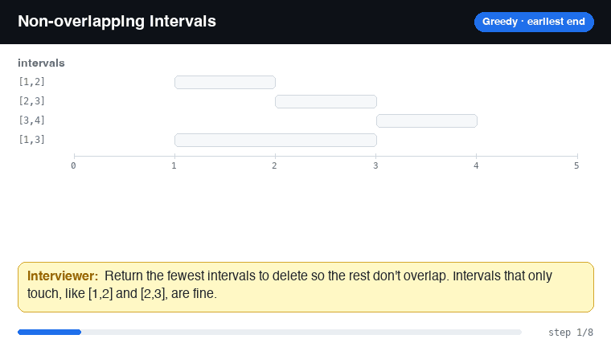

# Walkthrough: Non-overlapping Intervals

**Module:** [17 · Greedy & Intervals](../README.md) · **Difficulty:** Medium · **Solution:** [`p07_non_overlapping_intervals.go`](../p07_non_overlapping_intervals.go)



## The problem in plain words

You get a list of ranges. Delete as few as possible so that no two of the remaining ranges overlap. Ranges that only touch at an end, like `[1,2]` and `[2,3]`, are allowed. Return how many you deleted.

```
[1,2] [2,3] [3,4] [1,3]  →  1   (drop [1,3])
[1,2] [1,2] [1,2]        →  2
```

## Mock interview

**Interviewer:** Return the minimum number of intervals to remove so the rest don't overlap. Touching is fine.

**Candidate:** So the intervals act like half-open ranges for overlap: `[1,2]` and `[2,3]` can both stay. Can there be duplicates?

**Interviewer:** Yes, duplicates are allowed.

**Candidate:** For `[1,2] [2,3] [3,4] [1,3]`, if I drop `[1,3]` the other three only touch. So the answer is 1. For three copies of `[1,2]`, I keep one and drop two.

**Candidate:** Removing the fewest is the same as keeping the most. The brute force tries every subset, checks whether it's non-overlapping, and keeps the largest. That's O(2ⁿ · n log n).

**Interviewer:** What's the greedy?

**Candidate:** This is interval scheduling. I sort by **end**. Then I keep each interval that starts at or after the end of the last one I kept. The answer is `n - kept`.

**Interviewer:** Why sort by end? Why not by start, or by length?

**Candidate:** The interval that ends first leaves the most room for everything after it. Here's the exchange argument. Take any optimal set of kept intervals, and look at its first one. Swap it for the interval with the earliest end. That one ends no later, so it can't collide with the second kept interval. The set is still valid and the same size. Repeat for the rest, and you get the greedy's choice. Sorting by start fails on `[1,10] [2,3] [4,5]`: it would keep `[1,10]` and drop the other two.

**Candidate:** In code: `kept, lastEnd := 0, math.MinInt`. For each `iv` in `sortedByEnd(in)`, if `iv.Start >= lastEnd`, then `kept++` and `lastEnd = iv.End`. Return `len(in) - kept`.

**Candidate:** Testing it: sorted by end, the order is `[1,2] [1,3] [2,3] [3,4]`. `[1,2]` is kept, lastEnd = 2. `[1,3]` starts at 1 < 2, so it's dropped. `[2,3]` starts at 2 ≥ 2, kept, lastEnd = 3. `[3,4]` starts at 3 ≥ 3, kept. Kept 3 of 4, so the answer is 1.

**Interviewer:** Complexity?

**Candidate:** **O(n log n)** for the sort, O(n) for the sweep, and **O(n)** space for the sorted copy.

**Interviewer:** How would this change for "minimum arrows to burst balloons", where touching balloons share an arrow?

**Candidate:** Same greedy, but touching now counts as overlapping, so the test becomes `iv.Start > lastEnd`. The number of arrows is the number of intervals kept.

## What the animation shows

| Step | Interval (sorted by end) | Check | Decision | `kept` / `lastEnd` |
|---|---|---|---|---|
| 1 | | | Interviewer states the problem | |
| 2 | | | Brute force over subsets is exponential | |
| 3 | | | Sort by end: `[1,2] [1,3] [2,3] [3,4]` | 0 / -∞ |
| 4 | [1,2] | 1 ≥ -∞ | keep | 1 / 2 |
| 5 | [1,3] | 1 < 2 | drop | 1 / 2 |
| 6 | [2,3] | 2 ≥ 2 | keep | 2 / 3 |
| 7 | [3,4] | 3 ≥ 3 | keep | 3 / 4 |
| 8 | | | answer 4 - 3 = 1; O(n log n) time, O(n) space | |

## Detailed explanation

**Exchange argument.** Let `g₁` be the interval with the smallest end, and let `o₁, o₂, …` be an optimal kept set sorted by end. Since `g₁` ends no later than `o₁`, and `o₂` starts at or after `o₁` ends, `o₂` also starts at or after `g₁` ends. So replacing `o₁` with `g₁` keeps the set valid and the same size. Now remove `g₁` and every interval that overlaps it, and apply the same argument to what's left. Each greedy choice matches some optimal solution, so the greedy keeps the maximum number.

**Ties.** `sortedByEnd` breaks ties on end by start. For this problem, any tie order gives the same count: two intervals with the same end can't both be kept if they overlap, and either one leaves the same room.

`lastEnd` starts at `math.MinInt` so the first interval is always kept, even with negative coordinates.

Edge cases:

- **Empty input.** `kept = 0`, answer 0.
- **Duplicates.** Only the first copy passes `Start >= lastEnd` (unless the interval has zero length, like `[2,2]`, where copies only touch).

## Complexity

| Approach | Time | Space |
|---|---|---|
| Try every subset (`EraseOverlapIntervalsBrute`) | O(2ⁿ · n log n) | O(n) |
| Earliest end first (`EraseOverlapIntervals`) | O(n log n) | O(n) |

## Common mistakes

- Sorting by start and keeping the first interval of each overlap. A long early interval can block many short ones.
- Using `>` instead of `>=`, which treats touching intervals as overlapping.
- Starting `lastEnd` at 0, which wrongly drops intervals with negative starts.

## Try it yourself

```sh
go test ./course/17-greedy-intervals/ -run TestEraseOverlapIntervals -v
```
