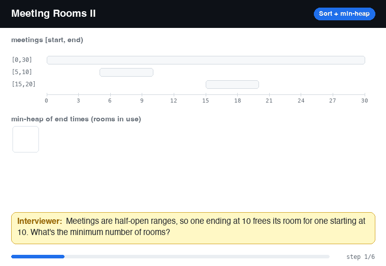

# Walkthrough: Meeting Rooms II

**Module:** [17 · Greedy & Intervals](../README.md) · **Difficulty:** Medium · **Solution:** [`p08_meeting_rooms_ii.go`](../p08_meeting_rooms_ii.go)



## The problem in plain words

You get a list of meetings, each with a start and end time. Two meetings that overlap can't share a room. A meeting that ends at 10 frees its room for one that starts at 10. What's the fewest rooms you need?

```
[0,30) [5,10) [15,20)  →  2
[7,10) [2,4)           →  1
```

## Mock interview

**Interviewer:** Meetings are half-open ranges `[Start, End)`. Return the minimum number of rooms so no two overlapping meetings share a room.

**Candidate:** Half-open means a meeting ending at 10 and one starting at 10 can use the same room. Are the meetings sorted? Can the list be empty?

**Interviewer:** Not sorted. Empty means 0 rooms.

**Candidate:** For `[0,30) [5,10) [15,20)`, the long meeting overlaps both others, but the two short ones don't overlap each other. So 2 rooms are enough, and 2 are needed at time 5.

**Candidate:** The answer is the largest number of meetings happening at the same moment. The brute force checks each start time and counts the meetings live then. That's O(n²).

**Interviewer:** Faster?

**Candidate:** I'll sort by start and keep a min-heap of end times, one per room in use. For each meeting, if the earliest-ending room is free by its start (`heap[0] <= Start`), I pop it and reuse that room. Then I push this meeting's end. At the end, the heap size is the number of rooms.

**Interviewer:** Why is reusing the earliest-ending room the right choice?

**Candidate:** If any room is free, the one that ends earliest is free. Reusing it never hurts: all rooms are the same, and the other rooms stay free for later. I only open a new room when even the earliest-ending room is busy, which means every room is busy and the extra room is really needed.

**Candidate:** In code: an `endHeap` that implements `heap.Interface`. I loop over `sortedByStart(meetings)`. If `h.Len() > 0 && (*h)[0] <= m.Start`, I call `heap.Pop`. Then `heap.Push(h, m.End)`. I return `h.Len()`.

**Candidate:** Testing it: `[0,30)` opens a room; the heap is `[30]`. `[5,10)` starts at 5, but the earliest end is 30, so I open a second room: `[10, 30]`. `[15,20)` starts at 15, and 10 ≤ 15, so I pop 10 and push 20: `[20, 30]`. The heap has 2 entries, so the answer is 2.

**Interviewer:** Complexity?

**Candidate:** Sorting is O(n log n), and each meeting does at most one push and one pop at O(log n). So **O(n log n) time and O(n) space.**

**Interviewer:** Is there a way without a heap?

**Candidate:** Yes, a sweep. Sort the starts and the ends separately. Walk through the starts; before each one, free every room whose end is at or before it, then add one. The peak count is the answer. Processing ends first on ties is what makes the ranges half-open. That's `MinMeetingRoomsSweep`.

## What the animation shows

| Step | Meeting | Earliest end | Action | Heap (ends) |
|---|---|---|---|---|
| 1 | | | Interviewer states the problem | empty |
| 2 | | | Brute force: count live meetings at each start, O(n²) | empty |
| 3 | [0,30) | none | open a room | 30 |
| 4 | [5,10) | 30 > 5 | all busy, open a room | 10, 30 |
| 5 | [15,20) | 10 ≤ 15 | reuse: pop 10, push 20 | 20, 30 |
| 6 | | | answer 2 (heap size); O(n log n) time, O(n) space | 20, 30 |

The animation draws the heap as a sorted row so the minimum is always on the left.

## Detailed explanation

**Why the heap size is the answer.** The heap pops at most once per push, so its size never goes down. It grows only when a meeting starts while every room is busy. At that moment, all the meetings in the heap plus the new one are live together, so that many rooms are truly needed. And the heap never opens more rooms than that. So the final size equals the peak number of live meetings.

The pop removes at most one room per meeting. That's enough: we only need one free room, and the heap size must stay at the peak.

**Half-open ranges.** The check is `<=`: a room ending at 10 is free for a meeting starting at 10. With closed ranges you'd use `<`.

Edge cases:

- **Empty input.** The heap stays empty; the answer is 0.
- **Back-to-back meetings.** `[1,5) [5,9)` reuse the same room, giving 1.
- **All meetings at once.** Every meeting opens a room; the answer is n.

## Complexity

| Approach | Time | Space |
|---|---|---|
| Count live meetings at each start (`MinMeetingRoomsBrute`) | O(n²) | O(1) |
| Sort + min-heap (`MinMeetingRoomsHeap`) | O(n log n) | O(n) |
| Sort starts and ends, sweep (`MinMeetingRoomsSweep`) | O(n log n) | O(n) |

## Common mistakes

- Using `<` instead of `<=`, which treats back-to-back meetings as overlapping.
- Popping every finished room before pushing and then returning the final heap size. That's not the peak. Either pop at most once, as here, or track the maximum size.
- Forgetting to sort by start before using the heap.

## Try it yourself

```sh
go test ./course/17-greedy-intervals/ -run TestMinMeetingRooms -v
```
