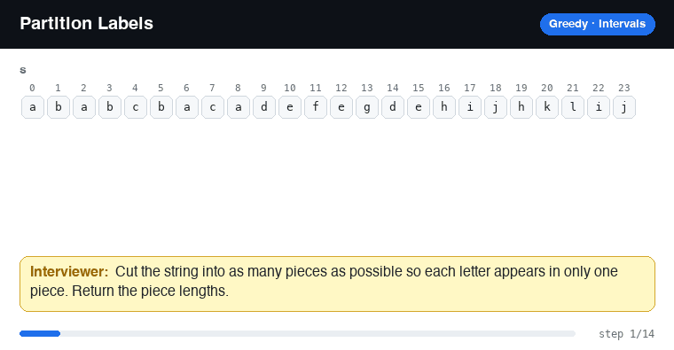

# Walkthrough: Partition Labels

**Module:** [17 · Greedy & Intervals](../README.md) · **Difficulty:** Medium · **Solution:** [`p09_partition_labels.go`](../p09_partition_labels.go)



## The problem in plain words

Cut a string of lowercase letters into as many pieces as you can, keeping the order, so that each letter shows up in only one piece. Return the length of each piece.

```
"ababcbacadefegdehijhklij"  →  [9 7 8]   ("ababcbaca" "defegde" "hijhklij")
"eccbbbbdec"                →  [10]
```

## Mock interview

**Interviewer:** Split the string into as many consecutive pieces as possible so every letter appears in at most one piece. Return the piece lengths in order.

**Candidate:** Only `'a'` to `'z'`? And for an empty string, do I return an empty list?

**Interviewer:** Yes, lowercase only. Empty in, `nil` out.

**Candidate:** In the first example, `a` appears at index 0 and last at 8, so the first piece must reach at least 8. Every letter inside that range also ends by 8, so I can cut there. That gives 9, then 7, then 8.

**Candidate:** The brute force tries every set of cut points, checks that no letter crosses a cut, and keeps the valid split with the most pieces. With n - 1 gaps that's O(2ⁿ · n).

**Interviewer:** How do you avoid trying cuts?

**Candidate:** Each letter covers an interval from its first to its last index. A piece can't cut through any of those intervals, so the pieces are just the merged intervals. I don't need to build the intervals. First pass: record `last[c]` for each letter. Second pass: keep `end`, the farthest last index of any letter in the current piece. If `i == end`, every letter so far finishes inside the piece, so I cut.

**Interviewer:** Why does cutting as early as possible give the most pieces?

**Candidate:** At `i == end`, this is the earliest valid cut: any earlier cut would split some letter. And cutting early never hurts later pieces, because the rest of the string doesn't share letters with this piece.

**Candidate:** In code: `var last [26]int`, filled in one loop. Then `start, end := 0, 0`, and for each `i`: `end = max(end, last[s[i]-'a'])`. If `i == end`, append `end - start + 1` and set `start = i + 1`.

**Candidate:** Testing it: at `i = 0`, `a` ends at 8, so end = 8. Letters 1 to 7 (`b`, `a`, `b`, `c`, ...) all end by 8, so nothing changes. At `i = 8`, `i == end`, so I cut a piece of 9. Then `d` pushes end to 14 and `e` to 15, and I cut 7 at index 15. Then `h`, `i`, `j` push end to 19, 22, 23, and I cut 8 at the end.

**Interviewer:** Complexity?

**Candidate:** Two passes over the string: **O(n) time.** The table has 26 entries: **O(1) extra space**, not counting the output.

**Interviewer:** What if the alphabet were all of Unicode?

**Candidate:** I'd range over runes and use a `map[rune]int` for `last`. Time stays O(n), and space becomes O(k) for k distinct characters.

## What the animation shows

| Step | `i` | Letter | `last` | `end` | Action |
|---|---|---|---|---|---|
| 1 | | | | | Interviewer states the problem |
| 2 | | | | | Brute force over cut points is O(2ⁿ · n) |
| 3 | | | | | First pass: last index of each letter |
| 4 | 0 | a | 8 | 0 → 8 | extend |
| 5 | 1 | b | 5 | 8 | no change (same for `i` = 2 to 7) |
| 6 | 8 | a | 8 | 8 | `i == end` → cut, length 9 |
| 7 | 9 | d | 14 | 8 → 14 | extend |
| 8 | 10 | e | 15 | 14 → 15 | extend |
| 9 | 15 | e | 15 | 15 | `i == end` → cut, length 7 |
| 10 | 16 | h | 19 | 15 → 19 | extend |
| 11 | 17 | i | 22 | 19 → 22 | extend |
| 12 | 18 | j | 23 | 22 → 23 | extend |
| 13 | 23 | j | 23 | 23 | `i == end` → cut, length 8 |
| 14 | | | | | answer `[9 7 8]`; O(n) time, O(1) space |

Steps where `end` doesn't change and no cut happens are skipped after the first one.

## Detailed explanation

Think of each letter `c` as the interval `[first[c], last[c]]`. A cut after index `i` is valid exactly when no interval contains both `i` and `i + 1`. The valid cuts are the gaps between merged intervals, so the maximum number of pieces is the number of merged intervals.

The sweep merges the intervals without sorting them. Scanning left to right visits each interval at its start (the first time the letter appears), so intervals arrive in start order, just like Merge Intervals after a sort. `end` plays the role of `last.End`. When `i == end`, the current merged interval is closed, because no letter seen so far reaches past `i`, and any letter not seen yet starts after `i`.

Edge cases:

- **Empty string.** The loop doesn't run; the result is `nil`.
- **All letters distinct.** Each letter is its own piece: all 1s.
- **First and last letter the same.** Like `"eccbbbbdec"`: one piece of the whole length.

## Complexity

| Approach | Time | Space |
|---|---|---|
| Try every set of cuts (`PartitionLabelsBrute`) | O(2ⁿ · n) | O(n) |
| Last-occurrence sweep (`PartitionLabels`) | O(n) | O(1) (26 counters) |

## Common mistakes

- Cutting when the current letter's last index equals `i`, instead of when `end` equals `i`. An earlier letter may still reach further.
- Forgetting to update `start` after a cut, which makes every later length wrong.
- Using `first` indices instead of `last`. The cut depends on where letters end.

## Try it yourself

```sh
go test ./course/17-greedy-intervals/ -run TestPartitionLabels -v
```
