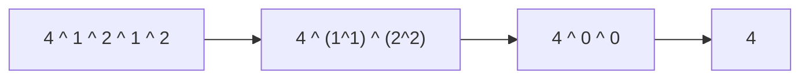

# 18 · Bit Manipulation

## What you'll learn

- How integers are stored (**two's complement**) and why that makes `-x == ^x + 1`.
- Building and applying **masks** to test, set, clear and toggle bits.
- The two tricks that power half of all bit problems: `x & (x-1)` and `x & -x`.
- XOR as a "cancel pairs" tool, bitmasks as compact sets, and adding numbers with gates.
- Go specifics: `^` as unary NOT, `&^` (AND NOT), `math/bits`, and how shifts behave on signed vs unsigned types.

## Recognize the pattern

| Signal | Trick |
|---|---|
| "Every element appears twice except one" | XOR everything |
| "Appears k times except one" | Count each bit position mod k |
| "Count set bits", "power of two", "lowest set bit" | `x & (x-1)`, `x & -x`, `math/bits` |
| "All subsets" with n ≤ ~20, or DP over "which items are used" | Integer mask as a set |
| "Without using + / * / extra space" | Gates: XOR = add without carry, AND<<1 = carry |
| Range 0..n with one missing/duplicate | XOR indices with values |

## The idea

### Two's complement (8-bit shown)

```
 5  = 0000 0101
^5  = 1111 1010        bitwise NOT
-5  = 1111 1011        = ^5 + 1
```

The top bit has weight −2^(w−1); every other bit is positive. That's why one adder circuit handles signed and unsigned numbers, and why overflow simply wraps.

### The two workhorse tricks

```
x          = 1011 0100
x - 1      = 1011 0011     borrow flips the lowest 1 and the zeros below it
x & (x-1)  = 1011 0000     -> lowest set bit CLEARED   (popcount loop, power-of-two test)

-x         = 0100 1100     = ^x + 1
x & -x     = 0000 0100     -> lowest set bit ISOLATED  (Fenwick trees, Gosper's hack)
```

### Masks

```
test   bit i:  x & (1<<i) != 0
set    bit i:  x | 1<<i
clear  bit i:  x &^ (1<<i)      Go's AND NOT
toggle bit i:  x ^ 1<<i
low n bits :   1<<n - 1
```

### XOR cancels pairs



## Go template

```go
// Popcount by Kernighan: one iteration per set bit.
for x != 0 {
	x &= x - 1
	count++
}

// Enumerate all subsets of n items.
for mask := 0; mask < 1<<n; mask++ {
	for i := 0; i < n; i++ {
		if mask>>i&1 == 1 {
			// item i is in this subset
		}
	}
}

// Real code: use the standard library.
import "math/bits"
bits.OnesCount64(x); bits.TrailingZeros(x); bits.Len(x); bits.Reverse32(x)
```

`bits.go` holds `Has`, `Set`, `Clear`, `Toggle`, `DropLowest`, `LowestBit`, `PopCount` and `LowMask`. (Because this package is itself named `bits`, it imports the standard library as `mbits "math/bits"`.)

## Complexity

Most bit tricks are **O(1)** per word, or **O(w)** where w is the word width (32 or 64) — treat that as constant but mention it. Subset enumeration is **O(n·2^n)**. XOR scans are **O(n)** time and **O(1)** space, which is usually the whole point.

## Common pitfalls

- **`^` means two things.** Binary `a ^ b` is XOR; unary `^x` is bitwise NOT. Go has no `~` operator.
- **`&^` is AND NOT**, i.e. "clear these bits": `x &^ mask == x & ^mask`.
- **Operator precedence differs from C.** In Go `<<`, `>>`, `&`, `&^` bind like `*`; `|` and `^` bind like `+`; comparisons bind loosest. So `x&1 == 0` means `(x&1) == 0` (in C it would be `x & (1 == 0)`), `mask>>i&1` is `(mask>>i)&1`, and `1<<n - 1` is `(1<<n) - 1`. But `a | b<<1` and `a ^ b&c` may not read the way you expect when porting from C or Java — add parentheses when in doubt.
- **Signed right shift is arithmetic.** `int(-8) >> 1 == -4`; it copies the sign bit, so a loop `for x != 0 { x >>= 1 }` never ends for negative `x`. Convert to `uint`/`uint64` first.
- **Shift counts.** Since Go 1.13 a signed shift count is allowed but panics at run time if negative. Shifting by ≥ the width yields 0 (no undefined behaviour as in C).
- **Overflow wraps silently.** `int32(math.MaxInt32) + 1 == math.MinInt32`. Go doesn't trap; you must check. `int` is 64-bit on 64-bit platforms but 32-bit on 32-bit ones — say which width you mean (`int32`, `uint64`).
- **Untyped constants.** `1 << 40` is fine as a constant but `int32(1) << 40` is 0. Mixing a typed variable into a constant expression fixes its width.
- **`math.MinInt` has one set bit** (the sign bit), so a naive `x&(x-1) == 0` calls it a power of two. Guard with `x > 0`.

## Problems

| # | Problem | Difficulty | Key idea |
|---|---|---|---|
| 01 | [Single Number](p01_single_number.go) | Easy | XOR cancels pairs |
| 02 | [Number of 1 Bits](p02_number_of_1_bits.go) | Easy | Kernighan: `n &= n-1` per set bit |
| 03 | [Power of Two](p03_power_of_two.go) | Easy | `n > 0 && n&(n-1) == 0`; power-of-four mask |
| 04 | [Missing Number](p04_missing_number.go) | Easy | XOR indices with values |
| 05 | [Counting Bits](p05_counting_bits.go) | Easy | `ans[i] = ans[i&(i-1)] + 1` |
| 06 | [Reverse Bits](p06_reverse_bits.go) | Easy | Shift loop, or swap halves with masks |
| 07 | [Subsets via Bitmask](p07_subsets_bitmask.go) | Medium | Mask = subset; Gosper's hack for k-subsets |
| 08 | [Single Number II](p08_single_number_ii.go) | Medium | Bit counts mod 3, or ones/twos state machine |
| 09 | [Sum of Two Integers](p09_sum_of_two_integers.go) | Medium | XOR = sum, AND<<1 = carry, repeat |

## Practice tip

Bit tricks are easy to half-remember. Hide the file, then write out the 8-bit example by hand before coding — if the pencil trace works, the code will. Verify:

```bash
go test ./course/18-bit-manipulation/ -run TestSingleNumberII -v
```

## Next

→ [19 · Strings](../19-strings/README.md)
