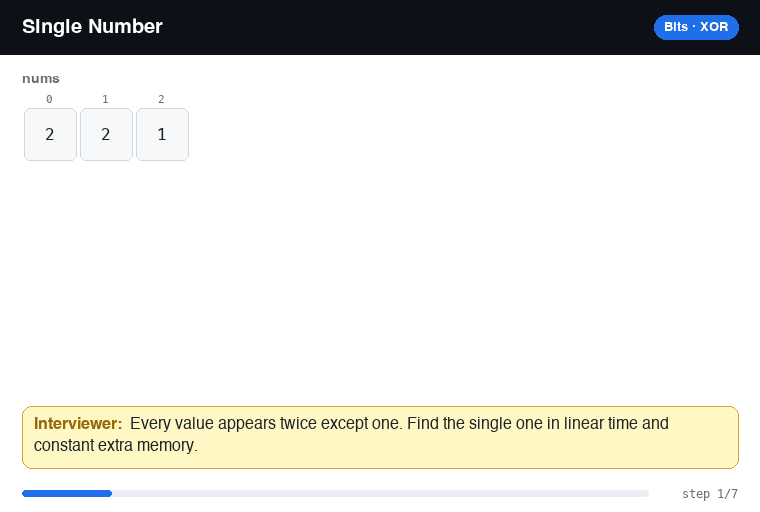

# Walkthrough: Single Number

**Module:** [18 · Bit Manipulation](../README.md) · **Difficulty:** Easy · **Solution:** [`p01_single_number.go`](../p01_single_number.go)



## The problem in plain words

Every number in the list shows up exactly twice, except one number that shows up once. Find that one, in a single pass, without extra memory.

```
[2, 2, 1]        →  1
[4, 1, 2, 1, 2]  →  4
```

## Mock interview

**Interviewer:** Every value in a non-empty slice appears exactly twice except one, which appears once. Find it in linear time with O(1) extra memory.

**Candidate:** Can the values be negative? And is "exactly twice" guaranteed, not "an even number of times"?

**Interviewer:** Negatives are allowed. Exactly twice, but your answer can handle any even count.

**Candidate:** For `[2, 2, 1]` the answer is 1. For `[4, 1, 2, 1, 2]` it's 4, even though the single value comes first.

**Candidate:** The first idea is a map from value to count, then return the value with count 1. That's O(n) time but O(n) extra space.

**Interviewer:** How do you get to O(1) space?

**Candidate:** XOR. Three facts: `x ^ x = 0`, `x ^ 0 = x`, and XOR is commutative and associative. So if I XOR every element, I can regroup the pairs next to each other, and each pair becomes 0. Only the single value is left.

**Interviewer:** Does that work for negative numbers?

**Candidate:** Yes. XOR works bit by bit on Go's 64-bit two's-complement `int`. A negative number XORed with itself is still 0.

**Candidate:** In code: `acc := 0`, then `for _, x := range nums { acc ^= x }`, then `return acc`.

**Candidate:** Testing it: acc starts at 0. XOR with 2 gives 2. XOR with the second 2 gives 0, because bit 1 meets bit 1. XOR with 1 gives 1. The answer is 1.

**Interviewer:** Complexity?

**Candidate:** One pass and one integer: **O(n) time and O(1) space.**

**Interviewer:** What if two values appear once and the rest twice?

**Candidate:** XOR everything to get `a ^ b`. Pick any set bit of that, for example the lowest one, `d & -d`. It splits the numbers into two groups, with `a` and `b` in different groups. XOR each group separately.

## What the animation shows

| Step | What happens | `acc` |
|---|---|---|
| 1 | Interviewer states the problem on `[2, 2, 1]` | |
| 2 | Map of counts: O(n) space | |
| 3 | XOR rules: `x ^ x = 0`, `x ^ 0 = x`, order doesn't matter | |
| 4 | `0 ^ 2` | 2 |
| 5 | `2 ^ 2`: bit 1 cancels | 0 |
| 6 | `0 ^ 1` | 1 |
| 7 | Answer 1; O(n) time, O(1) space | 1 |

The bit rows use 8 bits to keep the picture small. Go's `int` is 64 bits, but the high bits are all 0 here.

## Detailed explanation

XOR is addition mod 2 in each bit position. A bit of the result is 1 when an odd number of inputs have a 1 there. Every paired value adds its bits twice, which is even, so it contributes nothing. The single value adds its bits once, so the result has exactly its bits.

This is why the order doesn't matter. `4 ^ 1 ^ 2 ^ 1 ^ 2` regroups to `4 ^ (1 ^ 1) ^ (2 ^ 2) = 4 ^ 0 ^ 0 = 4`.

Edge cases:

- **One element.** The loop returns it.
- **The single value is 0.** Every pair cancels and `acc` stays 0, which is the right answer.
- **Negative values.** Two's complement bits cancel the same way.

## Complexity

| Approach | Time | Space |
|---|---|---|
| Count map (`SingleNumberMap`) | O(n) | O(n) |
| XOR everything (`SingleNumber`) | O(n) | O(1) |

## Common mistakes

- Starting `acc` at `nums[0]` and then looping over all of `nums`, which XORs the first element twice.
- Sorting and comparing neighbours. That works, but it's O(n log n).
- Using this trick when values appear three times. Three copies don't cancel; see Single Number II.

## Try it yourself

```sh
go test ./course/18-bit-manipulation/ -run TestSingleNumber -v
```
