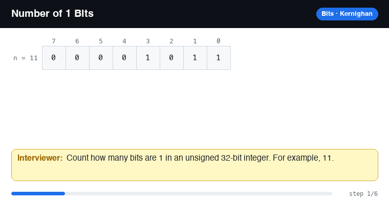

# Walkthrough: Number of 1 Bits

**Module:** [18 · Bit Manipulation](../README.md) · **Difficulty:** Easy · **Solution:** [`p02_number_of_1_bits.go`](../p02_number_of_1_bits.go)



## The problem in plain words

Write a number in binary and count the 1s. The number is an unsigned 32-bit integer.

```
11 (0b1011)  →  3
128          →  1
0xFFFFFFFF   →  32
```

## Mock interview

**Interviewer:** Count how many bits are 1 in an unsigned 32-bit integer. This is also called the Hamming weight, or popcount.

**Candidate:** The input is a `uint32`, so there's no sign bit to worry about, and a right shift fills with zeros?

**Interviewer:** Right.

**Candidate:** 11 is `1011` in binary, so the answer is 3. 0 gives 0, and `0xFFFFFFFF` gives 32.

**Candidate:** The simple loop checks the low bit with `n & 1`, adds it, and shifts right. It runs once per bit position until `n` is 0, so up to 32 steps.

**Interviewer:** Can you make the loop run fewer times?

**Candidate:** Yes, with Kernighan's trick. `n - 1` turns the lowest 1 into a 0 and every 0 below it into a 1. The bits above it stay the same. So `n & (n-1)` clears exactly the lowest set bit. I repeat that until `n` is 0 and count the steps. The loop runs once per **set** bit.

**Interviewer:** Why does `n - 1` behave like that?

**Candidate:** Subtracting 1 borrows from the lowest 1. Every 0 below it becomes 1, the lowest 1 becomes 0, and the borrow stops there. ANDing with the original `n` keeps the higher bits and zeroes everything from the lowest 1 down.

**Candidate:** In code: `count := 0`, then `for n != 0 { n &= n - 1; count++ }`, then `return count`.

**Candidate:** Testing on 11: `1011 & 1010 = 1010`, count 1. `1010 & 1001 = 1000`, count 2. `1000 & 0111 = 0000`, count 3. The loop stops and I return 3.

**Interviewer:** Complexity?

**Candidate:** **O(k) time for k set bits**, at most 32, and **O(1) space**. In real code I'd call `bits.OnesCount32`, which uses a single CPU instruction where one exists.

**Interviewer:** What changes if the input were a signed `int`?

**Candidate:** The shift loop could break, because `>>` on a negative signed value fills with 1s and never reaches 0. Kernighan's loop still ends, because each step clears a bit. The safe way is to convert to unsigned first, for example `uint64(n)`.

## What the animation shows

| Step | `n` | `n - 1` | `n & (n-1)` | `count` |
|---|---|---|---|---|
| 1 | Interviewer states the problem with n = 11 | | | |
| 2 | Shift loop: one step per bit position | | | |
| 3 | 11 (`1011`) | 10 (`1010`) | 10 (`1010`) | 1 |
| 4 | 10 (`1010`) | 9 (`1001`) | 8 (`1000`) | 2 |
| 5 | 8 (`1000`) | 7 (`0111`) | 0 | 3 |
| 6 | Answer 3; O(k) time, O(1) space | | | |

The rows show the low 8 bits. The real value is a `uint32`; the upper 24 bits are 0 here.

## Detailed explanation

Write `n` as `X10…0`, where `X` is the higher bits, then the lowest 1, then `t` zeros. Then `n - 1 = X01…1`. ANDing the two gives `X00…0`: the higher bits are kept and the lowest 1 is gone. Each iteration removes exactly one set bit, so the loop runs exactly `popcount(n)` times.

The same trick has other uses: `n & (n-1) == 0` tests for a power of two, and `ans[i] = ans[i & (i-1)] + 1` builds Counting Bits.

Edge cases:

- **n = 0.** The loop doesn't run; the answer is 0.
- **n = 0xFFFFFFFF.** The loop runs 32 times, the same as the shift loop. Kernighan's trick wins only when few bits are set.

## Complexity

| Approach | Time | Space |
|---|---|---|
| Shift loop (`HammingWeightShift`) | O(32) | O(1) |
| Kernighan (`HammingWeight`) | O(k), k = set bits | O(1) |
| Standard library (`HammingWeightStdlib`) | O(1) | O(1) |

## Common mistakes

- Using `n & (n+1)` or `n | (n-1)` by mistake. Only `n & (n-1)` clears the lowest set bit.
- Running the shift loop on a negative signed number. It never reaches 0.
- Looping a fixed 32 times and forgetting it could stop early.

## Try it yourself

```sh
go test ./course/18-bit-manipulation/ -run TestHammingWeight -v
```
